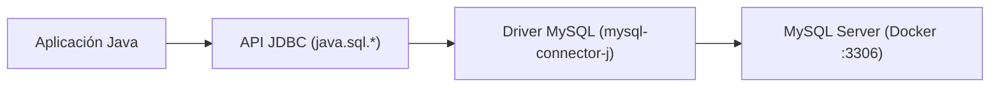

<div class="justify-text">

# 1. Introducción a JDBC y Configuración con Maven

> **Resumen de la sesión / Objetivos docentes:**
> En este primer apartado se sientan las bases de cómo Java se comunica con un motor de bases de datos relacional sin atarse a una implementación concreta. Se explica la arquitectura de JDBC y se configura un proyecto Maven listo para conectar con un servidor MySQL desplegado en Docker.

---

## 1. ¿Qué es JDBC? (Java Database Connectivity)

* **El rol de mediador:** En Java, la interacción con motores de bases de datos relacionales no se hace mediante comandos directos de red, sino a través de una **especificación estándar** llamada **JDBC** (paquetes `java.sql` y `javax.sql`).
* **Abstracción mediante interfaces:** JDBC define contratos (interfaces) comunes (`Connection`, `Statement`, `ResultSet`). Cada fabricante de bases de datos (Oracle, MySQL, PostgreSQL, SQLite) implementa esas interfaces en su propia librería, llamada **Driver** o **Conector**.
* **Ventaja clave:** El código Java que escribe el alumno es prácticamente idéntico si cambia de MySQL a PostgreSQL, solo cambia el driver y la URL de conexión.



---

## 2. Los Cuatro Pilares Esenciales de `java.sql`

En lugar de estudiar decenas de clases, solo se explican las 4 piezas fundamentales:

1. **`DriverManager`**: La clase gestora de drivers que se encarga de negociar y abrir conexiones con la base de datos a partir de una URL y unas credenciales.
2. **`Connection`**: Representa la sesión física activa o canal de comunicación abierto entre la aplicación Java y el servidor MySQL.
3. **`PreparedStatement`**: Objeto que contiene una sentencia SQL precompilada y parametrizada (`?`), garantizando seguridad y eficiencia.
4. **`ResultSet`**: Estructura de datos tabular que mantiene un cursor sobre las filas devueltas por una consulta `SELECT`.

---

## 3. Configuración del Proyecto con Maven

A diferencia de configuraciones manuales con ficheros `.jar`, en proyectos modernos se delega la gestión de dependencias a **Apache Maven**:

* **Dependencia en `pom.xml`:**
  ```xml
  <dependencies>
      <!-- Conector oficial de MySQL para Java -->
      <dependency>
          <groupId>com.mysql</groupId>
          <artifactId>mysql-connector-j</artifactId>
          <version>8.3.0</version>
      </dependency>
  </dependencies>
  ```
* **Carga automática del driver:** Explicar que desde **JDBC 4.0** (Java 6 en adelante), el mecanismo *Service Provider Interface (SPI)* detecta e inicializa automáticamente el driver presente en las dependencias sin requerir obligatoriamente `Class.forName("com.mysql.cj.jdbc.Driver")`, aunque es común encontrarlo en código legado.

---

## 4. Conexión con MySQL en Docker

* **Prerrequisito:** Contenedor Docker de MySQL en ejecución exponiendo el puerto `3306`.
* **Estructura universal de la URL JDBC:**
  $$\text{jdbc:mysql://[host]:[puerto]/[nombre\_bbdd]}$$
* **Ejemplo práctico de URL:**
  `jdbc:mysql://localhost:3306/tienda?useSSL=false&allowPublicKeyRetrieval=true&serverTimezone=UTC`
  * *Tip docente:* Explicar los parámetros opcionales (`useSSL=false`, `serverTimezone`) para evitar los avisos y excepciones típicas al conectar con contenedores Docker locales.

</div>
