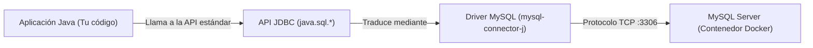
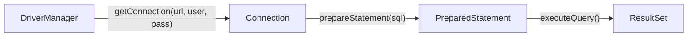
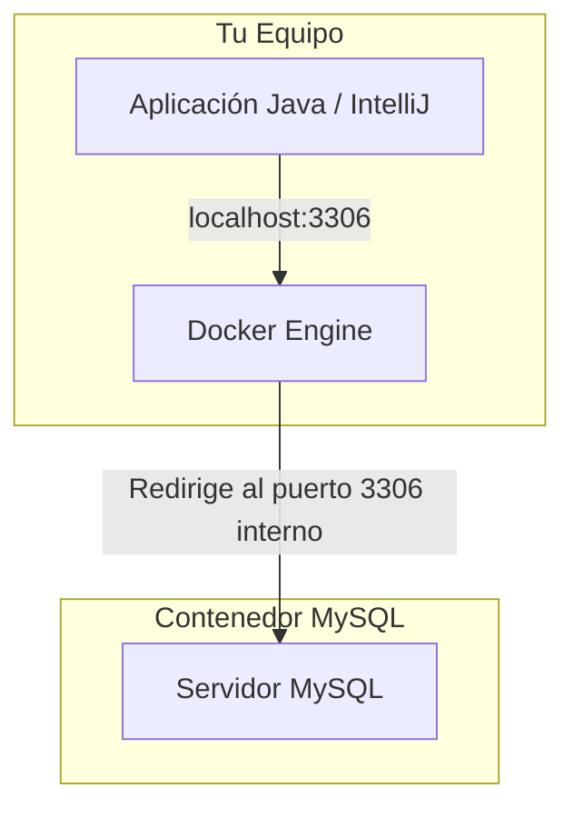

<div class="justify-text">

En las unidades anteriores hemos trabajado con la persistencia en el sistema de archivos (ficheros de texto, binarios, JSON y XML). Aunque los ficheros son útiles para almacenar configuraciones o exportar datos puntuales, presentan limitaciones severas para aplicaciones empresariales: no permiten consultas complejas concurrentes, no garantizan integridad referencial ni ofrecen mecanismos de indexación optimizados.

Para gestionar grandes volúmenes de información estructurada recurrimos a los **Sistemas de Gestión de Bases de Datos Relacionales (SGBD)** como MySQL, PostgreSQL u Oracle. En este tema aprenderemos cómo comunicar nuestras aplicaciones Java con un servidor MySQL mediante el estándar de la industria: **JDBC**.

---

## ¿Qué es JDBC? (Java Database Connectivity)

**JDBC** es una **especificación e interfaz de programación (API)** incluida en el núcleo de Java (paquetes `java.sql` y `javax.sql`) que define un conjunto estándar de interfaces y clases abstractas para interactuar con bases de datos relacionales.

### El problema que resuelve JDBC

Sin un estándar unificado, cada motor de base de datos obligaría a programar de una forma distinta, utilizando librerías propietarias y protocolos de red incompatibles entre sí.

JDBC actúa como una **capa de abstracción universal**:
* La aplicación Java siempre escribe código contra las interfaces estándar de JDBC (`Connection`, `PreparedStatement`, `ResultSet`).
* Cada fabricante de base de datos proporciona una librería propia llamada **Driver** (o Conector), que implementa dichas interfaces y traduce las llamadas de Java al protocolo de red nativo del motor.



:::tip Independencia del motor
Si mañana tu empresa decide migrar la base de datos de **MySQL** a **PostgreSQL**, tu código Java de consultas, inserciones y mapeos apenas cambia: únicamente se sustituye la dependencia del driver en Maven y la cadena de conexión.
:::

---

## Componentes clave de java.sql

Para dominar JDBC no es necesario memorizar decenas de clases. Toda la interacción gira en torno a **cuatro piezas fundamentales**:

| Componente | Tipo | Responsabilidad en la aplicación |
| :--- | :---: | :--- |
| **`DriverManager`** | Clase | La "centralita telefónica". Gestiona los drivers disponibles y se encarga de abrir una conexión física con la base de datos a partir de una URL y credenciales. |
| **`Connection`** | Interfaz | Representa la **sesión o canal abierto** con el servidor de bases de datos. A través de ella se preparan las sentencias SQL y se gestionan las transacciones. |
| **`PreparedStatement`** | Interfaz | Representa una **sentencia SQL precompilada y parametrizada** (`?`). Permite enviar consultas de forma segura contra ataques de inyección SQL. |
| **`ResultSet`** | Interfaz | Representa la **tabla de resultados devuelta** por una consulta de tipo `SELECT`. Mantiene un cursor que permite avanzar fila a fila para leer los datos. |



---

## Configuración del proyecto con Apache Maven

Para que Java pueda comunicarse con MySQL, necesitamos incorporar el driver oficial de MySQL (**Connector/J**) a nuestro proyecto.

Como ya utilizamos **Maven**, no es necesario descargar archivos `.jar` a mano ni configurar librerías en IntelliJ. Basta con añadir la siguiente dependencia en el archivo `pom.xml`:

```xml title="pom.xml"
<dependencies>
    <!-- Conector oficial de MySQL para JDBC -->
    <dependency>
        <groupId>com.mysql</groupId>
        <artifactId>mysql-connector-j</artifactId>
        <version>8.3.0</version>
    </dependency>
</dependencies>
```

:::info Recargar dependencias en IntelliJ
Tras modificar el archivo `pom.xml`, recuerda pulsar el botón de recarga de Maven (**Sync / Reload All Maven Projects**) o utilizar el atajo <kbd>Ctrl</kbd> + <kbd>Shift</kbd> + <kbd>O</kbd> (<kbd>Cmd</kbd> + <kbd>Shift</kbd> + <kbd>I</kbd> en macOS) para que IntelliJ descargue la librería en el proyecto.
:::

---

## Conexión con MySQL en Docker

Partimos del supuesto de que dispones de un contenedor **Docker** ejecutando MySQL localmente.



### Anatomía de la URL de conexión JDBC

Para que el `DriverManager` localice la base de datos, debemos construir una cadena de conexión con el siguiente formato universal:

$$\text{jdbc:mysql://[host]:[puerto]/[nombre\_bbdd]}$$

En un entorno de desarrollo local con Docker, los valores estándar son:
* **Protocolo:** `jdbc:mysql://`
* **Host / Servidor:** `localhost` (o `127.0.0.1`)
* **Puerto:** `3306` (el puerto asignado a tu contenedor Docker)
* **Base de datos:** El nombre de la base de datos (por ejemplo, `tienda`)

### Parámetros recomendados para entornos locales

Al conectar con MySQL en Docker, se recomienda añadir ciertos parámetros al final de la URL para evitar advertencias de zona horaria o bloqueos de clave pública:

```text
jdbc:mysql://localhost:3306/tienda?useSSL=false&allowPublicKeyRetrieval=true&serverTimezone=UTC
```

* `useSSL=false`: Desactiva la encriptación SSL obligatoria (adecuado para desarrollo local).
* `allowPublicKeyRetrieval=true`: Permite la negociación de contraseñas seguras con usuarios nativos de MySQL 8.
* `serverTimezone=UTC`: Fuerza una zona horaria fija para evitar discrepancias entre el contenedor y el sistema operativo anfitrión.

---

## Verificación rápida: "Hola Mundo" de conexión

Antes de estructurar el código con patrones de diseño, podemos crear una clase de prueba rápida para comprobar que el driver de Maven funciona y que el contenedor Docker responde correctamente:

```java title="TestConexion.java"
import java.sql.Connection;
import java.sql.DriverManager;
import java.sql.SQLException;

public class TestConexion {

    private static final String URL = "jdbc:mysql://localhost:3306/tienda?useSSL=false&allowPublicKeyRetrieval=true&serverTimezone=UTC";
    private static final String USER = "root";
    private static final String PASS = "root"; // Contraseña configurada en tu docker-compose o docker run

    public static void main(String[] args) {
        System.out.println("Intentando conectar con MySQL en Docker...");

        // Usamos try-with-resources para que la conexión se cierre al finalizar la prueba
        try (Connection conn = DriverManager.getConnection(URL, USER, PASS)) {
            if (conn != null && !conn.isClosed()) {
                System.out.println("¡Conexión establecida con éxito con MySQL!");
                System.out.println("Catálogo actual: " + conn.getCatalog());
            }
        } catch (SQLException e) {
            System.err.println("Error al conectar con la base de datos:");
            System.err.println("Código SQLState: " + e.getSQLState());
            System.err.println("Mensaje: " + e.getMessage());
        }
    }
}
```

:::warning Posibles errores frecuentes en el aula
* **`Communications link failure`**: El contenedor de Docker no está iniciado o el puerto `3306` no está publicado correctamente (`-p 3306:3306`).
* **`Access denied for user 'root'@'...'`**: La contraseña indicada no coincide con la definida al crear el contenedor Docker.
* **`Unknown database 'tienda'`**: La base de datos aún no ha sido creada en el servidor MySQL.
:::

</div>
