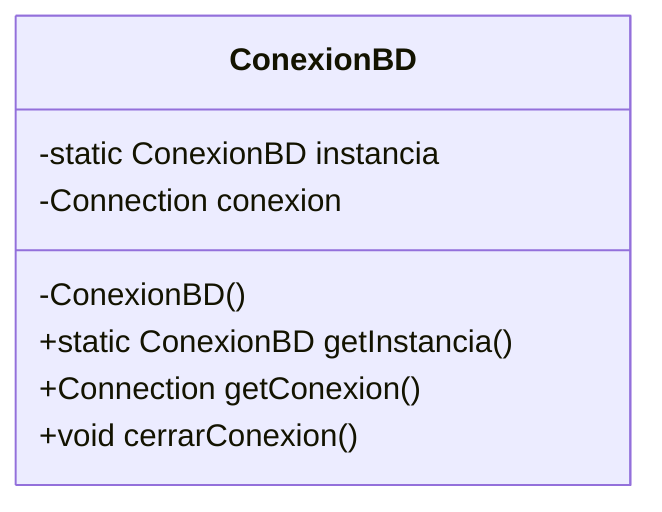
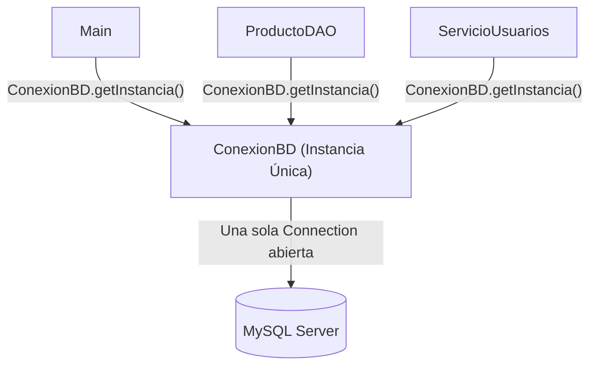

<div class="justify-text">

En el apartado anterior realizamos una prueba rápida de conexión en un método `main`. Para un script de prueba o verificación puntual esto es suficiente; sin embargo, en una aplicación real donde el usuario consulta productos, realiza pedidos o modifica registros continuamente, abrir y cerrar conexiones sin control provoca problemas graves de rendimiento y estabilidad.

Para solucionar este escenario recurrimos a uno de los patrones de diseño clásicos de la programación orientada a objetos: el **Patrón Singleton**.

---

## El problema: el coste de las conexiones a la base de datos

Cada vez que ejecutamos `DriverManager.getConnection(...)`, la aplicación no se limita a "leer una variable"; desencadena un proceso pesado a nivel de sistema y red:

* **Negociación de red (Handshake TCP):** Establecimiento del socket de comunicación entre Java y el puerto `3306` del contenedor Docker.
* **Autenticación y seguridad:** Envío de credenciales, comprobación de permisos y asignación de cifrado.
* **Consumo de memoria en el servidor:** El motor MySQL debe reservar un hilo de ejecución (*thread*) y memoria RAM para atender exclusivamente a esa conexión entrante.

Si cada método de nuestra aplicación abriera su propia conexión para ejecutar una consulta y olvidara cerrarla (o tardara en liberarla), el servidor MySQL alcanzaría rápidamente su límite máximo de clientes simultáneos, arrojando el temido error:

```text
SQLException: Data source rejected establishment of connection,  message from server: "Too many connections"
```

:::warning Mala práctica habitual
Crear un objeto `new Connection` dentro de cada método de consulta (por ejemplo, dentro de `buscarProducto()` o `listarTodos()`) satura el servidor de bases de datos y ralentiza drásticamente la aplicación.
:::

**La solución arquitectónica:** Garantizar que exista **una única conexión compartida** en toda la aplicación, centralizada en un único punto de acceso.

---

## ¿Qué es el patrón Singleton?

El patrón **Singleton** (o de *Instancia Única*) es un patrón de diseño creacional cuyo objetivo es doble:

1. Garantizar que una clase determinada tenga **una única instancia** en memoria durante toda la ejecución del programa.
2. Proporcionar un **punto de acceso global** a dicha instancia para cualquier otra clase que la necesite.



---

## Las tres reglas para construir un Singleton

Para transformar cualquier clase ordinaria en un Singleton estricto, debemos aplicar tres reglas en su estructura:

### Constructor privado (`private`)
En lugar de dejar el constructor público habitual (`public ConexionBD()`), lo declaramos `private`. Al ser privado, ninguna otra clase del proyecto puede instanciarla mediante el operador `new`. El control de creación pasa a ser propiedad exclusiva de la propia clase.

```java
// Nadie fuera de esta clase puede hacer: new ConexionBD();
private ConexionBD() {
    // Inicialización de la conexión
}
```

### Atributo estático privado de la propia clase
Declaramos una variable estática (`static`) del mismo tipo de la clase. Al ser estática, esta variable no pertenece a un objeto concreto, sino a la clase en sí, existiendo una única referencia compartida en la memoria de la Máquina Virtual de Java (JVM).

```java
private static ConexionBD instancia;
```

### Método estático público de acceso (`getInstancia`)
Es la única puerta de entrada para utilizar la clase. Cuando alguien solicita la instancia, el método comprueba si ya fue creada previamente:
* Si vale `null`, invoca al constructor privado por primera y única vez (*inicialización perezosa* o *lazy initialization*).
* Si ya existe, devuelve directamente la referencia existente sin crear objetos adicionales.

```java
public static ConexionBD getInstancia() {
    if (instancia == null) {
        instancia = new ConexionBD();
    }
    return instancia;
}
```

---

## Implementación de la clase gestora

A continuación se muestra la implementación completa de la clase `ConexionBD` siguiendo el patrón Singleton:

```java title="ConexionBD.java"
package bbdd;

import java.sql.Connection;
import java.sql.DriverManager;
import java.sql.SQLException;

public class ConexionBD {

    // Constantes de conexión
    // MALA PRÁCTICA definirlos en código, si se suben a un repo público tienen mis datos
    // Debería estar en un fichero Properties
    private static final String URL = "jdbc:mysql://localhost:3306/tienda?useSSL=false&allowPublicKeyRetrieval=true&serverTimezone=UTC";
    private static final String USER = "root";
    private static final String PASS = "root";

    // 1. Atributo estático que almacenará la única instancia
    private static ConexionBD instancia;

    // 2. Conexión compartida con MySQL
    private Connection conexion;

    // 3. Constructor PRIVADO: gestiona la apertura de la conexión una sola vez
    private ConexionBD() {
        try {
            System.out.println(">> [BBDD] Estableciendo conexión única con MySQL...");
            this.conexion = DriverManager.getConnection(URL, USER, PASS);
            System.out.println(">> [BBDD] Conexión establecida con éxito.");
        } catch (SQLException e) {
            System.err.println(">> [BBDD] Error crítico al conectar con la BBDD: " + e.getMessage());
            e.printStackTrace();
        }
    }

    // 4. Método público y estático de acceso global (Singleton)
    public static ConexionBD getInstancia() {
        if (instancia == null) {
            instancia = new ConexionBD();
        }
        return instancia;
    }

    // 5. Getter para proporcionar la conexión a los métodos que la necesiten
    public Connection getConexion() {
        return this.conexion;
    }

    // 6. Cierre controlado al finalizar la aplicación
    public void cerrarConexion() {
        if (this.conexion != null) {
            try {
                this.conexion.close();
                System.out.println(">> [BBDD] Conexión cerrada correctamente.");
            } catch (SQLException e) {
                System.err.println(">> [BBDD] Error al cerrar la conexión: " + e.getMessage());
            }
        }
    }
}
```

---

## Modo de uso desde cualquier punto de la aplicación

Gracias a este diseño, cuando queramos realizar operaciones sobre la base de datos desde el `Main` o cualquier servicio, **jamás usamos el operador `new`**:

```java title="Main.java"
// Obtenemos la conexión llamando al método estático
Connection conn = ConexionBD.getInstancia().getConexion();
```

Si ejecutamos esta llamada 100 veces a lo largo del programa, **la conexión física con MySQL se creará exactamente una vez**.



---

## Gestión de recursos: ¿cuándo se cierra cada elemento?

Con el patrón Singleton es fundamental distinguir el ciclo de vida de los distintos objetos JDBC:

* **La `Connection` (del Singleton):** Se mantiene **abierta** durante toda la ejecución del programa para atender las consultas que vayan surgiendo. Solo se invoca `cerrarConexion()` cuando la aplicación va a terminar definitivamente (por ejemplo, al seleccionar la opción "Salir" en el menú).
* **Los `PreparedStatement` y `ResultSet`:** Se abren y cierran **en cada consulta individual**. Como veremos en el siguiente apartado, estos objetos auxiliares sí deben cerrarse inmediatamente tras usarse (mediante `try-with-resources`) para no consumir memoria innecesaria en el cliente ni en el servidor.

</div>
