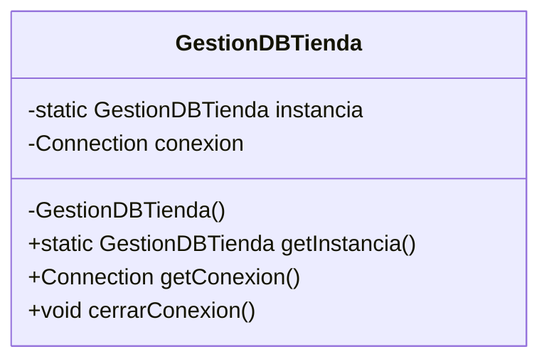

<div class="justify-text">

# 2. Gestión de Conexiones y el Patrón Singleton

> **Resumen de la sesión / Objetivos docentes:**
> Dado que el patrón Singleton no se abordó en unidades anteriores, este apartado explica desde cero qué es un patrón de diseño creacional, por qué es crítico evitar la proliferación descontrolada de conexiones a bases de datos y cómo implementar paso a paso una clase gestora de conexión única mediante Singleton.

---

## 1. El Problema: El Coste de las Conexiones a la Base de Datos

Cada vez que una aplicación Java ejecuta `DriverManager.getConnection(...)`, se desencadena una secuencia costosa de operaciones:
1. Resolución DNS y negociación de sockets TCP en red.
2. Handshake criptográfico o autenticación de usuario y contraseña con el motor MySQL.
3. Asignación de hilos y memoria en el servidor MySQL para atender esa sesión.

Si cada método de la aplicación abriera un `new Connection` para hacer un `SELECT` o un `INSERT`, se provocarían cuellos de botella severos, agotamiento del pool de conexiones de MySQL (`Too many connections`) y degradación del rendimiento.

**La solución:** Garantizar que la aplicación mantenga **una única instancia de conexión compartida** durante todo su ciclo de vida.

---

## 2. ¿Qué es el Patrón Singleton?

El patrón **Singleton** (Instancia Única) es un patrón de diseño creacional del catálogo *Gang of Four (GoF)* cuyo propósito es:
1. Asegurar que una clase tenga **una única instancia** en toda la ejecución del programa.
2. Proporcionar un **punto de acceso global** a dicha instancia.



---

## 3. Las Tres Reglas de Oro para Construir un Singleton

Para transformar cualquier clase en un Singleton estricto, se deben cumplir exactamente tres reglas en su estructura:

1. **Constructor privado (`private`):**
   * Impide que otras clases del proyecto puedan hacer `new GestionDBTienda()`. El control de creación pasa a ser exclusivo de la propia clase.
2. **Atributo estático privado de su propio tipo:**
   * `private static GestionDBTienda instancia;`
   * Al ser estático (`static`), el atributo pertenece a la clase y no a objetos individuales, existiendo una sola copia en memoria.
3. **Método estático y público de acceso (`getInstance`):**
   * Es la única puerta de entrada al recurso. Si la instancia aún no existe (`null`), la crea por primera vez (*inicialización perezosa* o *lazy initialization*); si ya existe, devuelve la referencia existente sin duplicarla.

---

## 4. Código Didáctico de la Clase Gestora

Esquema de código a explicar en el aula paso a paso:

```java
public class GestionDBTienda {

    // 1. Constantes de configuración
    private static final String URL = "jdbc:mysql://localhost:3306/tienda?useSSL=false&serverTimezone=UTC";
    private static final String USER = "root";
    private static final String PASS = "root";

    // 2. Atributo estático que almacenará la única instancia de la clase
    private static GestionDBTienda instancia;

    // 3. Atributo que almacena el canal de conexión JDBC
    private Connection conexion;

    // 4. Constructor PRIVADO: nadie desde fuera puede hacer "new"
    private GestionDBTienda() {
        try {
            this.conexion = DriverManager.getConnection(URL, USER, PASS);
            System.out.println(">> Conexión establecida con éxito con MySQL.");
        } catch (SQLException e) {
            System.err.println("Error crítico al conectar: " + e.getMessage());
            e.printStackTrace();
        }
    }

    // 5. Método estático de acceso global (lazy initialization)
    public static GestionDBTienda getInstancia() {
        if (instancia == null) {
            instancia = new GestionDBTienda();
        }
        return instancia;
    }

    // 6. Acceso al objeto Connection para ejecutar sentencias
    public Connection getConexion() {
        return this.conexion;
    }

    // 7. Método para liberar la conexión al apagar la aplicación
    public void cerrarConexion() {
        if (this.conexion != null) {
            try {
                this.conexion.close();
                System.out.println(">> Conexión cerrada correctamente.");
            } catch (SQLException e) {
                e.printStackTrace();
            }
        }
    }
}
```

---

## 5. Modo de Uso desde la Aplicación

Para invocar la conexión desde cualquier punto (por ejemplo, desde el `Main` o métodos de servicio), nunca se usa `new`, sino el método estático:

```java
// Obtenemos la conexión única compartida
Connection conn = GestionDBTienda.getInstancia().getConexion();
```

</div>
