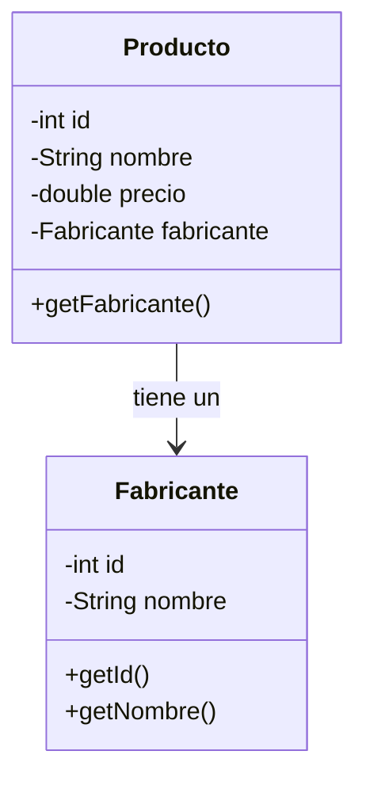

<div class="justify-text">

Para consolidar todos los conceptos vistos durante esta sesión (configuración con Maven, conexión única mediante el patrón Singleton y operaciones CRUD seguras con `PreparedStatement`), desarrollaremos una aplicación de consola completa para la gestión de productos de una tienda de informática.

En este ejercicio aplicaremos dos buenas prácticas fundamentales del desarrollo profesional:
1. **Separación de responsabilidades:** Separaremos la gestión de la conexión (`ConexionBD`) de las consultas a cada tabla (`FabricanteDAO` y `ProductoDAO`).
2. **Composición orientada a objetos:** En lugar de guardar identificadores foráneos sueltos en variables primitivas, `Producto` contendrá una referencia directa a su objeto `Fabricante`.

---

## Script de la base de datos (tienda.sql)

Antes de programar en Java, debemos contar con las tablas y datos de prueba en nuestro servidor MySQL (desplegado en el contenedor Docker).

:::info Descarga del script de base de datos
Descarga el archivo con la creación de tablas y los datos de prueba de la base de datos `tienda`:
* 📥 **<a href="/DevTacora/recursos/ada_ut3/tienda.sql" download="tienda.sql">Descargar tienda.sql</a>**

Ejecuta el contenido del script en la consola interactiva de Docker.
:::

---

## Dependencia de MySQL en Maven (pom.xml)

Antes de comenzar a implementar las clases Java, nos aseguramos de tener el conector oficial de MySQL añadido a las dependencias de nuestro archivo `pom.xml`:

```xml title="pom.xml"
<dependencies>
    <!-- Conector oficial de MySQL para JDBC -->
    <dependency>
        <groupId>com.mysql</groupId>
        <artifactId>mysql-connector-j</artifactId>
        <version>8.3.0</version>
    </dependency>
</dependencies>
```

Recuerda sincronizar o recargar el proyecto Maven en IntelliJ tras guardar los cambios en el archivo.

---

## Arquitectura y estructura del proyecto

Organizamos el proyecto Maven en IntelliJ separando claramente las responsabilidades en paquetes:

```text
src/main/java/
├── bbdd/
│   └── ConexionBD.java       # Singleton puro: gestión y apertura de la conexión
├── dao/
│   ├── FabricanteDAO.java    # Acceso a datos de la tabla fabricante
│   └── ProductoDAO.java      # Operaciones CRUD sobre la tabla producto
├── model/
│   ├── Fabricante.java       # Entidad Fabricante
│   └── Producto.java         # Entidad Producto con composición
└── Main.java                 # Punto de entrada con pruebas de todas las operaciones CRUD
```

:::info ¿Por qué creamos FabricanteDAO y qué responsabilidad tiene cada DAO?
Siguiendo el principio de responsabilidad única, **cada clase DAO gestiona exclusivamente las consultas sobre su propia tabla**:
* **`FabricanteDAO`** se encarga del acceso a la tabla `fabricante`. Aunque en esta demo no implementamos un CRUD completo de fabricantes, **necesitamos esta clase para buscar y recuperar un objeto `Fabricante` real de la base de datos** (`obtenerFabricante(int id)`) antes de crear e insertar un nuevo `Producto`, garantizando así que la clave foránea `id_fabricante` existe realmente en MySQL.
* **`ProductoDAO`** se encarga de todo el CRUD sobre la tabla `producto`: listar todos los productos con su fabricante, filtrar por nombre de fabricante, insertar nuevos productos (recuperando su ID autogenerado), modificar el precio y eliminar registros.
:::

---

## Clases de modelo

En la base de datos relacional la relación se establece mediante claves (`id_fabricante`). En Java, en cambio, representamos la relación mediante **composición de objetos**:



### Clase Fabricante

```java title="model/Fabricante.java"
package model;

public class Fabricante {

    private int id;
    private String nombre;

    public Fabricante(int id, String nombre) {
        this.id = id;
        this.nombre = nombre;
    }

    public int getId() {
        return id;
    }

    public void setId(int id) {
        this.id = id;
    }

    public String getNombre() {
        return nombre;
    }

    public void setNombre(String nombre) {
        this.nombre = nombre;
    }

    @Override
    public String toString() {
        return String.format("[%d] %s", id, nombre);
    }
}
```

### Clase Producto (con composición)

Fíjate en que incluimos **dos constructores**: uno sin `id` (útil cuando vamos a insertar un producto nuevo cuyo identificador generará MySQL automáticamente) y otro completo con `id` (usado al recuperar registros existentes desde la base de datos).

```java title="model/Producto.java"
package model;

public class Producto {

    private int id;
    private String nombre;
    private double precio;
    private Fabricante fabricante;

    public Producto(String nombre, double precio, Fabricante fabricante) {
        this.nombre = nombre;
        this.precio = precio;
        this.fabricante = fabricante;
    }

    public Producto(int id, String nombre, double precio, Fabricante fabricante) {
        this.id = id;
        this.nombre = nombre;
        this.precio = precio;
        this.fabricante = fabricante;
    }

    public int getId() {
        return id;
    }

    public void setId(int id) {
        this.id = id;
    }

    public String getNombre() {
        return nombre;
    }

    public void setNombre(String nombre) {
        this.nombre = nombre;
    }

    public double getPrecio() {
        return precio;
    }

    public void setPrecio(double precio) {
        this.precio = precio;
    }

    public Fabricante getFabricante() {
        return fabricante;
    }

    public void setFabricante(Fabricante fabricante) {
        this.fabricante = fabricante;
    }

    @Override
    public String toString() {
        String nombreFab = (fabricante != null) ? fabricante.getNombre() : "Sin fabricante";
        return String.format("ID: %-3d | %-28s | %7.2f € | Fabricante: %s\n", id, nombre, precio, nombreFab);
    }
}
```

---

## Gestor de conexión Singleton: ConexionBD.java

Esta clase actúa como factoría de la conexión única con MySQL en Docker:

```java title="bbdd/ConexionBD.java"
package bbdd;

import java.sql.Connection;
import java.sql.DriverManager;
import java.sql.SQLException;

public class ConexionBD {

    private static final String URL = "jdbc:mysql://localhost:2000/tienda?useSSL=false&allowPublicKeyRetrieval=true&serverTimezone=UTC";
    private static final String USER = "root";
    private static final String PASS = "root";

    private static ConexionBD instancia;
    private Connection conexion;

    private ConexionBD() {
        try {
            System.out.println(">> [BBDD] Estableciendo conexión con MySQL...");
            this.conexion = DriverManager.getConnection(URL, USER, PASS);
            System.out.println(">> [BBDD] Conexión establecida con éxito.");
        } catch (SQLException e) {
            System.err.println(">> [BBDD] Error al conectar con la base de datos: " + e.getMessage());
        }
    }

    public static ConexionBD getInstancia() {
        if (instancia == null) {
            instancia = new ConexionBD();
        }
        return instancia;
    }

    public Connection getConexion() {
        return this.conexion;
    }

    public void cerrarConexion() {
        if (conexion != null) {
            try {
                conexion.close();
                System.out.println(">> [BBDD] Conexión cerrada con éxito.");
            } catch (SQLException e) {
                System.err.println("Error al cerrar conexión: " + e.getMessage());
            }
        }
    }
}
```

:::info Sobre la URL de conexión y los datos sensibles
* **Anatomía de la URL:** `jdbc:mysql://localhost:2000/tienda?...` indica el protocolo (`jdbc:mysql://`), el servidor (`localhost`), el **puerto `2000`** (puerto mapeado en nuestro contenedor Docker hacia el `3306` interno de MySQL) y el nombre de la base de datos (`tienda`). Los parámetros finales (`useSSL=false`, `allowPublicKeyRetrieval=true` y `serverTimezone=UTC`) evitan errores de certificado y zona horaria en entornos locales.
* **Fichero de configuración (buena práctica):** En este ejemplo didáctico hemos escrito la URL, el usuario y la contraseña como constantes en el código, pero en un proyecto real **esta información nunca debe ir fija en el código fuente** (*hardcoded*). Debe externalizarse en un fichero de configuración (como un archivo `.properties`, visto en la UT2, o variables de entorno) para poder cambiar de servidor sin recompilar y evitar exponer credenciales en repositorios como GitHub.
:::

---

## Capa de acceso a datos (DAO)

### Acceso a datos de fabricantes: FabricanteDAO.java

Se encarga de consultar la tabla `fabricante`. En esta demo nos permite recuperar un `Fabricante` por su `id` para poder asociarlo al dar de alta un nuevo `Producto`:

```java title="dao/FabricanteDAO.java"
package dao;

import bbdd.ConexionBD;
import model.Fabricante;

import java.sql.Connection;
import java.sql.PreparedStatement;
import java.sql.ResultSet;
import java.sql.SQLException;

public class FabricanteDAO {

    public Fabricante obtenerFabricante(int id) {
        String consulta = """
            SELECT id, nombre
            FROM fabricante
            WHERE id = ?
            """;

        // Recuperamos la conexión a BBDD
        Connection conexionDB = ConexionBD.getInstancia().getConexion();

        try (PreparedStatement stmt = conexionDB.prepareStatement(consulta)) {
            stmt.setInt(1, id);
            // Ejecutamos query
            ResultSet rs = stmt.executeQuery();
            while (rs.next()) {
                int idFabricante = rs.getInt("id");
                String nombreFabricante = rs.getString("nombre");
                Fabricante fab = new Fabricante(idFabricante, nombreFabricante);

                // En la búsqueda por id solo debe haber 1, así que hacemos return dentro
                return fab;
            }
        } catch (SQLException e) {
            System.err.println("Error al obtener fabricante por id: " + e.getMessage());
        }
        return null;
    }

}
```

### Acceso a datos de productos: ProductoDAO.java

Centraliza todas las operaciones CRUD sobre la tabla `producto`, pidiendo la conexión al Singleton `ConexionBD` y construyendo objetos `Producto` compuestos con su `Fabricante`:

```java title="dao/ProductoDAO.java"
package dao;

import bbdd.ConexionBD;
import model.Fabricante;
import model.Producto;

import java.sql.*;
import java.util.ArrayList;
import java.util.List;

public class ProductoDAO {

    public List<Producto> obtenerProductos() {
        List<Producto> productos = new ArrayList<>();

        String consulta = """
            SELECT p.id, p.nombre, p.precio, f.id, f.nombre
            FROM producto p JOIN fabricante f ON p.id_fabricante = f.id
            """;

        // Recuperamos la conexión a BBDD
        Connection conexionDB = ConexionBD.getInstancia().getConexion();

        try (PreparedStatement stmt = conexionDB.prepareStatement(consulta)) {

            // Ejecutamos query
            ResultSet rs = stmt.executeQuery();
            while (rs.next()) {
                int idFabricante = rs.getInt("f.id");
                String nombreFabricante = rs.getString("f.nombre");
                Fabricante fab = new Fabricante(idFabricante, nombreFabricante);

                // También podemos recuperar los datos y a la vez crear el objeto, sin variables intermedias
                Producto prod = new Producto(
                        rs.getInt("p.id"),
                        rs.getString("p.nombre"),
                        rs.getDouble("p.precio"),
                        fab
                );

                // Vamos guardando los productos en la lista
                productos.add(prod);
            }
        } catch (SQLException e) {
            System.err.println("Error al obtener productos: " + e.getMessage());
        }
        return productos;
    }

    public List<Producto> obtenerProductosFabricante(String nombreFabricante) {
        List<Producto> productos = new ArrayList<>();

        String consulta = """
            SELECT p.id, p.nombre, p.precio, f.id, f.nombre
            FROM producto p JOIN fabricante f ON p.id_fabricante = f.id
            WHERE f.nombre = ?
            """;

        // Recuperamos la conexión a BBDD
        Connection conexionDB = ConexionBD.getInstancia().getConexion();

        try (PreparedStatement stmt = conexionDB.prepareStatement(consulta)) {
            // Establecemos los parámetros
            stmt.setString(1, nombreFabricante);

            // Ejecutamos query
            ResultSet rs = stmt.executeQuery();
            while (rs.next()) {
                int idFabricante = rs.getInt("f.id");
                String nombreF = rs.getString("f.nombre");
                Fabricante fab = new Fabricante(idFabricante, nombreF);

                Producto prod = new Producto(
                        rs.getInt("p.id"),
                        rs.getString("p.nombre"),
                        rs.getDouble("p.precio"),
                        fab
                );

                productos.add(prod);
            }

            // OJO: liberamos los recursos del ResultSet
            rs.close();
        } catch (SQLException e) {
            System.err.println("Error al obtener productos: " + e.getMessage());
        }
        return productos;
    }

    public boolean insertarProducto(Producto producto) {
        boolean insertado = false;

        String consulta = """
                INSERT INTO producto (nombre, precio, id_fabricante)
                VALUES (?, ?, ?)
            """;

        // Recuperamos la conexión a BBDD
        Connection conexionDB = ConexionBD.getInstancia().getConexion();

        // El segundo parámetro solo es necesario si queremos recuperar el id generado
        try (PreparedStatement stmt = conexionDB.prepareStatement(consulta, Statement.RETURN_GENERATED_KEYS)) {
            // Establecemos los parámetros
            stmt.setString(1, producto.getNombre());
            stmt.setDouble(2, producto.getPrecio());
            stmt.setInt(3, producto.getFabricante().getId());

            // Ejecutamos actualización
            int filasAfectadas = stmt.executeUpdate();

            if (filasAfectadas > 0) {
                insertado = true;

                // OJO: este bloque solo es necesario si tenéis que recuperar el id generado
                try (ResultSet generatedKeys = stmt.getGeneratedKeys()) {
                    if (generatedKeys.next()) {
                        int idGenerado = generatedKeys.getInt(1);
                        System.out.println(">> Producto dado de alta con éxito. ID asignado: " + idGenerado);
                    }
                }
            }
        } catch (SQLException e) {
            System.err.println("Error al insertar producto: " + e.getMessage());
        }

        return insertado;
    }

    public boolean modificarProducto(int id, double nuevoPrecio) {
        boolean actualizado = false;

        String consulta = """
                UPDATE producto
                SET precio = ?
                WHERE id = ?
            """;

        // Recuperamos la conexión a BBDD
        Connection conexionDB = ConexionBD.getInstancia().getConexion();

        try (PreparedStatement stmt = conexionDB.prepareStatement(consulta)) {
            // Establecemos los parámetros
            stmt.setDouble(1, nuevoPrecio);
            stmt.setInt(2, id);

            // Ejecutamos actualización
            int filasAfectadas = stmt.executeUpdate();

            if (filasAfectadas > 0) {
                actualizado = true;
            }
        } catch (SQLException e) {
            System.err.println("Error al actualizar producto: " + e.getMessage());
        }

        return actualizado;
    }

    public boolean eliminarProducto(int id) {
        boolean eliminado = false;

        String consulta = """
                DELETE FROM producto
                WHERE id = ?
            """;

        // Recuperamos la conexión a BBDD
        Connection conexionDB = ConexionBD.getInstancia().getConexion();

        try (PreparedStatement stmt = conexionDB.prepareStatement(consulta)) {
            // Establecemos los parámetros
            stmt.setInt(1, id);

            // Ejecutamos actualización
            int filasAfectadas = stmt.executeUpdate();

            if (filasAfectadas > 0) {
                eliminado = true;
            }
        } catch (SQLException e) {
            System.err.println("Error al eliminar producto: " + e.getMessage());
        }

        return eliminado;
    }

}
```

---

## Programa principal: Main.java

Desde `Main` probamos de forma secuencial todas las operaciones del CRUD apoyándonos en `ProductoDAO` y `FabricanteDAO`:

```java title="Main.java"
import dao.FabricanteDAO;
import dao.ProductoDAO;
import model.Fabricante;
import model.Producto;

void main() {
    ProductoDAO productoDAO = new ProductoDAO();
    FabricanteDAO fabricanteDAO = new FabricanteDAO();

    System.out.println("==== PRODUCTOS ====");
    List<Producto> productos = productoDAO.obtenerProductos();
    System.out.println(productos);

    System.out.println("\n==== PRODUCTOS FABRICANTE CRUCIAL ====");
    List<Producto> productosFab = productoDAO.obtenerProductosFabricante("Crucial");
    System.out.println(productosFab);

    System.out.println("\n==== INSERTAR PRODUCTO ====");
    // Recuperamos un fabricante que exista
    Fabricante fab = fabricanteDAO.obtenerFabricante(1);
    if (fab != null) {
        // El id del producto será autogenerado
        Producto nuevo = new Producto("Teclado", 100.99, fab);
        boolean insertado = productoDAO.insertarProducto(nuevo);

        if (insertado) System.out.println("Se insertó un nuevo elemento");
        else System.out.println("No se ha podido insertar el producto");
    }

    System.out.println("\n==== ACTUALIZAR PRODUCTO ====");
    // Recogemos un producto existente
    Producto productoMod = productos.getLast();
    productoDAO.modificarProducto(productoMod.getId(), 20);

    System.out.println("==== CONSULTAMOS PARA VER CAMBIOS ====");
    productos = productoDAO.obtenerProductos();
    System.out.println(productos);

    System.out.println("\n==== ELIMINAR PRODUCTO ====");
    productoDAO.eliminarProducto(productoMod.getId());

    System.out.println("==== CONSULTAMOS PARA VER CAMBIOS ====");
    productos = productoDAO.obtenerProductos();
    System.out.println(productos);
}
```

</div>
