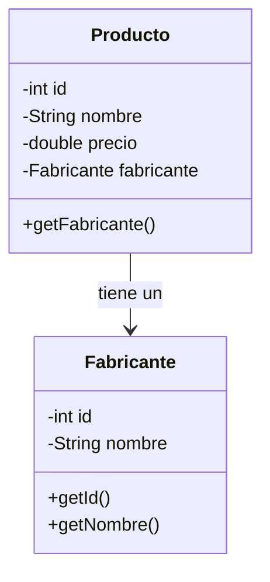

<div class="justify-text">

Para consolidar todos los conceptos vistos durante esta sesión (configuración con Maven, conexión única mediante el patrón Singleton y operaciones CRUD seguras con `PreparedStatement`), desarrollaremos una aplicación de consola completa para la gestión de productos de una tienda de informática.

En este ejercicio aplicaremos dos buenas prácticas fundamentales del desarrollo profesional:
1. **Separación de responsabilidades:** Separaremos la gestión de la conexión (`ConexionBD`) de las consultas a las tablas (`ProductoDAO`).
2. **Composición orientada a objetos:** En lugar de guardar identificadores foráneos sueltos en variables primitivas, `Producto` contendrá una referencia directa a su objeto `Fabricante`.

---

## Script de la base de datos (tienda.sql)

Antes de programar en Java, debemos contar con las tablas y datos de prueba en nuestro servidor MySQL (desplegado en el contenedor Docker).

Ejecuta el siguiente script en tu cliente de base de datos habitual (MySQL Workbench, DBeaver o la consola interactiva de Docker):

```sql title="tienda.sql"
DROP DATABASE IF EXISTS tienda;
CREATE DATABASE tienda CHARACTER SET utf8mb4;
USE tienda;

-- 1. Tabla fabricante
CREATE TABLE fabricante (
    id INT UNSIGNED AUTO_INCREMENT PRIMARY KEY,
    nombre VARCHAR(100) NOT NULL
);

-- 2. Tabla producto con clave foránea
CREATE TABLE producto (
    id INT UNSIGNED AUTO_INCREMENT PRIMARY KEY,
    nombre VARCHAR(100) NOT NULL,
    precio DOUBLE NOT NULL,
    id_fabricante INT UNSIGNED NOT NULL,
    FOREIGN KEY (id_fabricante) REFERENCES fabricante(id)
);

-- 3. Inserción de datos iniciales
INSERT INTO fabricante (id, nombre) VALUES
(1, 'Asus'),
(2, 'Lenovo'),
(3, 'Hewlett-Packard'),
(4, 'Samsung'),
(5, 'Seagate');

INSERT INTO producto (nombre, precio, id_fabricante) VALUES
('Disco duro SATA3 1TB', 86.99, 5),
('Memoria RAM DDR4 8GB', 120.00, 4),
('Disco SSD 1 TB', 150.99, 4),
('Monitor 24 LED Full HD', 202.00, 1),
('Monitor 27 LED Full HD', 245.99, 1),
('Portátil Yoga 520', 559.00, 2),
('Impresora HP Deskjet 3720', 59.99, 3);
```

---

## Arquitectura y estructura del proyecto

Organizamos el proyecto Maven en IntelliJ separando claramente las responsabilidades en paquetes:

```text
src/main/java/
├── bbdd/
│   └── ConexionBD.java       # Singleton puro: gestión y apertura de la conexión
├── dao/
│   └── ProductoDAO.java      # Métodos de consulta y modificación SQL de productos
├── model/
│   ├── Fabricante.java       # Entidad Fabricante
│   └── Producto.java         # Entidad Producto con composición
└── Main.java                 # Punto de entrada con menú interactivo por consola
```

:::info ¿Por qué solo creamos ProductoDAO y no FabricanteDAO?
En nuestra tienda hoy solo gestionamos productos. El fabricante lo necesitamos únicamente para mostrar su nombre en el listado del producto mediante un `JOIN`. Por eso hoy solo necesitamos `ProductoDAO`. Si mañana el cliente nos pide un menú para añadir o dar de baja marcas/fabricantes, crearíamos `FabricanteDAO`.
:::

---

## Clases de modelo

En la base de datos relacional la relación se establece mediante claves (`id_fabricante`). En Java, en cambio, representamos la relación mediante **composición de objetos**:



### Clase Fabricante

```java title="model/Fabricante.java"
package model;

public class Fabricante {

    private int id;
    private String nombre;

    public Fabricante(int id, String nombre) {
        this.id = id;
        this.nombre = nombre;
    }

    public int getId() { return id; }
    public void setId(int id) { this.id = id; }

    public String getNombre() { return nombre; }
    public void setNombre(String nombre) { this.nombre = nombre; }

    @Override
    public String toString() {
        return String.format("[%d] %s", id, nombre);
    }
}
```

### Clase Producto (con composición)

```java title="model/Producto.java"
package model;

public class Producto {

    private int id;
    private String nombre;
    private double precio;
    private Fabricante fabricante; // Composición directa

    public Producto(int id, String nombre, double precio, Fabricante fabricante) {
        this.id = id;
        this.nombre = nombre;
        this.precio = precio;
        this.fabricante = fabricante;
    }

    public int getId() { return id; }
    public void setId(int id) { this.id = id; }

    public String getNombre() { return nombre; }
    public void setNombre(String nombre) { this.nombre = nombre; }

    public double getPrecio() { return precio; }
    public void setPrecio(double precio) { this.precio = precio; }

    public Fabricante getFabricante() { return fabricante; }
    public void setFabricante(Fabricante fabricante) { this.fabricante = fabricante; }

    @Override
    public String toString() {
        String nombreFab = (fabricante != null) ? fabricante.getNombre() : "Sin fabricante";
        return String.format("ID: %-3d | %-28s | %7.2f € | Fabricante: %s", id, nombre, precio, nombreFab);
    }
}
```

---

## Gestor de conexión Singleton: ConexionBD.java

Esta clase actúa como factoría de la conexión única con MySQL en Docker:

```java title="bbdd/ConexionBD.java"
package bbdd;

import java.sql.Connection;
import java.sql.DriverManager;
import java.sql.SQLException;

public class ConexionBD {

    private static final String URL = "jdbc:mysql://localhost:3306/tienda?useSSL=false&allowPublicKeyRetrieval=true&serverTimezone=UTC";
    private static final String USER = "root";
    private static final String PASS = "root";

    private static ConexionBD instancia;
    private Connection conexion;

    private ConexionBD() {
        try {
            System.out.println(">> [BBDD] Estableciendo conexión con MySQL...");
            this.conexion = DriverManager.getConnection(URL, USER, PASS);
            System.out.println(">> [BBDD] Conexión establecida con éxito.");
        } catch (SQLException e) {
            System.err.println(">> [BBDD] Error al conectar con la base de datos: " + e.getMessage());
        }
    }

    public static ConexionBD getInstancia() {
        if (instancia == null) {
            instancia = new ConexionBD();
        }
        return instancia;
    }

    public Connection getConexion() {
        return this.conexion;
    }

    public void cerrarConexion() {
        if (conexion != null) {
            try {
                conexion.close();
                System.out.println(">> [BBDD] Conexión cerrada con éxito.");
            } catch (SQLException e) {
                System.err.println("Error al cerrar conexión: " + e.getMessage());
            }
        }
    }
}
```

---

## Acceso a datos de productos: ProductoDAO.java

La clase `ProductoDAO` centraliza todas las consultas y modificaciones SQL sobre la tabla `producto`. Solicita la conexión al Singleton `ConexionBD` y mapea los resultados construyendo objetos compuestos:

```java title="dao/ProductoDAO.java"
package dao;

import bbdd.ConexionBD;
import model.Fabricante;
import model.Producto;

import java.sql.Connection;
import java.sql.PreparedStatement;
import java.sql.ResultSet;
import java.sql.SQLException;
import java.util.ArrayList;
import java.util.List;

public class ProductoDAO {

    private Connection getConexion() {
        return ConexionBD.getInstancia().getConexion();
    }

    // 1. Obtener todos los productos componiendo su objeto Fabricante
    public List<Producto> obtenerProductos() {
        List<Producto> lista = new ArrayList<>();
        String sql = """
            SELECT p.id, p.nombre, p.precio, p.id_fabricante, f.nombre AS nombre_fab
            FROM producto p
            JOIN fabricante f ON p.id_fabricante = f.id
            ORDER BY p.id
        """;

        try (PreparedStatement stmt = getConexion().prepareStatement(sql);
             ResultSet rs = stmt.executeQuery()) {

            while (rs.next()) {
                Fabricante fab = new Fabricante(
                    rs.getInt("id_fabricante"),
                    rs.getString("nombre_fab")
                );

                Producto prod = new Producto(
                    rs.getInt("id"),
                    rs.getString("nombre"),
                    rs.getDouble("precio"),
                    fab
                );
                lista.add(prod);
            }
        } catch (SQLException e) {
            System.err.println("Error al obtener productos: " + e.getMessage());
        }
        return lista;
    }

    // 2. Imprimir todos los productos por consola
    public void mostrarProductos() {
        List<Producto> productos = obtenerProductos();
        if (productos.isEmpty()) {
            System.out.println("No hay productos registrados en la tienda.");
            return;
        }
        System.out.println("\n--- LISTADO DE PRODUCTOS EN TIENDA ---");
        for (Producto p : productos) {
            System.out.println(p);
        }
    }

    // 3. Mostrar productos filtrados por el nombre del fabricante
    public void mostrarProductosFabricante(String nombreFabricante) {
        String sql = """
            SELECT p.id, p.nombre, p.precio, p.id_fabricante, f.nombre AS nombre_fab
            FROM producto p
            JOIN fabricante f ON p.id_fabricante = f.id
            WHERE LOWER(f.nombre) = LOWER(?)
            ORDER BY p.id
        """;

        try (PreparedStatement stmt = getConexion().prepareStatement(sql)) {
            stmt.setString(1, nombreFabricante);

            try (ResultSet rs = stmt.executeQuery()) {
                boolean hayResultados = false;
                System.out.println("\n--- PRODUCTOS DEL FABRICANTE: " + nombreFabricante.toUpperCase() + " ---");

                while (rs.next()) {
                    hayResultados = true;
                    Fabricante fab = new Fabricante(
                        rs.getInt("id_fabricante"),
                        rs.getString("nombre_fab")
                    );

                    Producto p = new Producto(
                        rs.getInt("id"),
                        rs.getString("nombre"),
                        rs.getDouble("precio"),
                        fab
                    );
                    System.out.println(p);
                }

                if (!hayResultados) {
                    System.out.println("No se encontraron productos para el fabricante indicado.");
                }
            }
        } catch (SQLException e) {
            System.err.println("Error al filtrar por fabricante: " + e.getMessage());
        }
    }

    // 4. Buscar un producto específico por su ID
    public Producto buscarProducto(int id) {
        String sql = """
            SELECT p.id, p.nombre, p.precio, p.id_fabricante, f.nombre AS nombre_fab
            FROM producto p
            JOIN fabricante f ON p.id_fabricante = f.id
            WHERE p.id = ?
        """;

        try (PreparedStatement stmt = getConexion().prepareStatement(sql)) {
            stmt.setInt(1, id);

            try (ResultSet rs = stmt.executeQuery()) {
                if (rs.next()) {
                    Fabricante fab = new Fabricante(
                        rs.getInt("id_fabricante"),
                        rs.getString("nombre_fab")
                    );
                    return new Producto(
                        rs.getInt("id"),
                        rs.getString("nombre"),
                        rs.getDouble("precio"),
                        fab
                    );
                }
            }
        } catch (SQLException e) {
            System.err.println("Error al buscar producto con ID " + id + ": " + e.getMessage());
        }
        return null;
    }

    // 5. Modificar los datos de un producto
    public boolean modificarProducto(int id, String nuevoNombre, double nuevoPrecio) {
        String sql = "UPDATE producto SET nombre = ?, precio = ? WHERE id = ?";

        try (PreparedStatement stmt = getConexion().prepareStatement(sql)) {
            stmt.setString(1, nuevoNombre);
            stmt.setDouble(2, nuevoPrecio);
            stmt.setInt(3, id);

            int filasAfectadas = stmt.executeUpdate();
            return filasAfectadas > 0;
        } catch (SQLException e) {
            System.err.println("Error al actualizar producto: " + e.getMessage());
            return false;
        }
    }

    // 6. Eliminar un producto por su ID
    public boolean eliminarProducto(int id) {
        String sql = "DELETE FROM producto WHERE id = ?";

        try (PreparedStatement stmt = getConexion().prepareStatement(sql)) {
            stmt.setInt(1, id);

            int filasAfectadas = stmt.executeUpdate();
            return filasAfectadas > 0;
        } catch (SQLException e) {
            System.err.println("Error al eliminar producto: " + e.getMessage());
            return false;
        }
    }
}
```

---

## Programa principal: Main.java

El programa interactivo conecta el menú del usuario con `ProductoDAO` y cierra la conexión única al salir:

```java title="Main.java"
import bbdd.ConexionBD;
import dao.ProductoDAO;
import model.Producto;

import java.util.Scanner;

public class Main {

    public static void main(String[] args) {
        Scanner sc = new Scanner(System.in);
        ProductoDAO productoDAO = new ProductoDAO();

        int opcion = 0;
        do {
            System.out.println("\n================ MENÚ TIENDA ================");
            System.out.println("1. Mostrar todos los productos");
            System.out.println("2. Mostrar productos de un fabricante");
            System.out.println("3. Modificar datos de un producto");
            System.out.println("4. Eliminar un producto");
            System.out.println("5. Salir");
            System.out.print("Seleccione una opción: ");

            try {
                opcion = Integer.parseInt(sc.nextLine());
            } catch (NumberFormatException e) {
                opcion = -1;
            }

            switch (opcion) {
                case 1 -> productoDAO.mostrarProductos();

                case 2 -> {
                    System.out.print("Introduzca el nombre del fabricante (ej. Asus, Lenovo): ");
                    String fab = sc.nextLine().trim();
                    productoDAO.mostrarProductosFabricante(fab);
                }

                case 3 -> {
                    productoDAO.mostrarProductos();
                    System.out.print("\nIntroduzca el ID del producto a modificar: ");
                    try {
                        int idMod = Integer.parseInt(sc.nextLine());
                        Producto p = productoDAO.buscarProducto(idMod);

                        if (p != null) {
                            System.out.println("Fabricante actual: " + p.getFabricante().getNombre());
                            System.out.print("Nuevo nombre [" + p.getNombre() + "]: ");
                            String nuevoNombre = sc.nextLine().trim();
                            if (nuevoNombre.isBlank()) {
                                nuevoNombre = p.getNombre();
                            }

                            System.out.print("Nuevo precio [" + p.getPrecio() + " €]: ");
                            String precioStr = sc.nextLine().trim();
                            double nuevoPrecio = precioStr.isBlank() ? p.getPrecio() : Double.parseDouble(precioStr);

                            boolean ok = productoDAO.modificarProducto(idMod, nuevoNombre, nuevoPrecio);
                            System.out.println(ok ? ">> Producto actualizado con éxito." : ">> No se pudo actualizar.");
                        } else {
                            System.out.println(">> Error: No existe ningún producto con el ID " + idMod);
                        }
                    } catch (NumberFormatException e) {
                        System.out.println(">> Entrada no válida. Operación cancelada.");
                    }
                }

                case 4 -> {
                    productoDAO.mostrarProductos();
                    System.out.print("\nIntroduzca el ID del producto que desea eliminar: ");
                    try {
                        int idElim = Integer.parseInt(sc.nextLine());
                        boolean ok = productoDAO.eliminarProducto(idElim);
                        System.out.println(ok ? ">> Producto eliminado correctamente." : ">> Error: no existe ningún producto con ese ID.");
                    } catch (NumberFormatException e) {
                        System.out.println(">> ID no válido.");
                    }
                }

                case 5 -> {
                    System.out.println("Cerrando aplicación...");
                    ConexionBD.getInstancia().cerrarConexion();
                }

                default -> System.out.println("Opción no válida. Inténtelo de nuevo.");
            }

        } while (opcion != 5);

        sc.close();
    }
}
```

:::tip Fin de la primera sesión
Con esta demo se culmina el primer día: los alumnos han visto cómo estructurar un proyecto Maven con conexión JDBC a MySQL en Docker, aplicar el patrón Singleton para reutilizar la conexión en `ConexionBD`, desacoplar las operaciones de datos en `ProductoDAO` y ejecutar de forma segura todas las operaciones del CRUD vinculando clases mediante composición orientada a objetos.
:::

</div>
