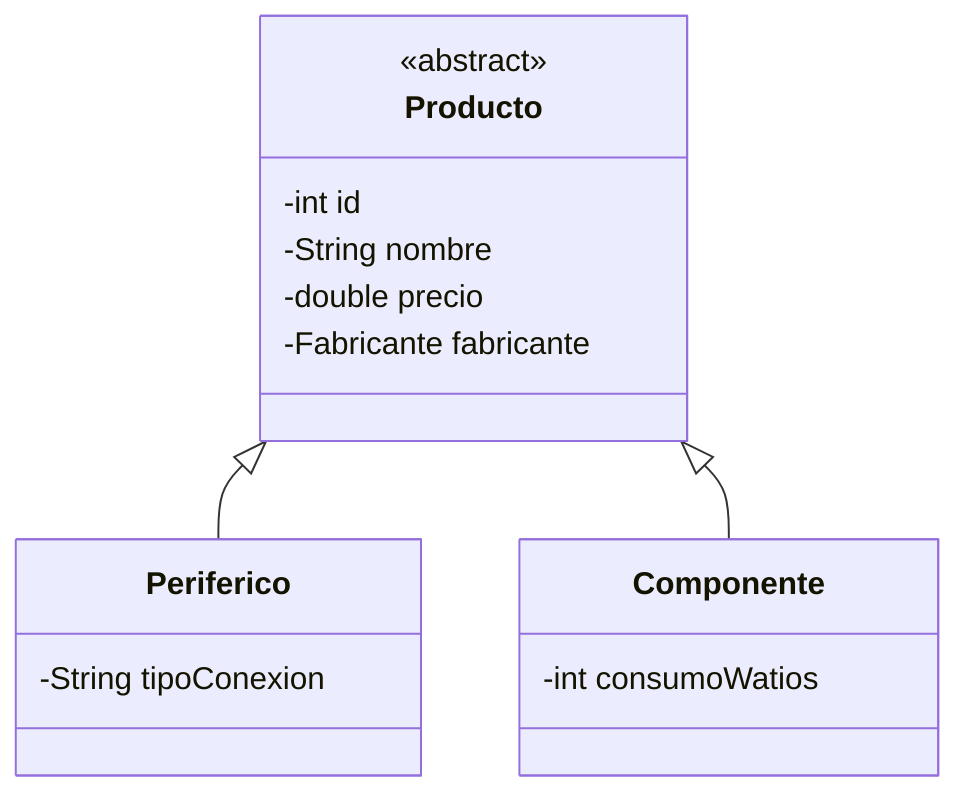

<div class="justify-text">

En la sesión anterior aprendimos a conectar Java con MySQL y a modelar relaciones 1:N mediante composición de clases (`Producto` contiene un `Fabricante`). 

En este taller de ampliación abordaremos el otro gran reto del **desfase objeto-relacional**: ¿cómo trasladamos una **jerarquía de herencia** de Java (`extends`, polimorfismo) a una base de datos relacional basada en tablas planas? Para mantener el código JDBC limpio y sencillo, aplicaremos la estrategia estándar de **tabla única (*Single Table*)**.

---

## El dilema: herencia en Java frente a tablas planas en SQL

* **En Java (POO):** La herencia es natural y habitual. Podemos definir una clase abstracta `Producto` y extenderla en subclases concretas con atributos propios (`Periferico` y `Componente`).
* **En SQL:** Los motores relacionales no disponen de un mecanismo nativo de herencia; únicamente entienden tablas bidimensionales de filas y columnas.

En persistencia avanzada existen varias formas de mapear herencia, pero en JDBC manual la más didáctica, limpia y eficiente es la **estrategia de tabla única (*Single Table Inheritance*)**:

* Todos los atributos de la jerarquía (comunes y específicos) se guardan en **una sola tabla** (`producto`).
* Se introduce una columna especial llamada **discriminador** (por ejemplo, `tipo`), cuyo valor indica qué clase concreta representa cada fila.
* Las columnas que no aplican a un tipo determinado simplemente se almacenan con valor `NULL`.



---

## Adaptación del esquema SQL

Aprovechando la base de datos `tienda` que ya tenemos en Docker, modificamos la tabla `producto` añadiendo la columna discriminadora `tipo` y las columnas específicas para cada subclase:

```sql title="actualizacion_tienda.sql"
USE tienda;

-- Añadimos la columna discriminadora y los atributos específicos
ALTER TABLE producto 
ADD COLUMN tipo VARCHAR(20) NOT NULL DEFAULT 'COMPONENTE',
ADD COLUMN tipo_conexion VARCHAR(50) NULL,
ADD COLUMN consumo_w INT NULL;

-- Clasificamos los productos existentes y rellenamos datos de prueba
UPDATE producto SET tipo = 'PERIFERICO', tipo_conexion = 'USB' WHERE id IN (1, 4, 5, 7);
UPDATE producto SET tipo = 'COMPONENTE', consumo_w = 65 WHERE id IN (2, 3, 6);
```

:::tip ¿Por qué columnas nulables?
En la estrategia de tabla única, una fila que guarde un `Periferico` tendrá datos en `tipo_conexion`, pero su columna `consumo_w` valdrá `NULL`. Al revés ocurrirá con un `Componente`.
:::

---

## Jerarquía de clases en Java

### Clase base abstracta: Producto.java

La clase padre agrupa los atributos comunes y se declara como `abstract` para evitar que se puedan instanciar productos genéricos:

```java title="model/Producto.java"
package model;

public abstract class Producto {

    protected int id;
    protected String nombre;
    protected double precio;
    protected Fabricante fabricante;

    public Producto(int id, String nombre, double precio, Fabricante fabricante) {
        this.id = id;
        this.nombre = nombre;
        this.precio = precio;
        this.fabricante = fabricante;
    }

    public int getId() { return id; }
    public void setId(int id) { this.id = id; }

    public String getNombre() { return nombre; }
    public void setNombre(String nombre) { this.nombre = nombre; }

    public double getPrecio() { return precio; }
    public void setPrecio(double precio) { this.precio = precio; }

    public Fabricante getFabricante() { return fabricante; }
    public void setFabricante(Fabricante fabricante) { this.fabricante = fabricante; }
}
```

### Subclases concretas: Periferico.java y Componente.java

```java title="model/Periferico.java"
package model;

public class Periferico extends Producto {

    private String tipoConexion; // Ej: "USB", "Bluetooth", "Inalámbrico"

    public Periferico(int id, String nombre, double precio, Fabricante fabricante, String tipoConexion) {
        super(id, nombre, precio, fabricante);
        this.tipoConexion = tipoConexion;
    }

    public String getTipoConexion() { return tipoConexion; }
    public void setTipoConexion(String tipoConexion) { this.tipoConexion = tipoConexion; }

    @Override
    public String toString() {
        return String.format("[PERIFÉRICO] ID: %-3d | %-25s | %7.2f € | Fab: %-15s | Conexión: %s",
                id, nombre, precio, fabricante.getNombre(), tipoConexion);
    }
}
```

```java title="model/Componente.java"
package model;

public class Componente extends Producto {

    private int consumoWatios; // Ej: 65, 120, 650

    public Componente(int id, String nombre, double precio, Fabricante fabricante, int consumoWatios) {
        super(id, nombre, precio, fabricante);
        this.consumoWatios = consumoWatios;
    }

    public int getConsumoWatios() { return consumoWatios; }
    public void setConsumoWatios(int consumoWatios) { this.consumoWatios = consumoWatios; }

    @Override
    public String toString() {
        return String.format("[COMPONENTE] ID: %-3d | %-25s | %7.2f € | Fab: %-15s | Consumo: %d W",
                id, nombre, precio, fabricante.getNombre(), consumoWatios);
    }
}
```

---

## Mapeo polimórfico en JDBC

La gran ventaja de la estrategia de tabla única es que la consulta SQL sigue siendo directa (no requiere hacer múltiples `JOIN` contra diferentes tablas hijas). 

Al recorrer el `ResultSet`, evaluamos el valor de la columna discriminadora `tipo` mediante un simple `switch` o `if`, instanciando la subclase correspondiente:

```java title="dao/ProductoDAO.java (Nuevo método polimórfico)"
public List<Producto> obtenerCatalogoCompleto() {
    List<Producto> catalogo = new ArrayList<>();
    String sql = """
        SELECT p.id, p.nombre, p.precio, p.tipo, p.tipo_conexion, p.consumo_w,
               p.id_fabricante, f.nombre AS nombre_fab
        FROM producto p
        JOIN fabricante f ON p.id_fabricante = f.id
        ORDER BY p.id
    """;

    try (PreparedStatement stmt = getConexion().prepareStatement(sql);
         ResultSet rs = stmt.executeQuery()) {

        while (rs.next()) {
            Fabricante fab = new Fabricante(
                rs.getInt("id_fabricante"),
                rs.getString("nombre_fab")
            );

            int id = rs.getInt("id");
            String nombre = rs.getString("nombre");
            double precio = rs.getDouble("precio");
            String tipo = rs.getString("tipo");

            // Instanciación polimórfica según la columna discriminadora
            Producto producto;
            if ("PERIFERICO".equalsIgnoreCase(tipo)) {
                String conexion = rs.getString("tipo_conexion");
                producto = new Periferico(id, nombre, precio, fab, conexion);
            } else {
                int consumo = rs.getInt("consumo_w");
                producto = new Componente(id, nombre, precio, fab, consumo);
            }

            catalogo.add(producto);
        }
    } catch (SQLException e) {
        System.err.println("Error al cargar el catálogo polimórfico: " + e.getMessage());
    }
    return catalogo;
}
```

---

## Ventajas didácticas de este enfoque

1. **Comprensible y sin sobrecarga:** Los alumnos entienden cómo resolver la herencia sin tener que diseñar esquemas relacionales complejos con 3 tablas vinculadas.
2. **Polimorfismo en acción:** Comprueban cómo una lista genérica `List<Producto>` alberga objetos `Periferico` y `Componente` procedentes de una misma tabla en MySQL, comportándose cada uno según su propia implementación de `toString()`.
3. **Puente directo hacia JPA / Hibernate:** En la siguiente unidad didáctica, cuando estudien las anotaciones `@Inheritance(strategy = InheritanceType.SINGLE_TABLE)` y `@DiscriminatorColumn`, entenderán inmediatamente la lógica interna que aplica el framework.

</div>
