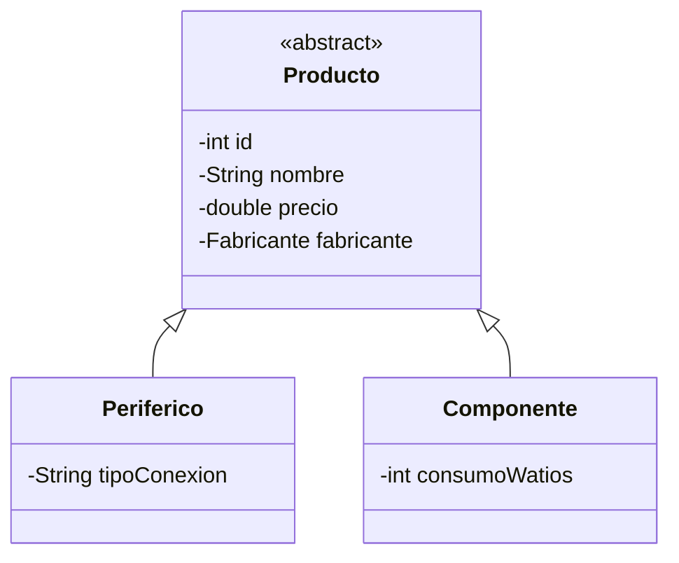

<div class="justify-text">

En la sesión anterior aprendimos a conectar Java con MySQL y a modelar relaciones 1:N mediante composición de clases (`Producto` contiene un `Fabricante`).

En esta sesión abordaremos el **desfase objeto-relacional** desde el punto de vista de la herencia: en muchos proyectos reales la base de datos ya existe y nos viene dada con una única tabla que agrupa varios tipos de entidades. Nuestro objetivo como programadores será **mapear esa tabla plana de SQL a una jerarquía de clases limpia en Java** usando herencia y polimorfismo.

---

## El dilema: tablas planas en SQL frente a herencia en Java

En SQL los motores relacionales no disponen de un mecanismo nativo de herencia; únicamente entienden tablas bidimensionales de filas y columnas. Por eso, es muy habitual encontrarnos con bases de datos que utilizan la estrategia de **tabla única (*Single Table*)**, donde distintos tipos de objetos conviven en la misma tabla.

Supongamos que nos entregan la base de datos de la tienda con una tabla `producto` que almacena tanto **periféricos** como **componentes** con la siguiente estructura:

| id | nombre | precio | id_fabricante | tipo | tipo_conexion | consumo_w |
| :---: | :--- | :---: | :---: | :---: | :---: | :---: |
| 10 | Impresora HP Deskjet 3720 | 59.99 | 3 | `PERIFERICO` | `USB` | *NULL* |
| 2 | Memoria RAM DDR4 8GB | 120.00 | 6 | `COMPONENTE` | *NULL* | `65` |

Si analizamos la tabla que nos han dado, observamos tres detalles clave:
* **Columnas comunes:** Todos los registros comparten `id`, `nombre`, `precio` e `id_fabricante`.
* **Columna discriminadora (`tipo`):** Indica qué subtipo concreto representa cada fila (`PERIFERICO` o `COMPONENTE`).
* **Columnas específicas nulables:** Los campos exclusivos de una categoría (`tipo_conexion` o `consumo_w`) quedan a `NULL` en las filas de la otra categoría.

**¿Cómo mapeamos esto a Java?**  
En lugar de crear una única clase `Producto` llena de atributos que a veces valdrán `null`, en Programación Orientada a Objetos lo modelamos mediante una **jerarquía de herencia**: una clase base abstracta `Producto` con los datos comunes y dos subclases concretas (`Periferico` y `Componente`) con sus atributos propios.



:::warning ¿Cuándo declarar la clase padre como abstracta?
En este caso declaramos `Producto` como `abstract` porque todos los registros de nuestra base de datos son obligatoriamente **periféricos** o **componentes**. Si en tu aplicación pudieran existir productos genéricos (que no pertenezcan a ninguna subclase), **`Producto` no debería ser una clase abstracta** para poder instanciarla directamente.
:::

---

## Script de la base de datos

Para trabajar con esta estructura en tu contenedor Docker de MySQL, descarga y ejecuta el script completo con la base de datos `tienda` ya preparada con la columna discriminadora `tipo` y los atributos específicos:

:::info Descarga del script de base de datos
Descarga el archivo completo de creación y carga de datos de la base de datos `tienda` con herencia:
* 📥 **<a href="/DevTacora/recursos/ada_ut3/tienda_herencia.sql" download="tienda_herencia.sql">Descargar tienda_herencia.sql</a>**

Ejecuta el contenido del script en la consola interactiva de Docker.
:::

:::tip ¿Por qué columnas nulables?
En la estrategia de tabla única, una fila que guarde un `Periferico` tendrá datos en `tipo_conexion`, pero su columna `consumo_w` valdrá `NULL`. Al revés ocurrirá con un `Componente`.
:::

---

## Jerarquía de clases en Java

Partiendo del proyecto de la sesión anterior, las clases `ConexionBD.java`, `Fabricante.java` y `FabricanteDAO.java` **no sufren ningún cambio**. A continuación se muestran únicamente las clases nuevas o modificadas para soportar la herencia.

### Enumerado: TipoProducto.java

Definimos un `enum` que refleja los valores posibles de la columna discriminadora `tipo` en MySQL, evitando errores tipográficos al comparar o insertar cadenas de texto:

```java title="model/TipoProducto.java"
package model;

public enum TipoProducto {
    COMPONENTE, PERIFERICO
}
```

### Clase base abstracta: Producto.java

La clase padre agrupa los atributos comunes (con visibilidad `protected` para que las subclases accedan directamente) y se declara como `abstract`:

```java title="model/Producto.java"
package model;

public abstract class Producto {

    protected int id;
    protected String nombre;
    protected double precio;
    protected Fabricante fabricante;

    public Producto(String nombre, double precio, Fabricante fabricante) {
        this.nombre = nombre;
        this.precio = precio;
        this.fabricante = fabricante;
    }

    public Producto(int id, String nombre, double precio, Fabricante fabricante) {
        this.id = id;
        this.nombre = nombre;
        this.precio = precio;
        this.fabricante = fabricante;
    }

    public int getId() {
        return id;
    }

    public void setId(int id) {
        this.id = id;
    }

    public String getNombre() {
        return nombre;
    }

    public void setNombre(String nombre) {
        this.nombre = nombre;
    }

    public double getPrecio() {
        return precio;
    }

    public void setPrecio(double precio) {
        this.precio = precio;
    }

    public Fabricante getFabricante() {
        return fabricante;
    }

    public void setFabricante(Fabricante fabricante) {
        this.fabricante = fabricante;
    }
}
```

### Subclases concretas: Periferico.java y Componente.java

```java title="model/Periferico.java"
package model;

public class Periferico extends Producto {

    private String tipoConexion;

    public Periferico(String nombre, double precio, Fabricante fabricante, String tipoConexion) {
        super(nombre, precio, fabricante);
        this.tipoConexion = tipoConexion;
    }

    public Periferico(int id, String nombre, double precio, Fabricante fabricante, String tipoConexion) {
        super(id, nombre, precio, fabricante);
        this.tipoConexion = tipoConexion;
    }

    public String getTipoConexion() { return tipoConexion; }
    public void setTipoConexion(String tipoConexion) { this.tipoConexion = tipoConexion; }

    @Override
    public String toString() {
        return String.format("[PERIFÉRICO] ID: %-3d | %-25s | %7.2f € | Fab: %-15s | Conexión: %s\n",
                id, nombre, precio, fabricante.getNombre(), tipoConexion);
    }

}
```

```java title="model/Componente.java"
package model;

public class Componente extends Producto {

    private int consumoWatios;

    public Componente(int id, String nombre, double precio, Fabricante fabricante, int consumoWatios) {
        super(id, nombre, precio, fabricante);
        this.consumoWatios = consumoWatios;
    }

    public int getConsumoWatios() { return consumoWatios; }
    public void setConsumoWatios(int consumoWatios) { this.consumoWatios = consumoWatios; }

    @Override
    public String toString() {
        return String.format("[COMPONENTE] ID: %-3d | %-25s | %7.2f € | Fab: %-15s | Consumo: %d W\n",
                id, nombre, precio, fabricante.getNombre(), consumoWatios);
    }

}
```

---

## Mapeo polimórfico en JDBC: ProductoDAO.java

La gran ventaja de la estrategia de tabla única es que las consultas SQL siguen siendo directas (sin `JOIN` extra a tablas hijas):
* **Al leer (`obtenerProductos`):** Leemos la columna discriminadora `tipo`, la convertimos a nuestro enum `TipoProducto` e instanciamos `Periferico` o `Componente` según corresponda.
* **Al insertar (`insertarProducto`):** Recibimos un parámetro genérico de tipo `Producto`, comprobamos su clase real con `instanceof`, rellenamos su columna específica y asignamos `NULL` (`stmt.setNull(...)`) a la columna que no corresponde.

:::info Solo se muestran los métodos que cambian
En `ProductoDAO` se muestran únicamente los métodos afectados por la herencia (`obtenerProductos` e `insertarProducto`). El resto de operaciones que trabajan con la clave primaria o campos comunes (como `eliminarProducto` o `modificarProducto` para actualizar el precio) **no se ven afectadas por la herencia** y se mantienen exactamente igual que en el tutorial anterior.
:::

```java title="dao/ProductoDAO.java"
package dao;

import bbdd.ConexionBD;
import model.*;

import java.sql.*;
import java.util.ArrayList;
import java.util.List;

public class ProductoDAO {

    // OJO: devolvemos una lista de la clase padre Producto para que pueda contener objetos de los dos tipos
    public List<Producto> obtenerProductos() {
        List<Producto> productos = new ArrayList<>();

        String consulta = """
            SELECT p.id, p.nombre, p.precio, p.tipo, p.tipo_conexion, p.consumo_w, f.id, f.nombre
            FROM producto p JOIN fabricante f ON p.id_fabricante = f.id
            """;

        // Recuperamos la conexión a BBDD
        Connection conexionDB = ConexionBD.getInstancia().getConexion();

        try (PreparedStatement stmt = conexionDB.prepareStatement(consulta)) {

            // Ejecutamos query
            ResultSet rs = stmt.executeQuery();
            while (rs.next()) {
                int idFabricante = rs.getInt("f.id");
                String nombreFabricante = rs.getString("f.nombre");
                Fabricante fab = new Fabricante(idFabricante, nombreFabricante);

                // Recuperamos los datos de producto
                int id = rs.getInt("id");
                String nombre = rs.getString("nombre");
                double precio = rs.getDouble("precio");
                // Convertimos el tipo de string al enum
                TipoProducto tipo = TipoProducto.valueOf(rs.getString("tipo"));

                // Según el tipo creamos un objeto u otro
                Producto prod;
                if (tipo == TipoProducto.PERIFERICO) {
                    String conexion = rs.getString("tipo_conexion");
                    prod = new Periferico(id, nombre, precio, fab, conexion);
                } else {
                    int consumo = rs.getInt("consumo_w");
                    prod = new Componente(id, nombre, precio, fab, consumo);
                }

                // Vamos guardando los productos en la lista
                productos.add(prod);
            }
        } catch (SQLException e) {
            System.err.println("Error al obtener productos: " + e.getMessage());
        }
        return productos;
    }

    // Como param recibimos la clase padre, puede ser cualquiera de los dos hijos, tendremos que comprobarlo
    public boolean insertarProducto(Producto producto) {
        boolean insertado = false;

        String consulta = """
                INSERT INTO producto (nombre, precio, tipo, tipo_conexion, consumo_w, id_fabricante)
                VALUES (?, ?, ?, ?, ?, ?)
            """;

        // Recuperamos la conexión a BBDD
        Connection conexionDB = ConexionBD.getInstancia().getConexion();

        // El segundo parámetro solo es necesario si queremos recuperar el id generado
        try (PreparedStatement stmt = conexionDB.prepareStatement(consulta, Statement.RETURN_GENERATED_KEYS)) {
            // Establecemos los parámetros fijos
            stmt.setString(1, producto.getNombre());
            stmt.setDouble(2, producto.getPrecio());
            stmt.setInt(6, producto.getFabricante().getId());

            // Comprobamos clase
            if (producto instanceof Periferico) {
                // Hacemos casting para poder acceder a atributos de la clase Periferico
                Periferico periferico = (Periferico) producto;
                stmt.setString(3, String.valueOf(TipoProducto.PERIFERICO));
                stmt.setString(4, periferico.getTipoConexion());
                stmt.setNull(5, Types.DOUBLE);
            } else { // Cuidado si teneis más tipos, podéis hacer un switch
                Componente componente = (Componente) producto;
                stmt.setString(3, String.valueOf(TipoProducto.COMPONENTE));
                stmt.setNull(4, Types.VARCHAR);
                stmt.setDouble(5, componente.getConsumoWatios());
            }

            // Ejecutamos actualización
            int filasAfectadas = stmt.executeUpdate();

            if (filasAfectadas > 0) {
                insertado = true;

                // OJO: este bloque solo es necesario si tenéis que recuperar el id generado
                try (ResultSet generatedKeys = stmt.getGeneratedKeys()) {
                    if (generatedKeys.next()) {
                        int idGenerado = generatedKeys.getInt(1);
                        System.out.println(">> Producto dado de alta con éxito. ID asignado: " + idGenerado);
                    }
                }
            }
        } catch (SQLException e) {
            System.err.println("Error al insertar producto: " + e.getMessage());
        }

        return insertado;
    }

}
```

---

## Programa principal: Main.java

Desde `Main` comprobamos cómo una misma lista `List<Producto>` almacena e imprime tanto periféricos como componentes, y cómo `insertarProducto` acepta una instancia de `Periferico` de forma polimórfica:

```java title="Main.java"
import dao.FabricanteDAO;
import dao.ProductoDAO;
import model.Fabricante;
import model.Periferico;
import model.Producto;

void main() {
    ProductoDAO productoDAO = new ProductoDAO();
    FabricanteDAO fabricanteDAO = new FabricanteDAO();

    System.out.println("==== PRODUCTOS ====");
    List<Producto> productos = productoDAO.obtenerProductos();
    System.out.println(productos);

    System.out.println("\n==== INSERTAR PRODUCTO ====");
    // Recuperamos un fabricante que exista
    Fabricante fab = fabricanteDAO.obtenerFabricante(1);
    if (fab != null) {
        // El id del producto será autogenerado
        Producto nuevo = new Periferico("Teclado", 100.99, fab, "USB");
        boolean insertado = productoDAO.insertarProducto(nuevo);

        if (insertado) System.out.println("Se insertó un nuevo elemento");
        else System.out.println("No se ha podido insertar el producto");
    }

    System.out.println("==== CONSULTAMOS PARA VER CAMBIOS ====");
    productos = productoDAO.obtenerProductos();
    System.out.println(productos);
}
```

</div>
