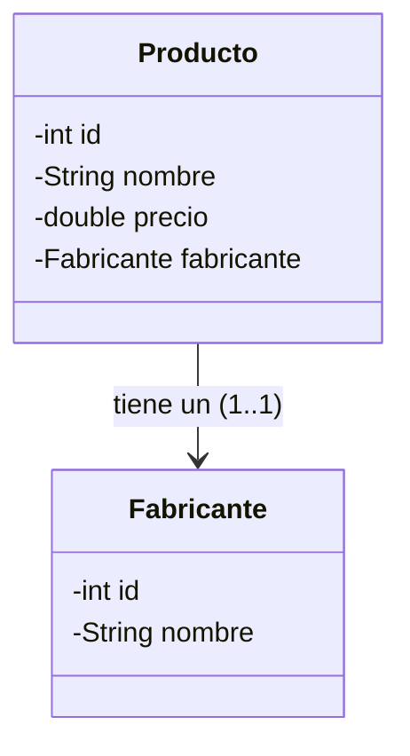

<div class="justify-text">

# 5. Relaciones entre Tablas, JOINs y Composición en Java

> **Resumen de la sesión / Objetivos docentes:**
> Este documento abre el **Día 2**. Se aborda el **desfase objeto-relacional** sin teoría abstracta: se evoluciona la clase `Producto` para que contenga un objeto `Fabricante` (composición en POO), se realizan consultas con `INNER JOIN` y se muestra cómo mapear filas planas a objetos enlazados. Por último, se introduce el control transaccional (`commit`/`rollback`).

---

## 1. El Desfase Objeto-Relacional en Relaciones 1:N

En el Día 1 guardamos los datos del fabricante dentro de `Producto` mediante tipos primitivos (`idFabricante`, `nombreFabricante`). Aunque funcional para empezar, choca contra las buenas prácticas de la Programación Orientada a Objetos:

* **En la Base de Datos Relacional:** Dos tablas (`fabricante` y `producto`) vinculadas mediante una Foreign Key (`id_fabricante`).
* **En Java (POO):** Los objetos no almacenan claves ajenas como números sueltos; **los objetos se componen** unos dentro de otros.



---

## 2. Refactorización del Modelo

Creamos la clase propia `Fabricante`:

```java
public class Fabricante {
    private int id;
    private String nombre;

    public Fabricante(int id, String nombre) {
        this.id = id;
        this.nombre = nombre;
    }
    // Getters, setters y toString()
}
```

Y actualizamos `Producto` sustituyendo los atributos primitivos por la composición:

```java
public class Producto {
    private int id;
    private String nombre;
    private double precio;
    private Fabricante fabricante; // Composición directa

    public Producto(int id, String nombre, double precio, Fabricante fabricante) {
        this.id = id;
        this.nombre = nombre;
        this.precio = precio;
        this.fabricante = fabricante;
    }
}
```

---

## 3. Consultas con `INNER JOIN` y Mapeo en JDBC

Para reconstruir el objeto completo en Java en una **única consulta eficiente** (evitando hacer dos peticiones a la base de datos):

```java
String sql = """
    SELECT p.id AS p_id, p.nombre AS p_nombre, p.precio AS p_precio,
           f.id AS f_id, f.nombre AS f_nombre
    FROM producto p
    INNER JOIN fabricante f ON p.id_fabricante = f.id
""";

List<Producto> lista = new ArrayList<>();

try (PreparedStatement stmt = conn.prepareStatement(sql);
     ResultSet rs = stmt.executeQuery()) {
    
    while (rs.next()) {
        // 1. Reconstruir el objeto asociado
        Fabricante fab = new Fabricante(
            rs.getInt("f_id"),
            rs.getString("f_nombre")
        );

        // 2. Reconstruir el objeto principal enlazando el fabricante
        Producto prod = new Producto(
            rs.getInt("p_id"),
            rs.getString("p_nombre"),
            rs.getDouble("p_precio"),
            fab
        );

        lista.add(prod);
    }
}
```

---

## 4. Transacciones Atómicas (`commit` y `rollback`)

En escenarios reales donde se tocan dos tablas a la vez (por ejemplo: dar de alta un nuevo fabricante y acto seguido insertar su primer producto), no podemos permitir que se inserte el fabricante si luego falla la inserción del producto.

Por defecto, JDBC opera en modo **`autoCommit = true`** (cada `executeUpdate` se guarda inmediatamente en disco). Para agruparlas en una transacción atómica (ACID):

```java
try {
    // 1. Desactivar el auto-guardado
    conn.setAutoCommit(false);

    // 2. Operación A: Insertar fabricante y obtener su ID
    // 3. Operación B: Insertar producto usando el ID del fabricante

    // 4. Si todo ha ido bien, consolidamos los cambios
    conn.commit();
    System.out.println(">> Transacción completada con éxito.");

} catch (SQLException e) {
    // 5. Ante cualquier error, revertimos todo al estado inicial
    try {
        conn.rollback();
        System.err.println(">> Error detectado. Se ha realizado ROLLBACK.");
    } catch (SQLException rollbackEx) {
        rollbackEx.printStackTrace();
    }
} finally {
    // 6. Restaurar el comportamiento por defecto
    try {
        conn.setAutoCommit(true);
    } catch (SQLException e) {
        e.printStackTrace();
    }
}
```

</div>
