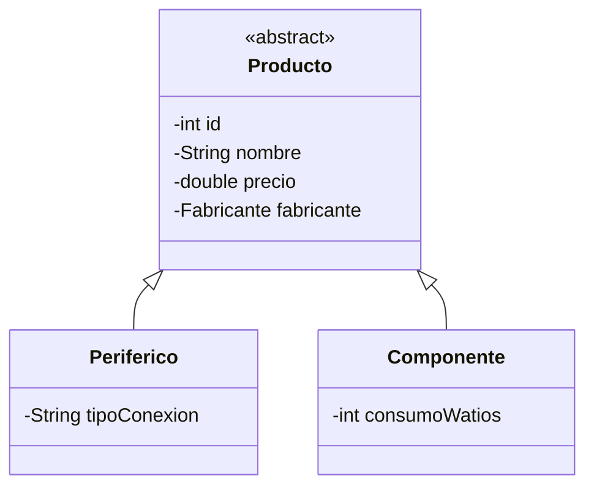

<div class="justify-text">

# 6. Herencia en BBDD Relacionales: Estrategia de Tabla Única

> **Resumen de la sesión / Objetivos docentes:**
> Este documento cierra el **Día 2**. Se explica cómo representar jerarquías de clases de Java (`extends`, polimorfismo) en un motor relacional como MySQL. Para mantener la explicación sencilla y sin caer en complejidades excesivas con JDBC manual, se aplica la estrategia estándar de **Tabla Única (*Single Table*) con columna discriminadora**.

---

## 1. El Dilema: Herencia en Java vs. Tablas Planas en SQL

* **En Java (POO):** La herencia es natural. Tenemos una clase base abstracta `Producto` y subclases que heredan y extienden su comportamiento (`Periferico`, `Componente`).
* **En SQL:** Las tablas relacionales son estructuras estrictamente bidimensionales (filas y columnas); **no existe el concepto de herencia nativa**.

Existen varias formas de mapearlo, pero en JDBC artesanal la más didáctica, limpia y eficiente es la **Estrategia de Tabla Única (*Single Table Inheritance*)**:

* Todos los atributos de la jerarquía se guardan en **una sola tabla**.
* Se añade una columna especial llamada **discriminador** (por ejemplo, `tipo`), que indica qué clase específica representa cada fila.
* Las columnas exclusivas de una subclase se declaran como `NULL` cuando la fila pertenece a otra subclase.



---

## 2. Adaptación del Esquema SQL

Añadimos la columna discriminadora `tipo` y los campos específicos a la tabla `producto`:

```sql
ALTER TABLE producto 
ADD COLUMN tipo VARCHAR(20) NOT NULL DEFAULT 'COMPONENTE',
ADD COLUMN tipo_conexion VARCHAR(50) NULL,
ADD COLUMN consumo_w INT NULL;

-- Actualizamos datos de prueba
UPDATE producto SET tipo = 'PERIFERICO', tipo_conexion = 'USB' WHERE id IN (1, 4, 5, 7);
UPDATE producto SET tipo = 'COMPONENTE', consumo_w = 65 WHERE id IN (2, 3, 6);
```

---

## 3. Jerarquía de Clases en Java

### Clase Base Abstracta
```java
public abstract class Producto {
    protected int id;
    protected String nombre;
    protected double precio;
    protected Fabricante fabricante;

    public Producto(int id, String nombre, double precio, Fabricante fabricante) {
        this.id = id;
        this.nombre = nombre;
        this.precio = precio;
        this.fabricante = fabricante;
    }
    // Getters y Setters comunes
}
```

### Subclases Específicas
```java
public class Periferico extends Producto {
    private String tipoConexion; // Ej: "USB", "Bluetooth", "Inalámbrico"

    public Periferico(int id, String nombre, double precio, Fabricante fabricante, String tipoConexion) {
        super(id, nombre, precio, fabricante);
        this.tipoConexion = tipoConexion;
    }
    public String getTipoConexion() { return tipoConexion; }
}

public class Componente extends Producto {
    private int consumoWatios; // Ej: 65W, 650W

    public Componente(int id, String nombre, double precio, Fabricante fabricante, int consumoWatios) {
        super(id, nombre, precio, fabricante);
        this.consumoWatios = consumoWatios;
    }
    public int getConsumoWatios() { return consumoWatios; }
}
```

---

## 4. Mapeo Polimórfico en JDBC

La belleza de este patrón reside en que la consulta SQL sigue siendo sencilla (sin necesidad de múltiples `LEFT JOIN` a tablas hijas). La decisión de qué objeto instanciar se toma evaluando la columna discriminadora `tipo`:

```java
String sql = """
    SELECT p.id, p.nombre, p.precio, p.tipo, p.tipo_conexion, p.consumo_w,
           f.id AS f_id, f.nombre AS f_nombre
    FROM producto p
    INNER JOIN fabricante f ON p.id_fabricante = f.id
""";

List<Producto> catalogo = new ArrayList<>();

try (PreparedStatement stmt = conn.prepareStatement(sql);
     ResultSet rs = stmt.executeQuery()) {

    while (rs.next()) {
        Fabricante fab = new Fabricante(rs.getInt("f_id"), rs.getString("f_nombre"));
        
        int id = rs.getInt("id");
        String nombre = rs.getString("nombre");
        double precio = rs.getDouble("precio");
        String tipo = rs.getString("tipo");

        // Instanciación polimórfica según la columna discriminadora
        Producto p;
        if ("PERIFERICO".equalsIgnoreCase(tipo)) {
            String conexion = rs.getString("tipo_conexion");
            p = new Periferico(id, nombre, precio, fab, conexion);
        } else {
            int consumo = rs.getInt("consumo_w");
            p = new Componente(id, nombre, precio, fab, consumo);
        }

        catalogo.add(p);
    }
}
```

---

## 5. Ventajas Didácticas para el Alumnado

1. **Sin consultas enrevesadas:** Los alumnos aprenden el concepto de almacenar herencia sin perderse en sintaxis SQL compleja.
2. **Polimorfismo real:** Comprueban cómo una lista genérica `List<Producto>` puede almacenar instancias de distintas clases hijas procedentes de la base de datos.
3. **Puente directo hacia Hibernate/JPA:** En la siguiente unidad didáctica, cuando vean `@Inheritance(strategy = InheritanceType.SINGLE_TABLE)` y `@DiscriminatorColumn`, comprenderán de inmediato qué hace el framework por debajo gracias a haberlo implementado manualmente con JDBC.

</div>
