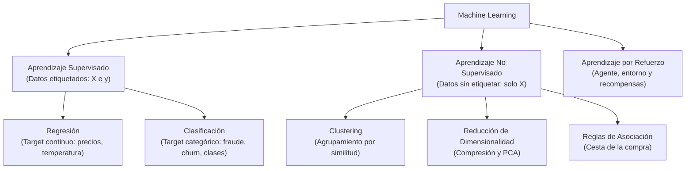
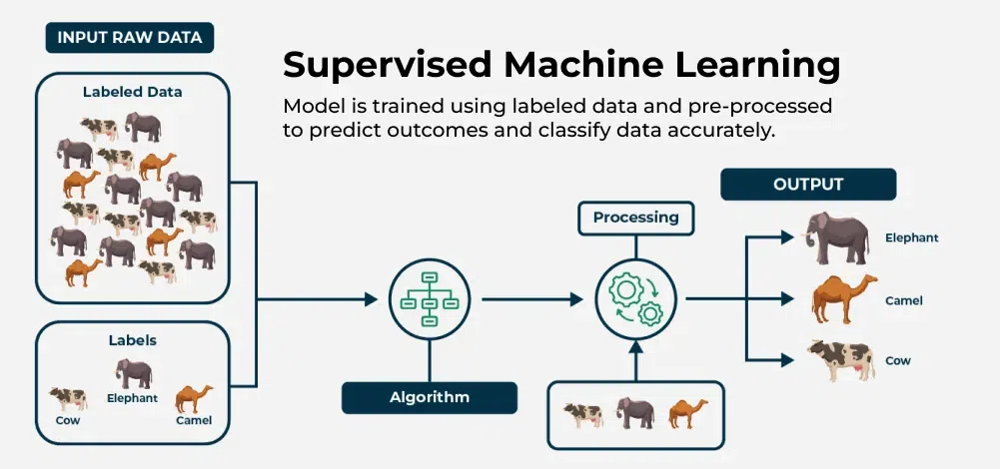
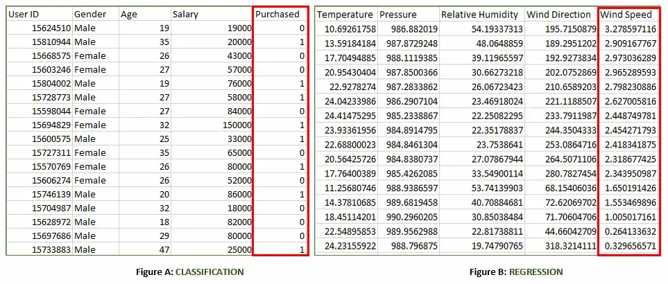
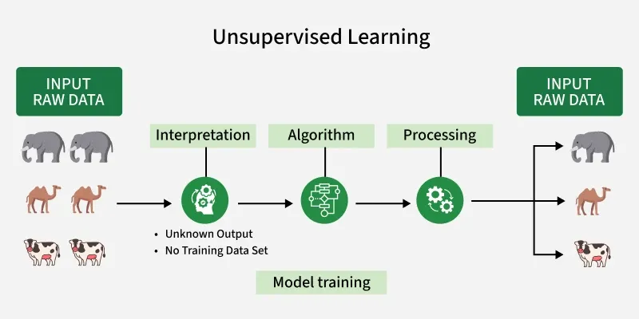
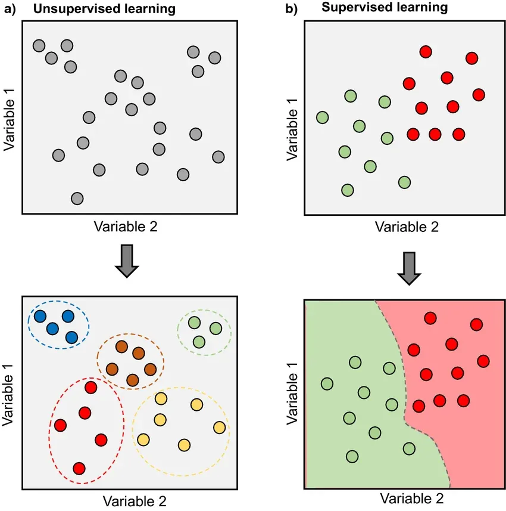
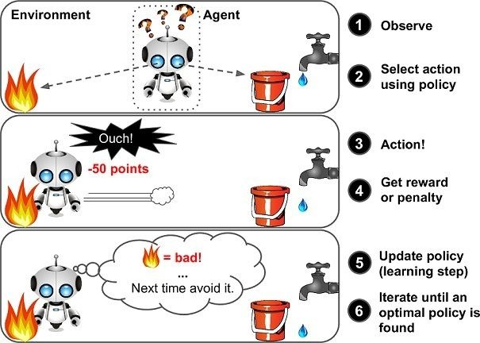
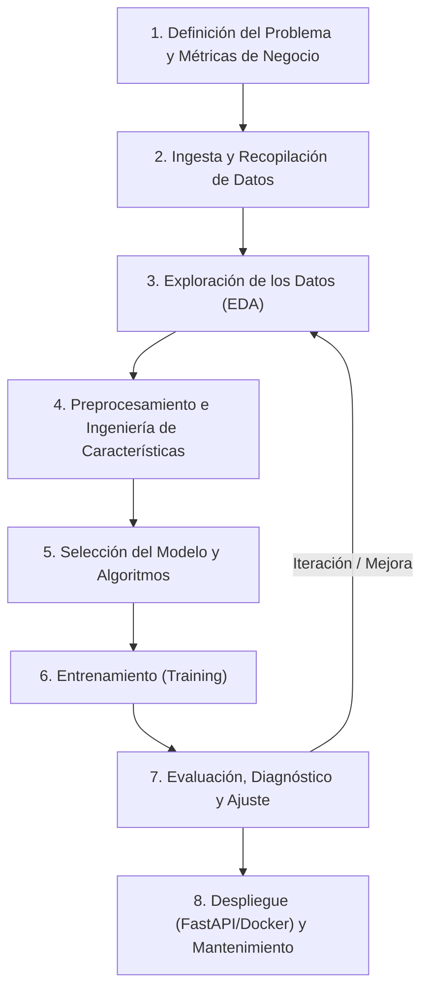

# Ciclo de Vida de ML y Tipos de Aprendizaje

El **aprendizaje automático (Machine Learning, ML)** es una rama nuclear de la **Inteligencia Artificial (IA)** que permite a los sistemas **aprender patrones a partir de datos** para realizar predicciones o tomar decisiones sin necesidad de programar explícitamente cada regla lógica.

En el desarrollo de software tradicional, los programadores escriben reglas fijas mediante condicionales (`if/else`) y bucles que procesan datos de entrada para generar respuestas. En Machine Learning se invierte este paradigma: suministramos al algoritmo datos de entrada junto con sus respuestas históricas, y el sistema **aprende de forma inductiva las reglas matemáticas** que conectan ambas partes, adquiriendo la capacidad de **generalizar ante situaciones nunca vistas**.

---

## Conceptos Fundamentales

Para comunicarnos con rigor en el ámbito del aprendizaje automático, es indispensable dominar su vocabulario técnico esencial:

| Término | Definición Técnica | Ejemplo Práctico |
| :--- | :--- | :--- |
| **Dataset** | Colección estructurada de datos organizada en observaciones y variables que se emplea para entrenar y evaluar algoritmos. | Un archivo CSV con información histórica de clientes bancarios. |
| **Features (Características / Variables)** | Atributos de entrada independientes que describen cada observación individual. Se denotan en conjunto como la matriz $X$. | Edad, ingresos mensuales, antigüedad, número de tarjetas contratadas. |
| **Target (Variable Objetivo / Etiqueta)** | La variable dependiente o resultado que deseamos que el modelo aprenda a predecir. Se denota como el vector $y$. | Si el cliente cancelará su cuenta ($1$) o permanecerá en la entidad ($0$). |
| **Modelo** | Artefacto matemático resultante de aplicar un algoritmo de aprendizaje sobre los datos, capaz de transformar entradas $X$ en estimaciones $\hat{y}$. | Un árbol de decisión, una regresión logística o un ensamble *Random Forest*. |
| **Entrenamiento (*Training / Fit*)** | Fase iterativa en la que el algoritmo analiza los datos conocidos y ajusta sus parámetros internos para minimizar el error predictivo. | El cálculo de los pesos o coeficientes que optimizan la función de pérdida. |
| **Predicción (*Inferencia / Transform*)** | Aplicación del modelo previamente entrenado sobre nuevos datos desconocidos para obtener una estimación o decisión. | Evaluar a un solicitante de préstamo hoy para predecir su probabilidad de impago. |

---

## Tipos de Aprendizaje Automático

El enfoque y la arquitectura de un modelo de Machine Learning dependen directamente del tipo de información disponible en el dataset y del objetivo de negocio que se persiga:

---

## Aprendizaje Supervisado

En el **aprendizaje supervisado**, el dataset de entrenamiento **incluye las respuestas correctas (etiquetas o target $y$)**. El algoritmo tiene acceso tanto a las características descriptivas $X$ como al resultado real de cada ejemplo. Su propósito es inferir una función matemática:

$$y \approx f(X)$$

Capaz de predecir la etiqueta de nuevas observaciones que se presenten en el futuro.

Las tareas supervisadas se dividen principalmente en dos grandes familias según la naturaleza de su variable objetivo:

### Regresión vs. Clasificación

* **Regresión:** La variable objetivo es un **valor numérico continuo** ($y \in \mathbb{R}$). El modelo responde a preguntas del tipo *«¿Cuánto?»*.
  * *Ejemplos:* Estimar el precio de venta de una vivienda, predecir la demanda eléctrica de una región en megavatios o calcular la temperatura máxima de mañana.
* **Clasificación:** La variable objetivo es una **categoría o etiqueta discreta**. El modelo responde a preguntas del tipo *«¿A qué clase pertenece?»*.
  * *Ejemplos:* Determinar si una transacción bancaria es legítima o fraudulenta, clasificar un correo como *spam* o *deseado*, o identificar el tipo de tejido patológico en una imagen médica.

### Ejemplo Práctico de Comparación

Analicemos las dos figuras representadas en la imagen anterior:

#### Figura A: Tarea de Clasificación
Corresponde a los registros de una tienda online utilizados para **predecir si un visitante comprará o no un producto determinado**:
* **Características de Entrada ($X$):** Género, Edad y Salario anual estimado.
* **Variable Objetivo ($y$):** *Purchased* (Variable discreta binaria $\in \{0, 1\}$).
  * **1:** El cliente compra el producto.
  * **0:** El cliente descarta la compra.

#### Figura B: Tarea de Regresión
Representa un dataset de monitorización meteorológica cuyo propósito es **predecir la velocidad del viento**:
* **Características de Entrada ($X$):** Punto de rocío, Temperatura ambiental, Presión barométrica, Humedad relativa y Dirección de la ráfaga.
* **Variable Objetivo ($y$):** *Wind Speed* (Variable cuantitativa continua en km/h o m/s).

---

### Casos Reales de Aprendizaje Supervisado en la Industria

* **Detección de fraude financiero:** Los bancos evalúan cada cargo en tarjeta de crédito en milisegundos para emitir una probabilidad de fraude antes de autorizar el cobro.
* **Predicción de abandono (*Customer Churn*):** Las empresas de telecomunicaciones identifican a los abonados con riesgo inminente de cancelación para ofrecerles ofertas de retención.
* **Medicina predictiva:** Estimación de supervivencia o progresión de patologías neurodegenerativas (Parkinson, Alzheimer) correlacionando historiales analíticos.
* **Mantenimiento predictivo:** Modelos que estiman las horas restantes de vida útil (*Remaining Useful Life*) de turbinas y motores industriales antes de que ocurra una avería.

---

## Aprendizaje No Supervisado

En el **aprendizaje no supervisado**, el dataset **carece de etiquetas o variable objetivo $y$**. El modelo recibe únicamente la matriz de características $X$ y su propósito es **descubrir patrones intrínsecos, agrupaciones naturales, geometrías subyacentes o anomalías ocultas** en los datos.

No existe un «resultado correcto» con el que comparar el error del modelo durante el entrenamiento; el sistema se guía por criterios matemáticos de distancia, densidad o varianza.

Las principales modalidades del aprendizaje no supervisado son:

### Modalidades del Aprendizaje No Supervisado

* **Clustering (Agrupamiento):** Particiona el conjunto de datos en grupos (*clusters*) homogéneos internamente y heterogéneos entre sí.
  * *Ejemplo:* Segmentación de clientes de un supermercado según su cesta de la compra sin definir categorías previas.
* **Reducción de Dimensionalidad:** Transforma datasets con decenas o cientos de columnas en un espacio reducido de variables combinadas preservando la mayor varianza posible.
  * *Ejemplo:* Comprimir 50 variables financieras en 2 o 3 componentes principales para visualización gráfica en 2D o para acelerar modelos pesados.
* **Reglas de Asociación:** Descubre relaciones probabilísticas de coocurrencia entre eventos o productos (*«quienes compran pan y café también compran leche en el 85% de las ocasiones»*).

## Comparativa Visual: Supervisado vs. No Supervisado

La siguiente figura ilustra con claridad la diferencia conceptual y geométrica entre ambos paradigmas:

* **En el Aprendizaje No Supervisado (a):**
  * **Punto de partida:** El algoritmo recibe observaciones representadas en el espacio de características (Variable 1 frente a Variable 2) sin ninguna etiqueta previa (todos los puntos parten en gris). No se conoce de antemano si pertenecen a un grupo u otro.
  * **Resultado:** El modelo calcula distancias matemáticas y densidades relativas para descubrir agrupaciones naturales (*clusters*), delimitando grupos homogéneos de datos que comparten similitudes (círculos discontinuos de colores).
* **En el Aprendizaje Supervisado (b):**
  * **Punto de partida:** Cada observación dispone desde el inicio de una etiqueta conocida (*ground truth*, puntos verdes frente a puntos rojos). El algoritmo sabe a qué clase pertenece cada ejemplo histórico.
  * **Resultado:** El modelo aprende una **frontera de decisión** (*decision boundary*) que particiona de forma óptima el espacio de características, garantizando que cuando llegue una nueva observación en el futuro pueda clasificarse automáticamente según la región en la que aterrice.

---

## Aprendizaje por Refuerzo

En el **aprendizaje por refuerzo (Reinforcement Learning)**, el sistema no aprende a partir de una tabla estática de datos, sino a través de la **interacción activa con un entorno**.

Un **agente** toma decisiones o acciones secuenciales en dicho entorno con el fin de maximizar una **recompensa acumulada (*reward*)** a lo largo del tiempo, recibiendo penalizaciones ante conductas no deseadas mediante un proceso de ensayo y error:

### Cómo Aprende el Agente por Refuerzo

Como se muestra en la ilustración anterior, el aprendizaje por refuerzo es un bucle continuo de seis pasos:

1. **Observar (*Observe*):** El agente inspecciona el estado actual del entorno a través de sus sensores o variables de entrada.
2. **Seleccionar acción (*Select action using policy*):** Consulta su estrategia o política interna (*policy*) para decidir qué acción emprender ante la situación observada (por ejemplo, avanzar hacia el fuego o hacia el agua).
3. **Ejecutar la acción (*Action!*):** El agente realiza la acción física o lógica elegida en el entorno.
4. **Recibir recompensa o castigo (*Get reward or penalty*):** El entorno reacciona devolviendo un valor numérico: una recompensa positiva si la acción fue favorable o una penalización negativa si fue perjudicial (por ejemplo, $-50$ puntos por quemarse con el fuego).
5. **Actualizar la política (*Update policy / learning step*):** El agente actualiza su mapa de decisiones asociando la acción tomada con su consecuencia (*«fuego = perjudicial, evitar en la próxima ocasión»*).
6. **Iterar hasta la política óptima:** El proceso se repite miles o millones de veces hasta que el agente descubre la estrategia óptima para resolver el problema maximizando la puntuación acumulada.

* **Ámbitos de aplicación:** Conducción autónoma de vehículos, robots que aprenden a caminar o manipular objetos en almacenes, sistemas de control de climatización en centros de datos, y sistemas capaces de vencer a campeones mundiales en juegos complejos como ajedrez o Go (*AlphaGo*).

---

## El Ciclo de Vida de un Proyecto de Machine Learning

Comprendidas las distintas modalidades de aprendizaje, resulta evidente que construir una solución de Machine Learning es un proceso metodológico estructurado que trasciende la simple elección de un algoritmo.

Un proyecto profesional sigue un flujo iterativo compuesto por **ocho fases concatenadas**:

### Definición del Problema y Métricas
Antes de programar, es imperativo fijar el objetivo: ¿Qué decisión se quiere automatizar? ¿Cómo mediremos el éxito? Las métricas técnicas de los algoritmos (exactitud, error cuadrático) deben alinearse siempre con los indicadores clave de rendimiento (**KPIs**) del negocio (ahorro de costes, retención de clientes).

### Carga y Recopilación de Datos
Identificación y extracción de fuentes: bases de datos relacionales, data lakes, APIs web, logs de servidores o archivos tabulares. Un modelo solo aprenderá aquello que esté presente en la variedad de sus datos de origen.

### Exploración de los Datos (EDA)
Es la fase central donde el analista audita los datos: revisa distribuciones, detecta nulos encubiertos, identifica valores atípicos y formula hipótesis basadas en evidencia visual y estadística. Como veremos en las próximas sesiones, **el EDA dicta la lista de tareas del preprocesamiento**.

### Preprocesamiento e Ingeniería de Características
Transformación matemática de los datos para que resulten digeribles por los algoritmos: imputación de ausentes, codificación de variables categóricas, escalado numérico y creación de nuevas variables derivadas con sentido de negocio. Es aquí donde se implementa el blindaje contra la fuga de información (*Data Leakage*).

### Selección del Modelo
Elección de los algoritmos candidatos que mejor se adapten a la naturaleza del problema (lineales, árboles, ensambles) y a los requisitos de explicabilidad o latencia requeridos en producción.

### Entrenamiento del Modelo
Ajuste de los parámetros del modelo sobre los datos de entrenamiento. En esta etapa se monitoriza la convergencia del algoritmo y se previenen problemas de sobreajuste (*overfitting*) o subajuste (*underfitting*).

### Evaluación y Ajuste
Medición objetiva del rendimiento del modelo sobre datos de evaluación que no intervinieron en el entrenamiento. Se analizan matrices de confusión, curvas ROC o gráficos de residuos para detectar debilidades antes de autorizar el pase a producción.

### Despliegue y Mantenimiento
El modelo entrenado y su pipeline de preprocesamiento se empaquetan y despliegan en servicios accesibles para el resto de la organización:
* En la **UT2** aprendimos a crear endpoints REST con **FastAPI**.
* En esta **UT3** empaquetaremos el preprocesamiento en objetos reproducibles con `scikit-learn` y `joblib`.
* En la **UT4** conectaremos el modelo final para que pueda recibir peticiones HTTP, responder predicciones en tiempo real y ser monitorizado frente a posibles desviaciones temporales en los datos (*Data Drift*).

