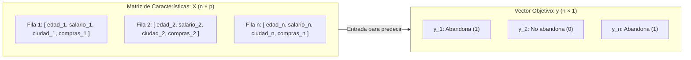
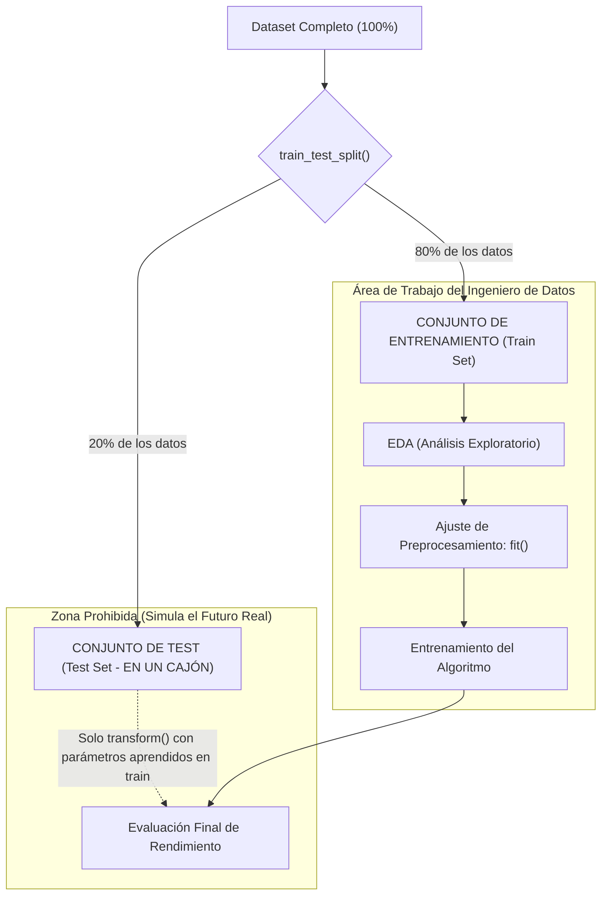

<div class="justify-text">

# Anatomía de los Datos y Partición Train-Test

Una vez comprendido el ciclo de vida de un proyecto de Machine Learning y los tipos de problemas que podemos resolver, llega el momento de sentarnos frente al ordenador con un dataset real.

Antes de construir cualquier gráfico o aplicar transformaciones matemáticas, es indispensable comprender la **estructura matricial de los datos** y aplicar la **primera regla metodológica innegociable de la ciencia de datos: la división entre entrenamiento y test**.

---

## Anatomía de una Matriz de Datos

Cuando cargamos un archivo de datos (por ejemplo, un archivo CSV o Parquet en un DataFrame de Pandas), estamos manejando una estructura bidimensional que en Machine Learning formalizamos matemáticamente como una **matriz de características** y un **vector objetivo**.



### La Unidad de Análisis (Observación o Fila)
Cada fila de nuestro dataset representa una **observación individual** (también llamada *instancia*, *muestra* o *registro*). 

Antes de escribir una sola línea de código, es obligatorio responder con claridad a la siguiente pregunta:  
**«¿Qué representa exactamente una fila en este dataset?»**
* ¿Es un cliente único registrado en una plataforma?
* ¿Es una transacción bancaria puntual realizada en un segundo determinado?
* ¿Es la medición horaria promedio de un sensor meteorológico?

Si no tenemos meridianamente clara la unidad de análisis, corremos el riesgo de mezclar niveles de agregación y extraer conclusiones estadísticas completamente equivocadas.

---

### Matriz de Características ($X$)
Representa el conjunto de variables de entrada o **predictoras** (*features*, atributos o covariables). Se denota habitualmente con la letra mayúscula $X$ porque matemáticamente es una **matriz bidimensional** de dimensiones $n \times p$:
* $n$: número de observaciones (filas).
* $p$: número de características (columnas).

Las características pueden pertenecer a diferentes naturalezas estadísticas:

| Tipo de Variable | Subtipo | Ejemplos |
| :--- | :--- | :--- |
| **Numérica (Cuantitativa)** | Continua | Salario, Temperatura, Distancia en kilómetros |
| | Discreta | Número de hijos, Visitas web, Años de antigüedad |
| **Categórica (Cualitativa)** | Nominal (Sin orden) | Ciudad, Método de pago, Tipo de navegador |
| | Ordinal (Con orden) | Nivel educativo, Talla de ropa, Nivel de riesgo |
| **Temporal** | Fecha / Timestamp | `2026-10-06 11:20:00` |
| **Identificadores y datos personales** | ID, DNI, Nombre completo | `CLI_89321`, `Carlos Ruiz` |

:::danger ¡Cuidado con identificadores y datos personales!
Columnas como el `id_usuario`, el `nombre_cliente` o el `numero_dni` son referencias individuales o claves primarias. **Carecen por completo de capacidad predictiva generalizable**. Si dejamos estas columnas dentro de $X$, el algoritmo intentará memorizar los nombres o números asociados a cada caso concreto en lugar de aprender patrones reales de comportamiento, provocando sobreajuste (*overfitting*).
:::

---

### El Vector Objetivo ($y$)
Representa la variable de salida, etiqueta o valor que nuestro sistema debe aprender a inferir (*target* o *ground truth*). Se denota con la letra minúscula $y$ porque matemáticamente es un **vector unidimensional** de longitud $n$.

El tipo de datos contenido en $y$ define la tipología de problema supervisado que estamos resolviendo:

* **Regresión ($y$ numérico continuo):** Predecir una cantidad escalar en la recta real ($y \in \mathbb{R}$). Ejemplos: tasación de inmuebles, consumo de combustible, horas de estudio necesarias.
* **Clasificación ($y$ discreto o categórico):** Predecir una clase o pertenencia:
  * **Binaria:** Solo existen dos estados posibles ($y \in \{0, 1\}$). Ejemplos: detección de spam, diagnóstico positivo/negativo, impago de préstamos.
  * **Multiclase:** Existen tres o más categorías mutuamente excluyentes ($y \in \{0, 1, \dots, C-1\}$). Ejemplos: clasificación de especies biológicas, asignación de departamento a un ticket de soporte.

---

### Ejemplo: Dataset Real

Para asentar los tres conceptos de forma conjunta, imaginemos una tabla extraída de una empresa de servicios de telecomunicaciones (`clientes_fibra.csv`):

| `id_cliente` | `nombre` | `edad` | `antiguedad_meses` | `tipo_contrato` | `nivel_satisfaccion` | `consumo_gb` | `abandono` |
| :---: | :---: | :---: | :---: | :---: | :---: | :---: | :---: |
| `CLI-001` | Carlos Ruiz | 42 | 24 | Mensual | Alto | 145.2 | **1** |
| `CLI-002` | Laura Gómez | 28 | 6 | Anual | Medio | 310.8 | **0** |
| `CLI-003` | Antonio Vega | 61 | 48 | Anual | Muy Alto | 82.0 | **0** |
| `CLI-004` | Marta Sanz | 35 | 12 | Mensual | Bajo | 220.5 | **1** |
| `CLI-005` | David Ramos | 50 | 3 | Mensual | Medio | 190.0 | **0** |

Al analizar esta estructura identificamos cada componente del problema:

* **Unidad de análisis (Fila):** Cada fila representa a un **cliente único con contrato activo** en el momento de la auditoría. Hay $n = 5$ observaciones en esta muestra.
* **Campos no predictivos a descartar:** Columnas como `id_cliente` (clave interna de base de datos) o `nombre` (dato personal nominativo). Ambas se descartan antes del modelado porque hacen referencia a individuos concretos y no contienen patrones extrapolables al resto de la población.
* **Matriz de características ($X$):** Las 5 columnas predictoras que describen el perfil y comportamiento del cliente:
  * `edad` (Numérica discreta).
  * `antiguedad_meses` (Numérica discreta).
  * `tipo_contrato` (Categórica nominal: *Mensual*, *Anual*).
  * `nivel_satisfaccion` (Categórica ordinal: *Bajo* < *Medio* < *Alto* < *Muy Alto*).
  * `consumo_gb` (Numérica continua).  
  * *Dimensión resultante de $X$:* Matriz de $5 \times 5$.
* **Vector objetivo ($y$):** La columna `abandono`, que toma valores binarios ($1$ = causó baja en el servicio, $0$ = permaneció en la compañía).
  * *Naturaleza del problema:* **Clasificación supervisada binaria**.
  * Si en su lugar quisiéramos predecir la columna `facturacion_mensual_euros` (ej. 35.50€, 62.00€), estaríamos ante un problema supervisado de **Regresión**.

---

## La Regla de Oro: Partición Train / Test antes de tocar nada

Imagina a un estudiante preparándose para un examen final de certificación oficial. El docente dispone de un banco de 1.000 preguntas oficiales:
* Si el docente entrega las 1.000 preguntas con sus soluciones al estudiante durante las semanas lectivas, el alumno puede memorizarlas sin necesidad de comprender los conceptos subyacentes.
* El día de la prueba, el docente le entrega un examen que contiene esas mismas preguntas. El alumno obtiene una calificación perfecta (10 sobre 10).
* Sin embargo, al incorporarse a su puesto de trabajo real, el alumno se enfrenta a problemas ligeramente distintos y fracasa estrepitosamente.

En Machine Learning ocurre exactamente lo mismo: **un modelo nunca debe evaluarse sobre los mismos datos con los que ha sido entrenado**.



### ¿Por qué separamos el test set antes de hacer EDA?
Existe una práctica viciada muy habitual: cargar el archivo con Pandas, calcular medias con `df.describe()`, inspeccionar valores nulos y generar gráficos de todo el dataset para «entenderlo mejor», y solo después dividir en train y test.

**Esto es un error metodológico grave denominado Data Snooping (espionaje de datos):**
* Si calculas la media o la desviación típica de todo el dataset para decidir cómo imputar o normalizar, la información estadística del conjunto de test ya ha contaminado tu criterio analítico y tu código.
* El conjunto de test debe comportarse como **datos futuros que todavía no han ocurrido**. Y en el mundo empresarial, no puedes consultar las cifras del año que viene para calcular la media de tus clientes de hoy.

:::tip Principio de diseño metodológico
**Todo lo que hagamos a partir de ahora (analizar distribuciones, detectar anomalías, calcular medianas para imputación o escalar columnas) se realizará única y exclusivamente sobre el conjunto de entrenamiento (`X_train`).** El conjunto de test se guarda de inmediato y solo se rescatará para transformar sus filas y medir el rendimiento final.
:::

---

## Implementación en Python con Scikit-Learn

Para llevar a cabo la división de forma reproducible utilizamos la función `train_test_split` del módulo `model_selection` de Scikit-Learn.

### Carga y separación de $X$ e $y$

```python
import pandas as pd

# 1. Cargar el dataset bruto
df = pd.read_csv("clientes_churn_raw.csv")

# 2. Inspeccionar las primeras filas para analizar las columnas
df.head(10)
```

Al inspeccionar las primeras 10 filas con `df.head(10)`, analizamos qué información contiene cada columna. Si detectamos columnas que actúan como identificadores puros (por ejemplo, `id_cliente`, `dni` o códigos autoincrementales sin valor predictivo), procedemos a eliminarlas del DataFrame:

```python
# 3. Eliminar la columna identificadora detectada
df = df.drop(columns=["id_cliente"])

# 4. Separar la matriz predictora X y el vector objetivo y
X = df.drop(columns=["abandono"])  # Todas las columnas predictoras
y = df["abandono"]                  # Exclusivamente el target
```

### La función `train_test_split` y sus parámetros esenciales

```python
from sklearn.model_selection import train_test_split

X_train, X_test, y_train, y_test = train_test_split(
    X, 
    y, 
    test_size=0.20,      # 20% para test, 80% para train
    random_state=42,     # Semilla para garantizar reproducibilidad exacta
    shuffle=True         # Barajar las filas antes de dividir
)
```

#### Parámetros clave:
* `test_size=0.20`: Reserva el 20% de las observaciones para el conjunto de evaluación (habitualmente entre un 15% y un 25%).
* `random_state=42`: Los algoritmos de partición utilizan generadores pseudoaleatorios. Fijar un número entero garantiza que **cada ejecución del script producirá exactamente las mismas particiones**, lo que permite verificar código entre compañeros y reproducir experimentos de forma consistente.
* `shuffle=True`: Baraja las filas antes de realizar el corte. Es fundamental por si los datos venían ordenados por fecha, por cliente o agrupados por clase.

---

## Revisión de las particiones

Una vez ejecutada la partición, comprobamos que no se ha producido pérdida de registros ni de variables:

```python
print(f"Dimensiones de X_train : {X_train.shape}")
print(f"Dimensiones de X_test  : {X_test.shape}")
print(f"Dimensiones de y_train : {y_train.shape}")
print(f"Dimensiones de y_test  : {y_test.shape}")
```

A partir de este instante, **`X_test` e `y_test` quedan congelados**. Todas las sesiones siguientes de análisis exploratorio (distribuciones, correlaciones, búsqueda de valores atípicos y nulos) se realizarán exclusivamente sobre `X_train` e `y_train`.

---

## 💻 Ejercicio guiado: Fase 1 - Estudio inicial del conjunto de datos

### Contexto del Reto
Eres el ingeniero de datos responsable de un nuevo proyecto en una entidad de servicios financieros. El equipo de sistemas te entrega un archivo CSV con datos históricos de clientes:

:::info Descarga del Dataset
📂 **Archivo de datos:** [`clientes_banca_raw.csv`](./0-datasets/clientes_banca_raw.csv) (haz clic para descargar el fichero).
:::

Tu objetivo es auditar formalmente los datos y blindar el conjunto de test.

### Paso a paso del ejercicio:

1. **Creación del entorno de trabajo:**
   * Abre VS Code en tu carpeta de trabajo con el entorno virtual activo (también puedes utilizar **Google Colab** si lo prefieres).
   * Descarga el archivo [`clientes_banca_raw.csv`](./0-datasets/clientes_banca_raw.csv) y guárdalo en tu carpeta del proyecto.
   * Crea un nuevo notebook denominado `01_auditoria_inicial.ipynb`.
   * Carga el dataset proporcionado utilizando `pd.read_csv("clientes_banca_raw.csv")`.

2. **Ficha Técnica Inicial:**
   * Muestra los 10 primeros registros para hacer una primera inspección.
   * Crea una celda de Markdown al inicio del notebook y cumplimenta los siguientes datos tras una primera inspección estructural:

```markdown
## Ficha Técnica de Auditoría Forense
* **Archivo de origen:** clientes_banca_raw.csv
* **Dimensiones brutas:** [Número de filas] filas × [Número de columnas] columnas
* **Unidad de análisis:** [Describe en una frase qué representa cada fila]
* **Variable objetivo detectada:** [Nombre de la columna target y breve descripción]
* **Naturaleza del problema:** [Clasificación Binaria / Multiclase / Regresión]
```

3. **Criba de identificadores:**
   * Localiza las columnas que correspondan a identificadores o claves primarias arbitrarias que no aporten información de comportamiento y elimínalas de la matriz de características.
   * Justifica en una celda de texto por qué deben descartarse antes de entrenar un modelo.

4. **Partición Train / Test:**
   * Separa la matriz predictora $X$ y el vector objetivo $y$.
   * Aplica `train_test_split` reservando un 20% para test fijando la semilla `random_state=42`.
   * Imprime las dimensiones resultantes de los 4 objetos generados (`X_train`, `X_test`, `y_train`, `y_test`).

5. **Verificación de integridad:**
   * Comprueba que la suma de filas de `X_train` y `X_test` coincide con el número total de filas de $X$.
   * Redacta una breve celda Markdown confirmando que las dimensiones son correctas y coherentes.

6. **Blindaje y persistencia:**
   * Exporta o conserva en memoria los conjuntos separados listos para la siguiente sesión de EDA univariante:
     ```python
     # Guardamos los conjuntos blindados para las próximas sesiones
     X_train.to_csv("datos_train_X.csv", index=False)
     y_train.to_csv("datos_train_y.csv", index=False)
     X_test.to_csv("datos_test_X.csv", index=False)
     y_test.to_csv("datos_test_y.csv", index=False)
     ```

</div>
