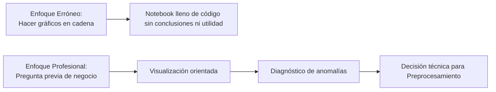
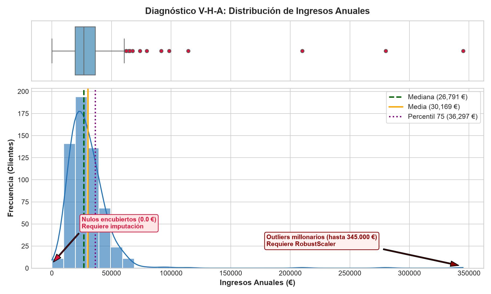
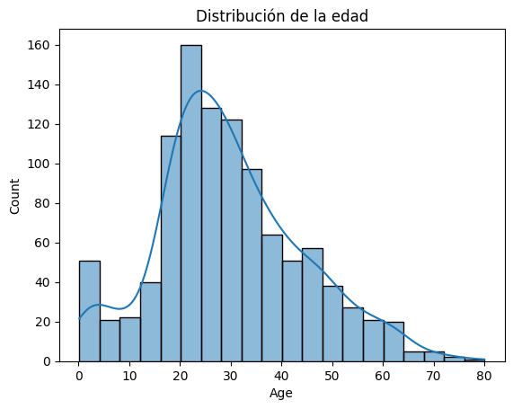
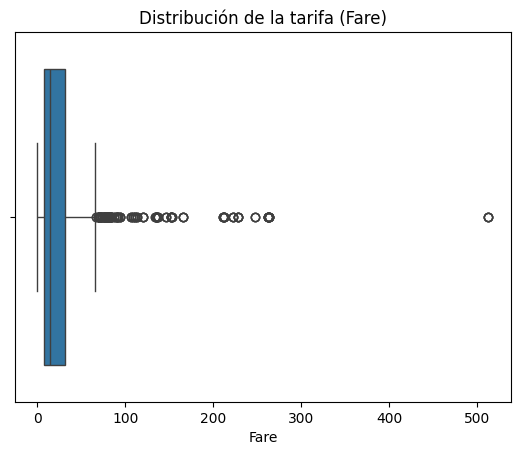
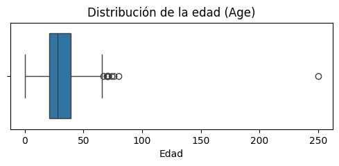
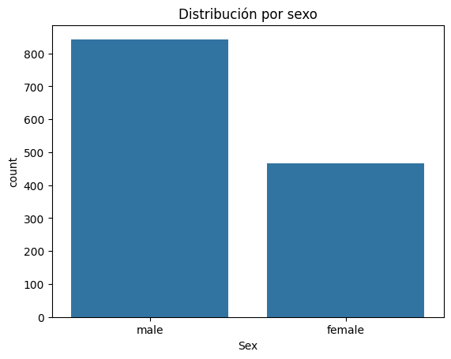

<div class="justify-text">

# EDA Univariante y la Fórmula V-H-A

En la sesión anterior aprendimos a blindar nuestro conjunto de datos separando el conjunto de test antes de empezar a trabajar. Ahora que disponemos de un conjunto de entrenamiento (`X_train`) libre de cualquier riesgo de fuga de datos (*Data Leakage*), llega el momento de realizar la primera gran tarea del científico de datos: el **Análisis Exploratorio de Datos (EDA)**.

El objetivo del EDA no es entrenar modelos todavía, sino **convertirnos en detectives**. Necesitamos interrogar a los datos, entender cómo se distribuyen, destapar posibles trampas y decidir qué transformaciones técnicas necesitaremos aplicar más adelante durante el preprocesamiento.

En esta sesión nos centraremos en el **análisis univariante**: estudiar cada variable de forma aislada, una a una, para comprender su rango, su forma y su calidad.

---

## El Cambio de Mentalidad: De la Galería de Gráficos al Diagnóstico

Uno de los errores más comunes al aprender Machine Learning es caer en el **«síndrome de la galería de arte»**: abrir un notebook, importar Seaborn y ejecutar veinte celdas seguidas con gráficos vistosos (`sns.histplot`, `sns.boxplot`) de todas las columnas del dataset.

El resultado de esa práctica suele ser un cuaderno lleno de imágenes bonitas pero sin una sola línea de texto que explique qué significan. Si alguien te pregunta: *«¿Qué vas a hacer con la columna edad antes de entrenar el modelo?»*, la respuesta suele ser el silencio.



Un gráfico en Machine Learning nunca es un fin en sí mismo; es una herramienta para **tomar decisiones técnicas**. Si un gráfico no te ayuda a decidir cómo limpiar, imputar o transformar esa columna, no aporta ningún valor al proyecto.

---

## La Fórmula V-H-A: «No Graph Without Markdown»

Para garantizar que cada visualización tenga un propósito concreto, en este módulo aplicaremos una regla metodológica: **ningún gráfico se da por válido si no va acompañado de un bloque Markdown inmediatamente inferior estructurado con la fórmula V-H-A**:

```markdown
### Variable: [nombre_de_la_columna]

* **V (Visualización / Pregunta previa):** ¿Qué pregunta o hipótesis quiero responder con este gráfico?
[Celda de código con el gráfico correspondiente]
* **H (Hallazgo):** ¿Qué observo objetivamente en los datos? (detallando cifras, asimetrías, modas o valores anómalos).
* **A (Acción para Preprocesamiento):** ¿Qué decisión técnica concreta tomaré con esta columna antes de entrenar el modelo?
```

Veamos un ejemplo práctico con la variable `ingresos_anuales` de nuestro conjunto de datos bancario. En el ejemplo se muestran dos gráficos diferentes: un boxplot y un histograma.



A partir de esta misma salida gráfica, observa el abismo que separa un análisis superficial de uno profesional:

* **Análisis superficial (lo que debemos evitar):**
  > *«He hecho un histograma de los ingresos y se ve que la gente gana dinero y casi todos están a la izquierda»*.  
  *(No aporta números, no detecta anomalías y no ayuda a preparar el modelo).*

* **Análisis profesional (siguiendo la fórmula V-H-A):**
  * **V (Visualización / Pregunta previa):** *«Comprobar si los ingresos anuales siguen una distribución equilibrada o si existen clientes con sueldos desproporcionados o valores anómalos»*.
  * **H (Hallazgo):** *«Existe una fuerte asimetría positiva hacia la derecha; la media (30.169 €) está claramente por encima de la mediana (26.791 €). El 75% de los clientes gana menos de 36.297 € (por debajo de 45.000 €), pero encontramos valores extremos de hasta 345.000 €. Además, la barra en x = 0 revela clientes con saldo o ingreso exacto de 0.0 €, lo que indica nulos encubiertos en clientes activos»*.
  * **A (Acción para Preprocesamiento):** *«Sustituiremos los valores 0.0 € por `np.nan` para imputarlos mediante la mediana (robusta frente a asimetrías), y utilizaremos un escalador robusto (`RobustScaler`) en lugar de `StandardScaler` para que los clientes millonarios no aplasten la escala del resto de la población»*.

---

## El Primer Paso: La Criba Tabular Inicial

Antes de lanzarnos a pintar gráficos individuales con Seaborn o Matplotlib, el científico de datos profesional nunca empieza a ciegas. Lo primero que se ejecuta es una **criba tabular global**: una «inspección médica general» en Pandas que radiografía todas las columnas del conjunto de entrenamiento en un par de segundos.

### La Tabla de Auditoría Rápida

En lugar de consultar funciones sueltas (`.info()`, `.isna().sum()`, `.nunique()`), es una buena práctica construir una pequeña tabla resumen que concentre los indicadores clave de calidad de datos:

```python
# Radiografía inicial de todas las variables predictoras (X_train)
auditoria = pd.DataFrame({
    'tipo': X_train.dtypes,
    'nulos': X_train.isna().sum(),
    'pct_nulos': (X_train.isna().mean() * 100).round(2),
    'cardinalidad': X_train.nunique()
})
print(auditoria)
print("\nFilas duplicadas en X_train:", X_train.duplicated().sum())
```

**Salida en consola / Notebook:**
```text
                          tipo  nulos  pct_nulos  cardinalidad
edad                   float64      7       1.17            57
ingresos_anuales       float64      7       1.17           591
salario_mensual_aprox  float64      7       1.17           593
antiguedad_meses       float64      5       0.83           118
saldo_cuenta           float64      0       0.00           508
nivel_estudios             str      7       1.17             5
tipo_cuenta                str      0       0.00             9
nivel_satisfaccion         str      0       0.00             5
num_productos            int64      0       0.00             4
tiene_tarjeta            int64      0       0.00             2
canal_preferido            str      0       0.00             5
comentarios_cliente        str    595      99.17             5
motivo_cancelacion         str    352      58.67             4

Filas duplicadas en X_train: 0
```

### Las Cuatro Conclusiones Inmediatas de la Criba

Al observar esta tabla y el conteo de duplicados, un profesional toma decisiones estratégicas en menos de un minuto:

* **Auditoría de duplicados:**  
  Confirmamos que no existen filas exactamente repetidas (`0` duplicados), descartando fallos típicos de volcados dobles o duplicidades en la base de datos.

* **Columnas inservibles a descartar:**  
  La columna `comentarios_cliente` tiene un **99.17% de valores nulos**. No aporta señal al modelo y conservarla solo añadiría ruido: es una candidata directa a ser eliminada antes del entrenamiento.
  
  La columna `motivo_cancelacion` tiene un **58.67% de valores nulos**. Habría que analizar sus valores para determinar si merece la pena mantenerla.
* **Alertas de calidad y suciedad:**  
  La columna `tipo_cuenta` arroja una **cardinalidad de 9** valores únicos. Si en nuestra entidad bancaria solo existen 4 tipos de cuenta comercializados, esta cifra enciende una alarma roja inmediata: indica erratas de texto, espacios sobrantes o caracteres comodín.
* **Columnas que requerirán imputación:**  
  Descubrimos que `edad`, `ingresos_anuales`, `salario_mensual_aprox`, `antiguedad_meses` y `nivel_estudios` presentan valores ausentes explícitos (~1%), por lo que necesitaremos decidir qué estrategia de imputación técnica aplicar.

---

## Diagnóstico de Variables Numéricas

Las variables numéricas (como la edad, los ingresos o el saldo) representan cantidades continuas o discretas. Antes de lanzarnos a pintar gráficos, es recomendable consultar su resumen numérico con `describe()`.

```python
# Resumen numérico en el conjunto de entrenamiento
X_train['ingresos_anuales'].describe()
```

**Salida en consola / Notebook:**
```text
count       593.000000
mean      30169.411265
std       22498.484356
min           0.000000
25%       19393.860000
50%       26790.710000
75%       36296.970000
max      345000.000000
Name: ingresos_anuales, dtype: float64
```

**Cómo interpretar el resumen estadístico:**

Las cifras que devuelve `describe()` no son datos aislados; al relacionarse entre sí nos cuentan una historia clara sobre la distribución antes incluso de abrir una librería de gráficos:

* **Conteo (`count`):** Indica cuántos registros válidos (no nulos) tiene la columna. Si nuestro conjunto de entrenamiento tiene 600 filas y el conteo arroja 593, ya sabemos al instante que **hay 7 valores ausentes (`NaN`)**.
* **Media (`mean`) frente a Mediana (`50%`):**
  * Si $\text{media} \approx \text{mediana}$, la distribución es aproximadamente simétrica (cercana a una campana de Gauss).
  * Si $\text{media} \gg \text{mediana}$ (en nuestro ejemplo, 30.169 € frente a 26.790 €), la distribución presenta una **asimetría positiva (sesgo a la derecha)**: unos pocos salarios muy elevados tiran de la media hacia arriba.
  * Si $\text{media} \ll \text{mediana}$, la distribución tendría una asimetría negativa (sesgo hacia la izquierda).
* **Mínimo (`min`) y Máximo (`max`):** Permiten detectar límites inverosímiles de un vistazo:
  * Un valor mínimo de `0.0 €` en ingresos para clientes bancarios activos levanta sospechas inmediatas de ser un **nulo encubierto**.
  * Un máximo de `345.000 €` frente a un percentil 75 de `36.296 €` destapa la presencia de **valores atípicos (*outliers*) extremos**.
* **Cuartiles (`25%`, `75%`) y Dispersión (`std`):**
  * La mitad central de los clientes (entre el percentil 25 y el 75) gana entre 19.393 € y 36.296 €.
  * Una desviación típica (`std`) de 22.498 € (muy alta en proporción a la media) avisa de que los datos están dispersos y será indispensable aplicar escalado.

---

### Histogramas y Curvas de Densidad (KDE)

El **histograma** agrupa los valores en intervalos (*bins*) y cuenta cuántas observaciones caen en cada uno. La curva de densidad (**KDE**, *Kernel Density Estimation*) traza una línea continua suavizada que representa la forma general de la distribución.

```python
import matplotlib.pyplot as plt
import seaborn as sns

plt.figure(figsize=(8, 4))
sns.histplot(data=X_train, x='edad', bins=20, kde=True, color='royalblue')
plt.title("Distribución de la Variable Edad")
plt.xlabel("Edad (años)")
plt.ylabel("Número de Clientes")
plt.show()
```

:::info Parámetros clave de `sns.histplot`
* **`bins` (intervalos o contenedores):** Divide el rango de la variable numérica en tramos iguales para contar cuántas observaciones caen en cada uno.
  * Si fijamos muy pocos intervalos (por ejemplo, `bins=5`), la distribución queda sobre-simplificada y se pueden ocultar valles o anomalías.
  * Si fijamos demasiados (por ejemplo, `bins=100`), veremos barras muy delgadas, huecos vacíos y demasiado ruido visual.
  * Un valor entre **15 y 30** suele ser un buen punto de partida para datasets medianos.
* **`kde=True` (*Kernel Density Estimation*):** Traza una curva continua suavizada sobre las barras del histograma. Estima la función de densidad de probabilidad, lo que nos permite visualizar la forma global de la distribución (si es simétrica, bimodal o sesgada) con independencia del número de barras elegido.
:::



#### Qué debemos buscar en un histograma:
* **Forma de la distribución:** ¿Tiene una campana central simétrica o tiene una cola alargada hacia un lado?
* **Multimodalidad:** ¿Aparecen dos «montañas» separadas? Si hay dos picos, suele significar que hay dos poblaciones mezcladas en la misma columna (por ejemplo, clientes jóvenes con cuentas universitarias y adultos con planes de pensiones).
* **Picos sospechosos aislados:** Una barra solitaria en el extremo superior suele indicar un valor centinela (por ejemplo, el valor `999` utilizado por la base de datos para indicar «dato desconocido»).

---

### Diagramas de Caja (*Boxplots*)

El **diagrama de caja** (*boxplot*) es la herramienta reina para analizar los cuartiles de una variable y localizar valores atípicos (*outliers*).

```python
plt.figure(figsize=(8, 3))
sns.boxplot(x=X_train['fare'], color='steelblue')
plt.title("Distribución de la tarifa (Fare)")
plt.xlabel("Fare")
plt.show()
```



#### Anatomía de un boxplot:
* **La línea central de la caja:** Representa la **mediana** (percentil 50%). La mitad de los datos está a la izquierda y la otra mitad a la derecha.
* **Los extremos de la caja:** Delimitan el **rango intercuartílico (IQR)**:
  * Límite izquierdo: Primer cuartil ($Q_1$, percentil 25%).
  * Límite derecho: Tercer cuartil ($Q_3$, percentil 75%).
  * El 50% central de los clientes se encuentra dentro de esta caja.
* **Los bigotes (*whiskers*):** Se extienden hasta $1.5 \times \text{IQR}$ desde los bordes de la caja.
* **Los puntos aislados:** Observaciones que caen más allá de los bigotes. Son candidatos a **valores atípicos (*outliers*)**.



:::warning ¿Error de datos o cliente excepcional?
Al ver puntos aislados en un boxplot, **nunca debemos borrarlos por defecto**. Es necesario razonar el contexto:
* Si en la columna `edad` encontramos un valor de `215`, es indiscutiblemente un **error humano o del sistema**.
* Si en `saldo_cuenta` encontramos a un cliente con $300.000\text{€}$, **no es un error**: es un cliente real adinerado. Borrarlo equivaldría a perder información valiosa de negocio. En su lugar, aplicaremos técnicas de escalado robusto o transformaciones logarítmicas.
:::

---

## Diagnóstico de Variables Categóricas y Discretas

Las variables categóricas describen cualidades (tipo de contrato, nivel de satisfacción, canal preferido). En ellas no tiene sentido calcular medias ni desviaciones estándar; lo que necesitamos saber es **cuántas veces se repite cada categoría** y si existen valores extraños.

### Cardinalidad y Frecuencias con Pandas

Antes de dibujar el gráfico, consultamos los valores únicos y su distribución porcentual:

```python
# Inspeccionar valores únicos
print("Valores distintos:", X_train['tipo_cuenta'].unique())
print("Número de categorías:", X_train['tipo_cuenta'].nunique())

# Porcentaje de aparición de cada categoría
X_train['tipo_cuenta'].value_counts(dropna=False, normalize=True) * 100
```

**Salida en consola / Notebook:**
```text
Valores distintos: ['Corriente', 'Ahorro', 'Nomina', 'corriente', ' Ahorro', 'Inversion', 'AHORRO', 'nomina ', '?']
Número de categorías: 9

tipo_cuenta
Corriente    45.83
Ahorro       31.83
Nomina       17.17
Inversion     4.33
corriente     0.17
 Ahorro       0.17
AHORRO        0.17
nomina        0.17
?             0.17
Name: proportion, dtype: float64
```

#### Aspectos críticos que debemos evaluar:

* **Textos sucios y erratas:**
  * Espacios invisibles al principio o final: `' Ahorro'` y `'Ahorro'` son interpretados por Python como dos categorías completamente distintas.
  * Mayúsculas y minúsculas: `'corriente'` o `'AHORRO'` frente a `'Corriente'` y `'Ahorro'`.
  * Caracteres comodín o valores centinela: `'?'`, `'None'`, `'Desconocido'` que enmascaran nulos.
* **Cardinalidad:**
  * **Baja cardinalidad (de 2 a 5 categorías reales):** Una vez limpia, esta columna tiene 4 tipos de cuenta reales (`Corriente`, `Ahorro`, `Nomina`, `Inversion`), lo que la hace idónea para codificación *One-Hot*.
  * **Alta cardinalidad (por ejemplo, 150 códigos postales o ciudades):** Peligro de explosión de columnas en el modelo. Requerirá agrupar las minoritarias en un grupo común (`'Otros'`).
* **Desbalanceo univariante y categorías residuales:** Observar si existen categorías que aparecen con frecuencias insignificantes (< 1%), ya que pueden dar problemas al dividir datos o impedir que el modelo aprenda sobre ellas de forma consistente.

:::tip En el EDA diagnosticamos, no modificamos los datos
El objetivo del análisis exploratorio es actuar como detectives: examinar los datos, destapar inconsistencias y anotar la acción requerida (la **A** de la fórmula V-H-A). **No se aplican transformaciones sobre el DataFrame durante el EDA**. Las modificaciones (limpieza de cadenas, imputación de nulos y codificación) se implementarán de forma ordenada y reproducible en la fase de **preprocesamiento** para evitar fugas de datos (*data leakage*).
:::

---

### Gráficos de Recuento (*Countplots*)

Para visualizar variables cualitativas y analizar la frecuencia de cada categoría utilizamos `sns.countplot()`:

```python
plt.figure(figsize=(6, 4))
sns.countplot(data=X_train, x='Sex', color='steelblue')
plt.title("Distribución por sexo")
plt.xlabel("Sex")
plt.ylabel("count")
plt.show()
```



---

## Ejemplo Completo de Aplicación del Marco V-H-A

Veamos cómo debe quedar documentado en un Jupyter Notebook el análisis forense de dos columnas reales de nuestro dataset bancario.

### Ejemplo Numérico: Columna `ingresos_anuales`

```python
# Código de inspección
print(X_train['ingresos_anuales'].describe())

plt.figure(figsize=(10, 4))
plt.subplot(1, 2, 1)
sns.histplot(data=X_train, x='ingresos_anuales', kde=True, color='teal')
plt.title("Histograma de Ingresos")

plt.subplot(1, 2, 2)
sns.boxplot(x=X_train['ingresos_anuales'], color='teal')
plt.title("Boxplot de Ingresos")
plt.tight_layout()
plt.show()
```

#### Ficha V-H-A: Ingresos Anuales

* **V (Visualización):** Observar cómo se distribuyen los ingresos de los clientes y qué nivel de dispersión presentan
* **H (Hallazgo):** 
  * La mediana se sitúa en 26.850€, mientras que la media asciende a 31.420€, lo que confirma una clara asimetría positiva con cola a la derecha.
  * El 75% de los clientes gana menos de 41.000€ anuales, pero el boxplot muestra clientes con ingresos de hasta 345.000€.
  * Hemos detectado 3 registros con valor exacto 0.0€, lo cual es inviable para clientes bancarios activos con productos contratados (nulos encubiertos).
* **A (Acción para Preprocesamiento):**
  1. En la fase de limpieza sustituiremos los valores 0.0€ por `np.nan`.
  2. Imputaremos los valores ausentes utilizando la **mediana** (y no la media, para evitar que los sueldos altos distorsionen la estimación).
  3. Utilizaremos `RobustScaler` para escalar esta variable antes de enviarla a algoritmos sensibles a distancias.


---

### Ejemplo Categórico: Columna `tipo_cuenta`

```python
# Código de inspección
print(X_train['tipo_cuenta'].value_counts(dropna=False))

plt.figure(figsize=(7, 3))
sns.countplot(data=X_train, y='tipo_cuenta', order=X_train['tipo_cuenta'].value_counts().index, palette='mako')
plt.title("Distribución de Tipo de Cuenta")
plt.show()
```

#### Ficha V-H-A: Tipo de Cuenta

* **V (Visualización):** Observar cuáles son las cuentas más contratadas y si existe consistencia en los textos registrados.
* **H (Hallazgo):**
  * La cuenta `Corriente` es la mayoritaria (45%), seguida de `Ahorro` (30%) y `Nomina` (20%).
  * Se han detectado inconsistencias de formato: aparecen cadenas en minúsculas (`'corriente'`), espacios en blanco sobrantes (`' Ahorro'`) y un valor `'?'` en una observación.
* **A (Acción para Preprocesamiento):**
  1. Aplicaremos limpieza de cadenas para eliminar espacios y para homogeneizar mayúsculas.
  2. Reemplazaremos el carácter `'?'` por `np.nan` e imputaremos mediante la categoría más frecuente (`SimpleImputer(strategy='most_frequent')`).
  3. Al ser una variable cualitativa nominal sin orden jerárquico, aplicaremos `OneHotEncoder(handle_unknown='ignore')`.


---

## 💻 Ejercicio Guiado: El Informe Univariante

### Contexto de la Práctica
Continuando con la auditoría de la entidad bancaria iniciada en la sesión anterior, el director técnico te solicita un **informe forense univariante exhaustivo** sobre el conjunto de entrenamiento blindado (`X_train`).

:::info Archivo de Trabajo
Trabajaremos sobre el dataset de entrenamiento resultante de la partición de [`clientes_banca_raw.csv`](./0-datasets/clientes_banca_raw.csv) y sobre el mismo Jupyter Notebook del ejercicio anterior.
:::

### Tareas a realizar

* **Criba tabular inicial**
  * Construye la tabla de auditoría rápida con Pandas mostrando tipo de dato, cantidad de nulos, porcentaje de nulos y cardinalidad para todas las columnas de `X_train`.
  * Redacta una breve conclusión justificando qué columnas habría que estudiar posteriormente con detenimiento (aquellas que tengan nulos) o que directamente habría que descartar (aquellas con un porcentaje de nulos muy elevado). 
  * Indica qué variables son numéricas y cuáles categóricas. Fíjate para ello en el tipo de dato y la cardinalidad.

* **Auditoría de las variables numéricas:**
  * Una vez identificadas en el paso anterior las variables numéricas, realiza el diagnóstico forense univariante para cada una de ellas.
    * Muestra su resumen estadístico con `.describe()`.
    * Genera una figura que combine histograma con KDE y boxplot.
    * Redacta obligatoriamente su bloque **V-H-A** en Markdown detallando hallazgos numéricos (outliers, asimetrías o nulos encubiertos) y acciones técnicas de preprocesamiento.

* **Auditoría de las variables categóricas:**
  * Una vez identificadas en el paso anterior las variables categóricas, realiza el diagnóstico forense univariante para cada una de ellas.
    * Muestra la tabla de frecuencias.
    * Genera un gráfico de barras horizontal.
    * Redacta obligatoriamente su bloque **V-H-A** en Markdown documentando problemas de formato, textos sucios o categorías minoritarias.

* **Auditoría de la variable target:**
  * Aplica un análisis univariante para la variable target, identificando su distribución y posibles anomalías.
  
* **Conclusiones:**
  * Para facilitar el preprocesamiento posterior, documenta en una celda las **conclusiones finales**: qué columnas están listas y cuáles requerirán limpieza obligatoria.
  * Para estructurar este inventario de trabajo, lo mejor es utilizar una **tabla resumen** con el nombre de la variable, el tipo de característica (numérica continua, discreta, categórica nominal u ordinal) y su correspondiente acción de preprocesamiento. Por ejemplo:

    | Variable | Tipo de característica | Acción de preprocesamiento |
    | :--- | :--- | :--- |
    | `edad` | Numérica continua | Sustituir los valores anómalos (>110 años) por `np.nan` e imputar los valores ausentes mediante la mediana. |
    | `tipo_cuenta` | Categórica nominal | Limpiar espacios en blanco y unificar mayúsculas, reemplazar `'?'` por `np.nan`, imputar por la moda y aplicar `OneHotEncoder`. |

</div>
