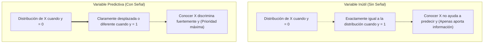
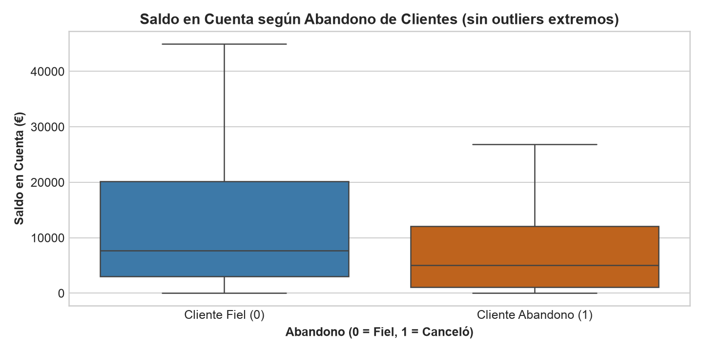
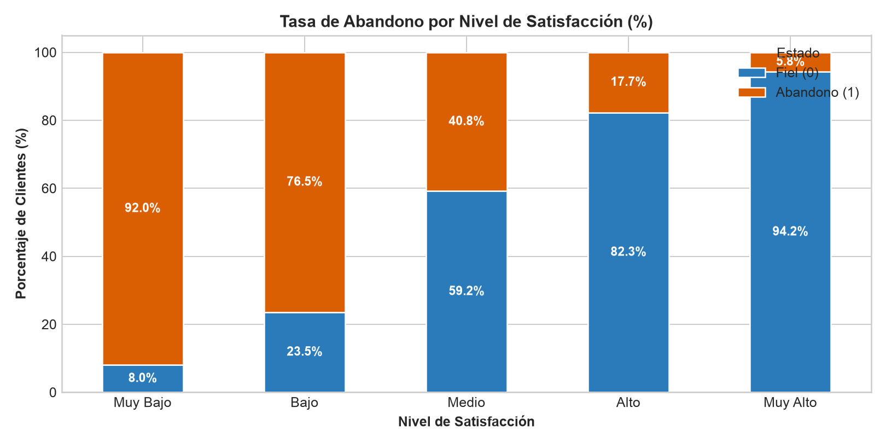
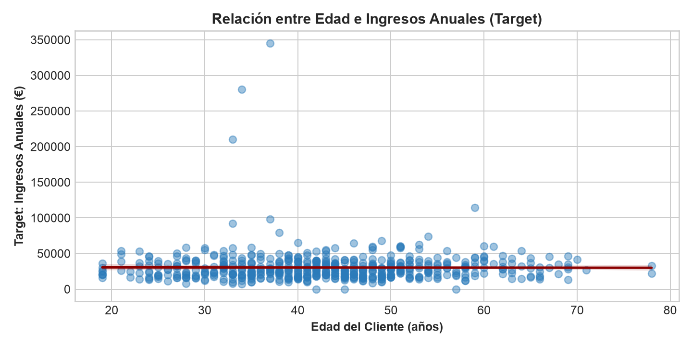
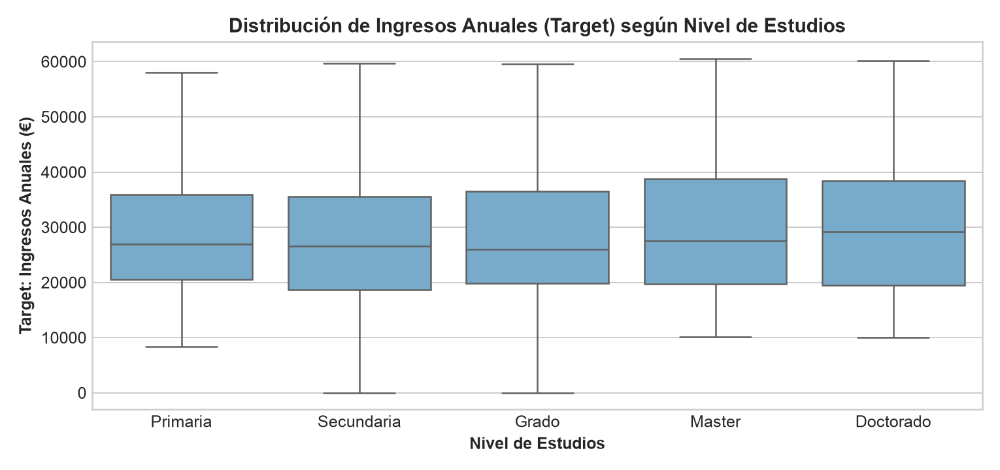
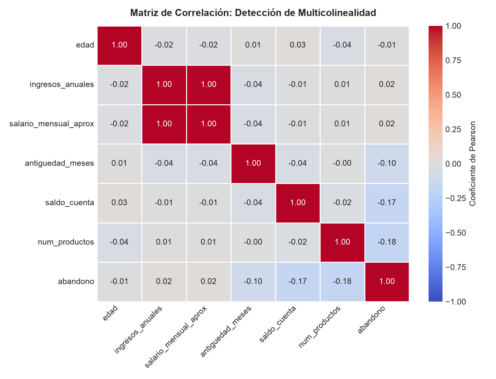
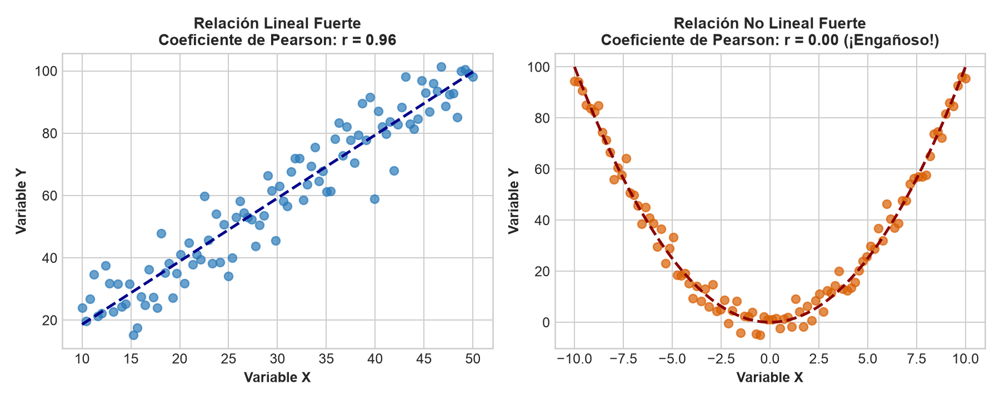

<div class="justify-text">

# EDA Bivariante y Multivariante

En la sesión anterior aprendimos a inspeccionar cada variable de forma aislada para comprender su forma, su dispersión y destapar errores groseros en los datos (nulos encubiertos, textos sucios o edades imposibles). 

Sin embargo, en Machine Learning supervisado nuestro objetivo final no es contemplar variables individuales, sino **aprender a predecir la variable objetivo ($y$) a partir de las características ($X$)**.

Ahora llega el momento de dar el salto al **análisis bivariante**: cruzar las variables contra el *target* para ver si tienen verdadero poder de predicción, y cruzar las predictoras entre sí mediante la **matriz de correlación** para destapar redundancias (multicolinealidad) y trampas temporales (fugas de datos).

---

## El Objetivo: Buscar Señal Predictiva

Cuando exploramos los datos en Machine Learning supervisado, cada visualización y cada prueba deben responder a una única pregunta fundamental:

> *«Si yo conozco el valor de esta variable $X_i$, ¿cambia significativamente la probabilidad o el valor de la variable objetivo $y$?»*



La estrategia técnica para analizar esta relación **depende directamente del tipo de variable objetivo ($y$)** que estemos intentando predecir:
* Si el target es **cualitativo / categórico**, nos encontramos ante un problema de **Clasificación**.
* Si el target es **cuantitativo / continuo**, nos encontramos ante un problema de **Regresión**.

---

## Análisis Bivariante con Target Categórico (Clasificación)

En nuestro caso bancario, la variable objetivo es binaria: `abandono` ($0$ = el cliente permanece, $1$ = el cliente cancela la cuenta).

### Variable Numérica frente al Target Categórico

Para comparar cómo se comporta una variable numérica (como el saldo en cuenta) en cada uno de los dos grupos de clientes, la herramienta más directa y limpia es trazar un **diagrama de caja (*boxplot*) segmentado por la clase**:

```python
import matplotlib.pyplot as plt
import seaborn as sns

plt.figure(figsize=(8, 4))
# Comparamos la distribución del saldo según si el cliente abandonó o no
sns.boxplot(
    data=X_train.assign(abandono=y_train), 
    x='abandono', 
    y='saldo_cuenta', 
    palette=['#2b7bba', '#d95f02'],
    showfliers=False # Ocultamos outliers extremos para comparar el cuerpo central
)
plt.title("Saldo en Cuenta según Abandono de Clientes", fontsize=12, fontweight='bold')
plt.xlabel("Abandono (0 = Fiel, 1 = Canceló)", fontweight='bold')
plt.ylabel("Saldo en Cuenta (€)", fontweight='bold')
plt.xticks([0, 1], ['Cliente Fiel (0)', 'Cliente Abandono (1)'])
plt.tight_layout()
plt.show()
```



#### Qué debemos buscar en el gráfico:
* **¿Están las cajas a distinta altura?**  
  Fíjate en la línea central de cada caja (la mediana):
  * Si una línea está claramente más arriba o más abajo que la otra, los dos grupos se comportan de forma diferente (la variable sirve para predecir).
  * Si las dos líneas están a la misma altura, esa variable apenas ayuda al modelo a distinguir quién se va y quién se queda.
* **¿Cuánto se pisan las cajas?**  
  Cada caja encierra al 50% central de los clientes de ese grupo:
  * Cuanto menos se pisen o solapen las cajas entre sí, más fácil lo tendrá el algoritmo para trazar una frontera y separar a los clientes fieles de los que cancelan.

#### Ficha V-H-A: Saldo en Cuenta frente al Abandono
* **V (Visualización / Pregunta previa):** *«¿Tienen menos dinero en la cuenta los clientes que deciden marcharse del banco?»*.
* **H (Hallazgo visual):**
  * La línea de la mediana de los clientes que se quedan está en torno a **7.600 €**, mientras que en los que se marchan baja hasta los **5.000 €**.
  * El cuerpo de la caja de los clientes fieles es mucho más alto y llega hasta los **20.000 €**, mientras que la caja de los que abandonan no pasa de **12.000 €**.
  * Por encima de **27.000 €** (donde termina el bigote de los que se van) prácticamente solo encontramos clientes fieles.
* **A (Acción para Preprocesamiento):** *«Es una variable con gran poder predictivo, por lo que la conservamos con alta prioridad. Como la caja y los bigotes están comprimidos abajo y se extienden hacia arriba, usaremos un escalado robusto (`RobustScaler`) para que los clientes con saldos muy grandes no distorsionen al modelo»*.

---

### Variable Categórica frente al Target Categórico

Cuando tanto la característica predictora como el target son cualitativos (por ejemplo, `nivel_satisfaccion` frente a `abandono`), los gráficos de recuento tradicionales pueden llevarnos a conclusiones totalmente equivocadas si no tenemos cuidado.

#### La Trampa de las Frecuencias Absolutas frente a las Relativas
Imagina que en una categoría vemos 100 abandonos y en otra vemos solo 20. A primera vista parecería que la primera es mucho más peligrosa. Sin embargo, si en la primera había 1.000 clientes (tasa del 10%) y en la segunda había solo 25 clientes (tasa del 80%), la realidad es exactamente la contraria.

:::warning Nunca compares categorías por recuento absoluto
En Machine Learning, el poder discriminatorio de una categoría se mide por su **tasa de incidencia o porcentaje relativo**, nunca por el número bruto de muestras.
:::

#### Tablas de Contingencia con `pd.crosstab()`
La función `pd.crosstab()` permite cruzar dos columnas categóricas al instante. Con el parámetro `normalize='index'` calculamos los porcentajes por fila (cada fila suma 100%):

```python
# Tabla de contingencia normalizada por filas (%)
tabla_relacion = pd.crosstab(
    X_train['nivel_satisfaccion'], 
    y_train, 
    normalize='index'
) * 100

print(tabla_relacion.round(2))
```

**Salida en consola / Notebook:**
```text
abandono                    0          1
nivel_satisfaccion                      
Muy Bajo                 8.00      92.00
Bajo                    23.53      76.47
Medio                   59.15      40.85
Alto                    82.26      17.74
Muy Alto                94.23       5.77
```

:::info ¿Cómo interpreta Pandas el parámetro `normalize='index'`?
Por defecto, `pd.crosstab()` devolvería el número bruto de personas (frecuencias absolutas). Al añadir **`normalize='index'`**, le indicamos que calcule el **porcentaje relativo por fila** (haciendo que cada categoría sume 100%):
* Responde exactamente a la pregunta que necesita responder el modelo: *«Si un cliente tiene satisfacción 'Muy Bajo', ¿cuál es su probabilidad de abandonar?»*.
* En la fila `Muy Bajo`, el **92.00%** de los clientes cancelaron su cuenta (abandono = 1), mientras que en `Muy Alto` solo canceló el **5.77%**.
* Esto nos proporciona directamente la **tasa de riesgo** de cada grupo, independientemente de si en una categoría hay 20 clientes y en otra 500.
:::

#### Gráficos de Barras Apiladas Normalizados
Para visualizar esta tabla de contingencia de forma clara, utilizamos un gráfico de barras apiladas al 100%:

```python
# Gráfico de barras apiladas al 100%
orden_satisfaccion = ['Muy Bajo', 'Bajo', 'Medio', 'Alto', 'Muy Alto']
tabla_relacion.reindex(orden_satisfaccion).plot(
    kind='bar', 
    stacked=True, 
    color=['#2b7bba', '#d95f02'], 
    figsize=(9, 4.5), 
    edgecolor='white'
)
plt.title("Tasa de Abandono por Nivel de Satisfacción (%)", fontsize=12, fontweight='bold')
plt.xlabel("Nivel de Satisfacción", fontweight='bold')
plt.ylabel("Porcentaje de Clientes (%)", fontweight='bold')
plt.legend(['Cliente Fiel (0)', 'Cliente Abandono (1)'], title='Estado', loc='upper right')
plt.xticks(rotation=0)
plt.tight_layout()
plt.show()
```



#### Ficha V-H-A: Nivel de Satisfacción frente al Abandono
* **V (Visualización / Pregunta previa):** *«¿Los clientes descontentos se van mucho más del banco que los clientes satisfechos?»*.
* **H (Hallazgo visual):**
  * La relación es clarísima y va en escalera:
    * En **Muy Bajo**, el **92.0%** de los clientes cancelan la cuenta (la barra naranja casi llena todo el bloque).
    * Conforme aumenta la satisfacción, los abandonos se reducen drásticamente: caen al **76.5%** en 'Bajo', al **40.8%** en 'Medio', al **17.7%** en 'Alto' y apenas un **5.8%** en 'Muy Alto'.
  * Es la variable más potente de todo el dataset para predecir el abandono.
* **A (Acción para Preprocesamiento):** *«Como las categorías tienen un orden natural evidente (de peor a mejor satisfacción), no usaremos OneHotEncoder (que crearía 5 columnas independientes perdiendo la jerarquía). Utilizaremos `OrdinalEncoder` para convertirlas en números ordenados del 1 al 5 (`'Muy Bajo': 1` hasta `'Muy Alto': 5`), de forma que el modelo entienda que a mayor valor, menor riesgo de fuga»*.

---

## Análisis Bivariante con Target Numérico (Regresión)

¿Qué ocurriría si nuestro objetivo no fuera predecir una categoría binaria (abandono sí o no), sino una **magnitud cuantitativa continua** (como predecir los `ingresos_anuales` del cliente, el precio de una vivienda o la demanda eléctrica)?

En los problemas de regresión, las herramientas visuales cambian para evaluar cómo varían las cantidades numéricas continuas del *target*.

---

### Variable Numérica frente al Target Numérico

Cuando tanto la característica predictora como la variable objetivo son numéricas continuas (por ejemplo, evaluar si la `edad` predice los `ingresos_anuales`), la herramienta por excelencia es el **gráfico de dispersión (*Scatter plot*) acompañado de una recta de regresión**:

```python
import matplotlib.pyplot as plt
import seaborn as sns

plt.figure(figsize=(8, 4))
# Filtramos outliers extremos de edad para observar la tendencia real
df_edad_valida = df[(df['edad'] > 18) & (df['edad'] < 90)]

sns.regplot(
    data=df_edad_valida, 
    x='edad', 
    y='ingresos_anuales', 
    scatter_kws={'alpha': 0.45, 'color': '#2b7bba'}, 
    line_kws={'color': 'darkred', 'linewidth': 2}
)
plt.title("Relación entre Edad e Ingresos Anuales (Target)", fontsize=12, fontweight='bold')
plt.xlabel("Edad del Cliente (años)", fontweight='bold')
plt.ylabel("Target: Ingresos Anuales (€)", fontweight='bold')
plt.tight_layout()
plt.show()
```



#### Qué debemos buscar en el gráfico:
* **Inclinación de la recta (pendiente):**  
  * Si la recta sube claramente hacia la derecha (pendiente positiva), a mayor valor de la característica, mayor valor del target.
  * Si la recta baja (pendiente negativa), existe una relación inversa.
  * Si la recta es completamente horizontal (plana), la variable predictora **no tiene relación lineal con el target**.
* **Dispersión de la nube de puntos:**  
  * Cuanto más agrupados estén los puntos alrededor de la recta, más precisa y fuerte será la capacidad predictiva.
  * Si los puntos forman una nube redonda y dispersa, la relación es débil o inexistente.
* **Patrones en curva:** Si los puntos dibujan una parábola o una forma en «U», nos avisa de que existe una relación no lineal que una recta simple no captará.

#### Ficha V-H-A: Edad frente a Ingresos Anuales
* **V (Visualización / Pregunta previa):** *«Observar si la edad influye en los ingresos anuales»*.
* **H (Hallazgo visual):**
  * La recta de tendencia es completamente horizontal y plana a lo largo de todas las edades (en torno a los 30.000 €).
  * La nube de puntos se reparte de forma uniforme entre los 20 y los 75 años, sin que los clientes senior ganen sistemáticamente más dinero.
  * Salvo unos pocos ingresos atípicos por encima de 200.000 € entre los 30 y 40 años, no se observa ninguna pendiente de crecimiento salarial con la edad.
* **A (Acción para Preprocesamiento):** *«La edad no presenta capacidad predictiva lineal para estimar los ingresos. En un modelo de regresión lineal simple aportará un peso cercano a cero, aunque la conservaremos en el dataset por si modelos basados en árboles detectan tramos específicos»*.

---

### Variable Categórica frente al Target Numérico

Si queremos evaluar si una variable cualitativa (como el `nivel_estudios` o el `tipo_cuenta`) influye sobre una variable objetivo continua (`ingresos_anuales`), ya no podemos trazar una recta de dispersión.

La técnica estándar consiste en comparar la **distribución continua del target dentro de cada categoría mediante boxplots paralelos**:

```python
plt.figure(figsize=(8.5, 4))
orden_estudios = ['Primaria', 'Secundaria', 'Grado', 'Master', 'Doctorado']
df_estudios = df[df['nivel_estudios'].isin(orden_estudios)]

sns.boxplot(
    data=df_estudios, 
    x='nivel_estudios', 
    y='ingresos_anuales', 
    order=orden_estudios, 
    color='#6baed6', 
    showfliers=False # Ocultamos outliers extremos para comparar el cuerpo central
)
plt.title("Distribución de Ingresos Anuales (Target) según Nivel de Estudios", fontsize=12, fontweight='bold')
plt.xlabel("Nivel de Estudios", fontweight='bold')
plt.ylabel("Target: Ingresos Anuales (€)", fontweight='bold')
plt.tight_layout()
plt.show()
```



#### Qué debemos buscar en el gráfico:
* **Diferencia de alturas entre las cajas:**  
  * Si las cajas de unas categorías están claramente más altas que otras (por ejemplo, si la mediana de 'Master' estuviera en 50.000 € y la de 'Primaria' en 18.000 €), el nivel formativo sería un factor determinante para predecir el salario.
  * Si todas las cajas y medianas están prácticamente al mismo nivel horizontal, esa categoría apenas discrimina la magnitud del target.
* **Amplitud y dispersión ($IQR$):** Observar si alguna categoría tiene un rango salarial mucho más variable o disperso que las demás.

#### Ficha V-H-A: Nivel de Estudios frente a Ingresos Anuales
* **V (Visualización / Pregunta previa):** *«Observar si el nivel de estudios influye en los ingresos anuales»*.
* **H (Hallazgo visual):**
  * Las medianas de las 5 categorías se sitúan prácticamente a la misma altura, entre **26.000 € y 29.000 €**.
  * No obstante, en 'Master' y 'Doctorado' la caja ($Q_3$) y el bigote superior se extienden más arriba (alcanzando los **60.000 €**), reflejando una mayor dispersión hacia salarios elevados que en 'Primaria' o 'Secundaria'.
* **A (Acción para Preprocesamiento):** *«Aunque las medianas son similares, la dispersión superior aporta información. Al tratarse de una escala educativa ordinal con progresión formativa clara, codificaremos la variable mediante `OrdinalEncoder` para que el modelo de regresión pueda utilizar el orden jerárquico de los estudios»*.

---

## La Matriz de Correlación (Heatmap)

Para ver de un solo vistazo cómo se relacionan entre sí todas las variables numéricas del dataset a la vez, calculamos una **matriz de correlación**:

```python
# Calculamos la correlación entre todas las variables numéricas y el target
df_num = X_train.select_dtypes(include='number').assign(abandono=y_train)
matriz_corr = df_num.corr()

plt.figure(figsize=(8.5, 6.5))
sns.heatmap(
    matriz_corr, 
    annot=True, 
    fmt='.2f', 
    cmap='coolwarm', 
    vmin=-1, 
    vmax=1, 
    linewidths=0.5
)
plt.title("Matriz de Correlación", fontsize=12, fontweight='bold')
plt.xticks(rotation=45, ha='right')
plt.tight_layout()
plt.show()
```



### ¿Qué muestra este gráfico y qué significan sus números?

El mapa de calor cruza todas las columnas numéricas dos a dos. En cada casilla aparece un número (el coeficiente de correlación de Pearson) que **siempre está entre -1 y +1**:

* **Cercano a +1 (rojo fuerte):** Las dos variables van de la mano. Si una sube, la otra sube en la misma proporción.
* **Cercano a -1 (azul fuerte):** Van en direcciones opuestas. Si una sube, la otra baja.
* **Cercano a 0 (gris claro):** No tienen relación en línea recta. El cambio en una no te dice nada sobre la otra.

---

### ¿Qué descartamos y qué CONSERVAMOS según la matriz?

Al observar este gráfico en nuestro dataset bancario, tomamos dos decisiones muy distintas:

* **Lo que se DESCARTA: Variables duplicadas (Multicolinealidad):**  
  Fíjate en el cruce entre `ingresos_anuales` y `salario_mensual_aprox`: su correlación es de **1.00 (rojo puro)**.  
  Son exactamente la misma información repetida dos veces con distinto nombre. Tener columnas duplicadas perjudica a los modelos lineales (hace que sus cálculos sean inestables) y añade peso inútil.  
  $\rightarrow$ **Decisión técnica:** **Eliminamos `salario_mensual_aprox`** en el preprocesamiento y conservamos `ingresos_anuales`.

* **Lo que se CONSERVA: Variables con correlación cercana a cero:**  
  Si miras la última fila (`abandono`), verás que `edad` tiene un valor de **-0.01** y `ingresos_anuales` tiene **0.02**.  
  ¿Significa esto que debemos borrarlas? **¡Rotundamente NO!**  
  * La correlación de Pearson solo busca líneas rectas. Una variable puede tener correlación cero y ser muy útil por **tramos** (por ejemplo, clientes menores de 25 y mayores de 65 que abandonan más, frente a los de mediana edad que se quedan). Un modelo basado en árboles (como Random Forest o XGBoost) aprenderá esos cortes sin problema.
  * Por tanto, en el EDA **solo descartamos lo que está duplicado o roto**, pero conservamos las variables numéricas aunque su correlación lineal sea baja.

:::warning Cuidado con las Trampas: La Correlación No Lineal

Un error muy común entre principiantes es pensar que si una variable tiene correlación $0$ con el target, no sirve para predecir. **Cuidado:** el coeficiente de Pearson solo detecta relaciones en línea recta.



* En el gráfico de la izquierda, los puntos siguen una recta clara y el coeficiente es alto ($r = 0.96$).
* En el de la derecha, la relación es perfecta pero tiene forma de curva o parábola ($y = x^2$). Sin embargo, su correlación de Pearson da exactamente **$r = 0.00$**.

:::tip Regla de oro
Usa el mapa de correlación como una primera pista rápida, pero **nunca borres una variable solo porque su correlación lineal sea cercana a cero**: podría tener una relación en curva o por intervalos que modelos no lineales sabrán aprovechar.
:::

---

## Alerta Crítica: Fuga de Datos (Data Leakage)

Hay una trampa todavía peor que las variables duplicadas: meter en el modelo información que en la realidad viene «del futuro».

:::danger Alerta de Data Leakage
Si al cruzar una columna con el target descubres que predice el abandono al 100% de forma perfecta, sospecha de inmediato.
:::

* **El caso de `motivo_cancelacion`:**  
  En nuestro dataset bancario, si cruzamos `motivo_cancelacion` con `abandono`, descubrimos que el 100% de los clientes que tienen un motivo de cancelación han abandonado el banco. 
* **Por qué es una trampa:**  
  Ese dato solo existe en la base de datos **después** de que el cliente solicita la baja. Cuando usemos el modelo en producción para predecir qué clientes activos están en riesgo el próximo mes, **ninguno tendrá todavía un motivo de cancelación registrado**.
* **Decisión técnica:**  
  **Esta columna se elimina de raíz** antes de entrenar ningún algoritmo.

---

## 💻 Ejercicio Guiado: Estudio de las relaciones

### Contexto de la Práctica
En las sesiones previas hemos realizado el análisis univariante y construido una tabla de auditoría inicial. Ahora el equipo de ciencia de datos necesita emitir un **informe de poder predictivo y redundancia** para decidir qué columnas merecen entrar al pipeline de modelado y cuáles no.

:::info Archivo de Trabajo
Continuaremos trabajando sobre el mismo Jupyter Notebook en la partición de entrenamiento blindada (`X_train` e `y_train`) derivada de [`clientes_banca_raw.csv`](./0-datasets/clientes_banca_raw.csv).
:::

:::info ¿Cómo se enfoca en el mundo profesional?
En un proyecto real, el análisis bivariante persigue dos metas simultáneas:
1. **Identificar las palancas predictivas:** Localizar las 2 o 3 características con mayor señal para priorizarlas en el diseño de nuevas variables (*Feature Engineering*).
2. **Sanear el espacio de características:** Eliminar duplicidades (multicolinealidad) y purgar cualquier variable contaminada con información del futuro (*Data Leakage*).
:::

### Tareas a realizar

Ten en cuenta que solo vamos a analizar algunas variables para reducir tiempo de trabajo. En un proyecto completo, analizaríamos todas.

* **Auditoría Bivariante Numérica vs. Target:**
  * Cruza las variables `saldo_cuenta`, `antiguedad_meses` y `edad` contra el target.
  * Genera gráficos comparativos para cada una.
  * Redacta su bloque **V-H-A** completo explicando si muestran o no capacidad para separar clientes fieles de abandonos y cualquier detalle que merezca atención.

* **Auditoría Bivariante Categórica vs. Target:**
  * Genera tablas de contingencia normalizadas para las variables `nivel_satisfaccion`, `tipo_cuenta` y `motivo_cancelacion`.
  * Representa las tablas mediante un gráfico de barras apiladas al 100%.
  * Redacta sus bloques **V-H-A** indicando qué categoría presenta el mayor riesgo relativo de fuga.

* **Auditoría de Multicolinealidad Numérica:**
  * Calcula la matriz de correlación de Pearson para todas las variables numéricas de `X_train`.
  * Representa la matriz mediante un mapa de calor (`sns.heatmap`) rotulado con valores numéricos.
  * Justifica en una celda Markdown si eliminarías alguna variable y por qué.

* **Inventario de Decisiones Bivariantes para Preprocesamiento:**
  * Sintetiza las conclusiones de la sesión añadiendo a la tabla de la sesión anterior la columna `Poder Predictivo Observado`:

    | Variable | Poder Predictivo Observado | Decisión Técnica (esta columna ya está de la sesión anterior - añade si hay algo nuevo.) |
    | :--- | :--- | :--- |
    | `nivel_satisfaccion` | Gran influencia en la target. | **Conservar con prioridad alta** y codificar con `OrdinalEncoder`. |
    | `edad` | Correlación lineal casi nula ($r = -0.01$). | **Conservar** para que modelos no lineales exploren patrones por tramos de edad. |

</div>
