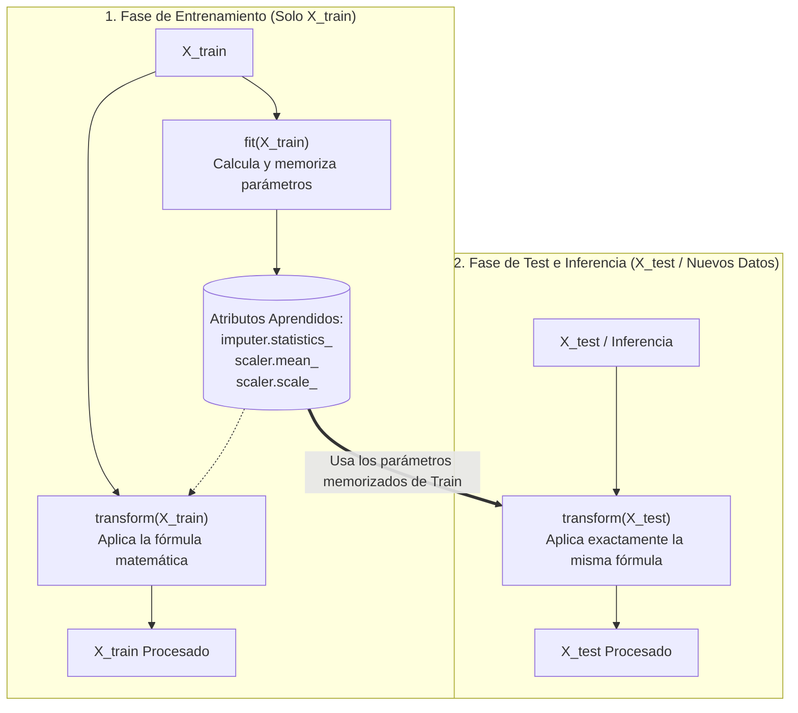
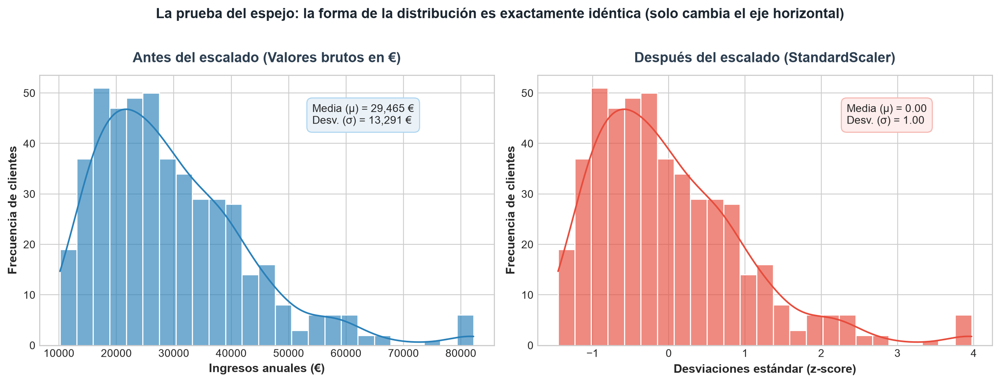

<div class="justify-text">

En las sesiones anteriores hemos realizado el diagnóstico de nuestros datos: identificamos la anatomía matricial de $X$ e $y$, blindamos la partición con `train_test_split` y completamos el Análisis Exploratorio de Datos (EDA) univariante y bivariante con la fórmula **V-H-A**.

Fruto de ese análisis, ya disponemos de una **prescripción técnica clara**: sabemos qué columnas tienen nulos, cuáles esconden valores centinela, cuáles presentan asimetría y valores atípicos (*outliers*) y qué variables se encuentran en escalas totalmente dispares.

Ahora empieza el tratamiento: el **preprocesamiento de datos**. En esta sesión nos centraremos de forma exclusiva y exhaustiva en la **rama numérica (cuantitativa)**, dominando la API de transformadores de Scikit-learn, aprendiendo a evitar la temida fuga de datos (*Data Leakage*) y aplicando la secuencia matemática correcta: **centinelas $\to$ imputación $\to$ outliers $\to$ escalado**.

---

## El gran error de concepto: ¿por qué no usar Pandas a mano?

Cuando un programador empieza en Machine Learning, su primer impulso suele ser utilizar Pandas para resolverlo todo mediante código secuencial rápido:

```python
# ❌ ENFOQUE PELIGROSO EN PRODUCCIÓN (PANDAS A MANO)
media_edad = df['edad'].mean()
df['edad'] = df['edad'].fillna(media_edad)
```

Para una exploración rápida en un notebook, esto funciona. Sin embargo, en un entorno profesional de Inteligencia Artificial este enfoque genera **tres problemas graves de arquitectura**:

1. **Pérdida del estado de entrenamiento:** Si calculas la media de la edad al vuelo y la aplicas directamente sobre el DataFrame, ¿dónde queda registrado ese valor? Si mañana desplegamos el modelo en una API REST y entra una petición HTTP con un nuevo cliente sin edad, ¿cómo recordará el servidor qué media exacta se calculó hace tres meses?
2. **Riesgo crítico de fuga de datos (*Data Leakage*):** Es facilísimo aplicar sin querer un `.mean()`, un `.quantile()` o un `.min()` sobre el conjunto completo antes de hacer el *split*, contaminando el modelo con información del futuro.
3. **Imposibilidad de automatización:** Requiere mantener decenas de líneas de código manual que no se pueden empaquetar, versionar ni reutilizar de forma limpia.

### La solución profesional: transformadores con estado en Scikit-learn

Scikit-learn resuelve esto modelando todas las transformaciones mediante **objetos transformadores con estado**. Un transformador es una clase que encapsula una regla de cálculo y unos **parámetros aprendidos** en memoria:

* Cuando se ejecuta sobre los datos de entrenamiento, **aprende** los parámetros estadísticos necesarios (como la mediana, la media, la desviación típica o los percentiles de corte).
* Esos parámetros quedan almacenados de por vida como atributos del objeto (terminados en guion bajo, como `.statistics_`, `.mean_` o `.scale_`).
* Posteriormente, ese mismo transformador puede aplicarse sobre el conjunto de test o sobre clientes reales en producción **utilizando exactamente los mismos números memorizados**.

### Los métodos de los transformadores: `fit()` y `transform()`

Toda la librería de Scikit-learn se rige por una interfaz común basada en dos métodos esenciales:



#### ¿Qué hace cada método?

* **`fit(X_train)` (aprender):**  
  Analiza los datos de entrada y calcula las métricas estadísticas necesarias. **No modifica los datos ni devuelve nada**; simplemente guarda los parámetros en el interior del objeto.
* **`transform(X)` (aplicar):**  
  Toma una matriz de datos y le aplica la transformación matemática utilizando los parámetros que el objeto aprendió previamente durante el `fit()`.
* **`fit_transform(X_train)` (atajo optimizado):**  
  Realiza ambas operaciones de forma consecutiva en una sola llamada. Es computacionalmente más eficiente para el conjunto de entrenamiento.

:::danger Regla inquebrantable de la ciencia de datos
**¡Está terminantemente prohibido ejecutar `fit()` o `fit_transform()` sobre el conjunto de test!**

Si ejecutas `scaler.fit(X_test)` o `scaler.fit_transform(X_test)`, recalculas la media y la desviación típica a partir de la muestra de evaluación. Esto destruye la estanqueidad del test: el conjunto de evaluación debe simular datos futuros del mundo real que el sistema nunca ha visto y cuyas estadísticas globales se desconocen por completo. El test solo debe transformarse utilizando los parámetros memorizados durante el entrenamiento (`scaler.transform(X_test)`).
:::

---

## Data Leakage

La **fuga de datos (*Data Leakage*)** se produce cuando información ajena al entrenamiento —datos del conjunto de evaluación, del futuro o variables que no existirían en el momento de una predicción real— se filtra en el modelo durante su construcción.

En el contexto del preprocesamiento, el leakage ocurre casi siempre por un error de cálculo: **estimar estadísticas globales sobre el dataset completo antes de separar en *train* y *test*** (o al ejecutar `fit()` sobre el conjunto de test). Cuando calculas la media, la mediana o los percentiles con todas las filas juntas, el conjunto de entrenamiento «absorbe» indirectamente información sobre la distribución de las muestras de prueba.

El gran peligro del Data Leakage es que genera un **falso optimismo**: las métricas de evaluación en el notebook resultan artificialmente brillantes, pero el modelo fracasará en cuanto se enfrente a datos reales en producción.

### Demostración práctica en código

Veamos en código qué ocurre cuando se ajusta un transformador sobre todos los datos antes del *split*, frente al flujo profesional correcto:

```python
import numpy as np
import pandas as pd
from sklearn.model_selection import train_test_split
from sklearn.preprocessing import StandardScaler

# Creamos un dataset sintético con 10 clientes
np.random.seed(42)
datos = pd.DataFrame({
    'saldo': [1000, 1500, 1200, 900, 1100, 1300, 1400, 1050, 8000, 9500]
})

# -------------------------------------------------------------
# ❌ ENFOQUE INCORRECTO: Escalado global antes de la separación
# -------------------------------------------------------------
escalador_tramposo = StandardScaler()
# El escalador ve el 8000 y el 9500 (clientes atípicos del futuro test)
datos_escalados_mal = escalador_tramposo.fit_transform(datos)
X_train_mal, X_test_mal = train_test_split(datos_escalados_mal, test_size=0.2, random_state=42)

print("--- ENFOQUE INCORRECTO (CON FUGA DE DATOS) ---")
print(f"Media aprendida globalmente: {escalador_tramposo.mean_[0]:.2f}")
print(f"Desviación aprendida globalmente: {escalador_tramposo.scale_[0]:.2f}")

# -------------------------------------------------------------
# ✅ ENFOQUE PROFESIONAL: Separación primero, aprendizaje en Train
# -------------------------------------------------------------
X_train_bien, X_test_bien = train_test_split(datos, test_size=0.2, random_state=42)

escalador_limpio = StandardScaler()
# 1. Aprendemos ÚNICAMENTE de X_train
escalador_limpio.fit(X_train_bien[['saldo']])

# 2. Transformamos X_train y X_test por separado
X_train_bien_scaled = escalador_limpio.transform(X_train_bien[['saldo']])
X_test_bien_scaled = escalador_limpio.transform(X_test_bien[['saldo']])

print("\n--- ENFOQUE PROFESIONAL (ESTANQUEIDAD TOTAL) ---")
print(f"Media real aprendida solo de Train: {escalador_limpio.mean_[0]:.2f}")
print(f"Desviación real aprendida solo de Train: {escalador_limpio.scale_[0]:.2f}")
```

**Salida obtenida:**
```text
--- ENFOQUE INCORRECTO (CON FUGA DE DATOS) ---
Media aprendida globalmente: 2795.00
Desviación aprendida globalmente: 3267.38

--- ENFOQUE PROFESIONAL (ESTANQUEIDAD TOTAL) ---
Media real aprendida solo de Train: 1206.25
Desviación real aprendida solo de Train: 185.01
```

:::warning Análisis del resultado
En el enfoque incorrecto, los valores extremos del conjunto de test elevaron la media aprendida de $1.206$ € a casi $2.800$ €. El modelo de entrenamiento cree falsamente que un cliente típico gana el doble de lo que realmente gana la población de estudio. Al pasar a producción, el sistema fracasará.
:::

---

## El orden de operaciones en la rama numérica

En un dataset real con valores cuantitativos continuos, debemos seguir rigurosamente este orden:


Analicemos en detalle cada una de las cuatro etapas.

---

## Sanitización previa de valores centinela

Durante el EDA descubrimos con frecuencia que las bases de datos antiguas o las exportaciones de sistemas bancarios codifican la ausencia de información mediante números imposibles:
* Edades con valor `-1` o `999`.
* Saldo o ingresos fijados en exactamente `0.0` para clientes con compras activas.
* Códigos de error como `99999` o nulos formateados como texto (`"?"`, `"None"`).

### ¿Por qué debe ser el primer paso?
Si dejas un valor `999` en una columna como la edad:
* Al imputar por la media, la media subirá de $40$ a más de $80$ años.
* Al buscar percentiles para recortar outliers, el percentil 99 se disparará.
* Al escalar, la desviación típica quedará completamente deformada.

### Implementación en código

```python
import numpy as np
import pandas as pd

# Supongamos que X_train y X_test provienen de clientes_banca_raw.csv
# En el EDA identificamos las columnas numéricas que tienen centinelas
cols_con_centinelas = ['edad', 'ingresos_anuales']

# 1. Reemplazamos centinelas conocidos por np.nan de forma explícita en Train y Test
# (Esta sustitución no aprende parámetros; aplica una regla determinista de limpieza)

# Limpieza en X_train:
X_train.loc[(X_train['edad'] <= 0) | (X_train['edad'] > 120), 'edad'] = np.nan
X_train.loc[X_train['ingresos_anuales'] <= 0, 'ingresos_anuales'] = np.nan

# Limpieza en X_test:
X_test.loc[(X_test['edad'] <= 0) | (X_test['edad'] > 120), 'edad'] = np.nan
X_test.loc[X_test['ingresos_anuales'] <= 0, 'ingresos_anuales'] = np.nan

print("Nulos detectados en X_train tras sustituir centinelas:")
print(X_train[cols_con_centinelas].isna().sum())
```

---

## Imputación numérica con `SimpleImputer`

Una vez que todas las ausencias están etiquetadas como `np.nan`, debemos sustituirlas por estimadores estadísticos razonables mediante la clase `SimpleImputer` de Scikit-learn.

### Comparativa de estrategias

| Estrategia | Parámetro | Cuándo utilizarla | Cuándo evitarla |
| :--- | :--- | :--- | :--- |
| **Mediana** | `strategy='median'` | **Opción recomendada por defecto.** Distribuciones con asimetría, presencia de outliers o distribuciones no gaussianas. | Datos categóricos o distribuciones bimodales perfectas. |
| **Media** | `strategy='mean'` | Únicamente en distribuciones perfectamente simétricas (campana de Gauss) sin valores atípicos. | Variables asimétricas (salarios, importes, visitas web), ya que los extremos distorsionan el valor medio. |
| **Constante** | `strategy='constant'`, `fill_value=k` | Cuando el valor nulo tiene un significado de negocio específico (ej. imputar 0 en `deuda_pendiente`). | Cuando la ausencia es aleatoria. |

:::info ¿Cuándo usar una constante (`fill_value`) frente a la mediana?
La clave reside en distinguir entre dos tipos de ausencia en las bases de datos:

1. **Nulo por desconocimiento (ausencia aleatoria):**  
   El dato existe en el mundo real, pero no se registró (ej. `edad` o `ingresos_anuales`). Si imputas un cero, le dices al modelo que el cliente tiene 0 años (un recién nacido). Aquí **nunca** se usa constante; se imputa la **mediana** (o media).

2. **Nulo con significado de negocio (no aplica / no existe):**  
   El `NaN` refleja que una acción o producto jamás ha ocurrido para ese cliente. Observa el peligro de imputar la mediana:

   | Columna | Cliente A (tiene el servicio) | Cliente B (no lo tiene) | Si imputas la mediana... | Enfoque correcto |
   | :--- | :---: | :---: | :--- | :--- |
   | `deuda_hipotecaria` | 140.000 € | `NaN` (no tiene) | Le asignas una deuda de **120.000 €** que nunca ha pedido. | `strategy='constant'`, `fill_value=0` |
   | `dias_retraso_pago` | 15 días | `NaN` (paga al día) | Conviertes a un cliente puntual en un moroso con retrasos. | `strategy='constant'`, `fill_value=0` |
   | `descuento_promocional` | 15 % | `NaN` (sin promo) | Le inventas un descuento que jamás se le aplicó. | `strategy='constant'`, `fill_value=0` |

**Regla:** Si el nulo significa *«no lo sé»*, usa la **mediana**. Si el nulo significa *«no tiene o nunca ocurrió»*, usa una **constante fija** (`fill_value=0`).
:::

### Implementación en código

Supongamos que en el EDA diagnosticamos que `ingresos_anuales`, `saldo_cuenta` y `antiguedad_meses` presentan asimetría o valores atípicos (requiriendo la **mediana**), mientras que la `edad` sigue una distribución simétrica en campana (permitiendo el uso de la **media**).

Separamos las columnas en dos listas para aplicar la estrategia óptima a cada una:

```python
from sklearn.impute import SimpleImputer

# Agrupamos las características numéricas según el diagnóstico del EDA
# (Las incluimos todas para blindar el modelo ante futuros nulos en producción)
cols_mediana = ['ingresos_anuales', 'saldo_cuenta', 'antiguedad_meses']
cols_media = ['edad']

# 1. Imputador por mediana (variables asimétricas o con outliers)
imputer_mediana = SimpleImputer(strategy='median')
imputer_mediana.fit(X_train[cols_mediana])

X_train[cols_mediana] = imputer_mediana.transform(X_train[cols_mediana])
X_test[cols_mediana] = imputer_mediana.transform(X_test[cols_mediana])

# 2. Imputador por media (distribución simétrica gaussiana)
imputer_media = SimpleImputer(strategy='mean')
imputer_media.fit(X_train[cols_media])

X_train[cols_media] = imputer_media.transform(X_train[cols_media])
X_test[cols_media] = imputer_media.transform(X_test[cols_media])

# Inspección de los parámetros aprendidos (código meramente informativo)
print("Medianas aprendidas por columna:")
for col, val in zip(cols_mediana, imputer_mediana.statistics_):
    print(f" - {col}: {val:.2f}")

print("\nMedia aprendida por columna:")
for col, val in zip(cols_media, imputer_media.statistics_):
    print(f" - {col}: {val:.2f}")
```

Una vez ejecutado este codigo, `X_train` y `X_test` ya no tendrán nulos.

---

## Tratamiento de outliers numéricos: truncado (*clipping* o *winsorizing*)

En el EDA bivariante descubrimos que existen clientes con ingresos de $345.000$ € frente a una mediana de $26.800$ €. Estos valores no son erratas (son clientes con rentas muy altas reales), por lo que **no queremos borrarlos ni perder sus filas**.

Sin embargo, si intentamos escalar estas columnas directamente, los resultados serán catastróficos.

### ¿Por qué tratar los outliers antes del escalado?

Pensemos en la fórmula de la estandarización clásica:
$$z = \frac{x - \mu}{\sigma}$$

Donde $x$ es el valor original, $\mu$ la media de la columna, $\sigma$ su desviación típica y $z$ el nuevo valor estandarizado (*z-score*).

Si una variable tiene una media $\mu = 30.000$ € y un outlier extremo de $1.000.000$ €:
1. La desviación típica ($\sigma$) se infla de forma colosal.
2. Al dividir entre un $\sigma$ gigantesco, todos los clientes normales ($25.000$ €, $32.000$ €, $28.000$ €) tendrán un valor $z$ prácticamente idéntico (ej. $-0.01$, $+0.02$, $0.00$).
3. **El modelo pierde la capacidad de distinguir entre un cliente con 20.000 € y uno con 40.000 €**, porque ambos han quedado aplastados en el mismo milímetro numérico.

### La técnica de truncado (*clipping* o *winsorizing*)

Consiste en acotar los valores extremos sustituyendo cualquier cifra por debajo de un umbral inferior o por encima de un umbral superior por dicho valor límite:

* **Cálculo de umbrales:** Se calculan **estrictamente sobre `X_train`** mediante percentiles (ej. percentil 1 y 99) o límites del rango intercuartílico ($Q_1 - 1.5\text{IQR}$ y $Q_3 + 1.5\text{IQR}$).
* **Aplicación:** Se aplica `.clip(inferior, superior)` tanto sobre `X_train` como sobre `X_test`.

### Implementación en código

```python
# Aplicaremos clipping sobre las columnas con colas pesadas identificadas en el EDA
cols_outliers = ['ingresos_anuales', 'saldo_cuenta']

# Guardaremos los límites aprendidos para reutilizarlos en inferencia
limites_outliers = {}

for col in cols_outliers:
    # 1. Calculamos los percentiles 1% y 99% SOLO EN X_train
    q_inf = X_train[col].quantile(0.01)
    q_sup = X_train[col].quantile(0.99)
    
    limites_outliers[col] = (q_inf, q_sup)
    print(f"Umbrales aprendidos para {col}: inferior = {q_inf:.2f} | superior = {q_sup:.2f}")
    
    # 2. Aplicamos el recorte directamente sobre Train y Test usando los límites de Train
    X_train[col] = X_train[col].clip(lower=q_inf, upper=q_sup)
    X_test[col] = X_test[col].clip(lower=q_inf, upper=q_sup)
```

#### Ejemplo visual del efecto de *clipping*

Para comprender qué le ocurre a los datos fila a fila, imaginemos que para `ingresos_anuales` los percentiles calculados en `X_train` resultan ser:
* **Límite inferior (percentil 1%):** $12.000$ €
* **Límite superior (percentil 99%):** $85.000$ €

| Observación | Valor antes de *clipping* | Valor después de *clipping* | Diagnóstico del cambio |
| :--- | :---: | :---: | :--- |
| **Cliente A** (ingreso atípicamente bajo) | $4.500$ € | **$12.000$ €** | Inferior al umbral mínimo $\to$ se eleva al percentil 1%. |
| **Cliente B** (ingreso típico) | $26.800$ € | **$26.800$ €** | Dentro del rango normal $\to$ **permanece inalterado**. |
| **Cliente C** (ingreso medio-alto) | $55.000$ € | **$55.000$ €** | Dentro del rango normal $\to$ **permanece inalterado**. |
| **Cliente D** (outlier extremo) | $345.000$ € | **$85.000$ €** | Superior al umbral máximo $\to$ se acota al percentil 99%. |

> **Conclusión clave:** El *clipping* no modifica en absoluto los datos del 98% de la población normal. Solo «pone un techo y un suelo» a los extremos legítimos para evitar que inflen artificialmente la desviación típica en el siguiente paso: el escalado.

---

## Escalado numérico con `StandardScaler`

Ahora que los datos están limpios, sin nulos y con los valores extremos acotados, llega la última etapa de la rama numérica: **el escalado**.

### ¿Por qué es obligatorio escalar?

La mayoría de los algoritmos de Machine Learning son «miopes» frente a las unidades de medida:
* Si introducimos `ingresos_anuales` (valores entre $10.000$ y $90.000$) y `edad` (valores entre $18$ y $80$), el modelo interpretará que una diferencia de $1.000$ € es numéricamente mucho más importante que una diferencia de $20$ años de vida, simplemente porque el número absoluto es mayor.
* Los algoritmos basados en **distancias euclídeas** (KNN, SVM, K-Means) o en **optimización por descenso de gradiente** (Regresión Lineal, Regresión Logística, Redes Neuronales) colapsan si las variables no están en rangos equiparables.

### Nuestro transformador de referencia: `StandardScaler`

En este curso utilizaremos **`StandardScaler`** como nuestro escalador estándar de referencia para todas las variables cuantitativas continuas. 

Transforma cada variable para que tenga **media 0 y desviación típica 1**:
$$z = \frac{x - \mu}{\sigma}$$

* **$z$ (*z-score* o valor estandarizado):** Es el nuevo valor resultante tras el escalado. Representa a cuántas desviaciones típicas de distancia se encuentra la observación respecto al promedio (por ejemplo, $z = +2.0$ significa que ese cliente está dos desviaciones típicas por encima de la media de la población).
* **$x$:** El valor original de la variable en sus unidades brutas (por ejemplo, $35.000$ € de sueldo).
* **$\mu$ (*mu*):** La **media aritmética** calculada exclusivamente sobre el conjunto de entrenamiento (`scaler.mean_`).
* **$\sigma$ (*sigma*):** La **desviación típica** calculada exclusivamente sobre el conjunto de entrenamiento (`scaler.scale_`), que mide la dispersión habitual de los datos.

Al haber aplicado previamente *clipping* sobre los outliers, `StandardScaler` se convierte en la opción óptima: los datos se distribuyen uniformemente sin deformaciones y encajan de forma nativa con los algoritmos de Machine Learning que aplican regularización ($L_1$, $L_2$).

:::info ¿Existen otros tipos de escaladores?
Sí, Scikit-learn ofrece alternativas para casos específicos, aunque no serán nuestro estándar de trabajo en datos tabulares:
* **`MinMaxScaler`:** Escala los datos a un intervalo acotado estricto, típicamente $[0, 1]$. Es muy útil en procesamiento de imágenes (píxeles de 0 a 255) o en algoritmos que no admiten números negativos, pero tiene el peligro de que si en producción entra un valor superior al máximo visto en entrenamiento, el resultado superará el 1.0.
* **`RobustScaler`:** Utiliza la mediana y el rango intercuartílico ($IQR$). Se concibió para datasets con outliers que no se quieren o no se pueden recortar. Como nosotros ya realizamos *clipping* en el paso previo, no necesitamos utilizarlo.
:::

### Implementación en código

```python
from sklearn.preprocessing import StandardScaler

# Columnas cuantitativas continuas que deben recibir escalado
cols_a_escalar = ['edad', 'ingresos_anuales', 'antiguedad_meses', 'saldo_cuenta']

# 1. Instanciamos el escalador
scaler = StandardScaler()

# 2. FIT: Aprende la media y desviación típica ÚNICAMENTE de X_train
scaler.fit(X_train[cols_a_escalar])

print("Parámetros aprendidos por StandardScaler:")
for col, media, desviacion in zip(cols_a_escalar, scaler.mean_, scaler.scale_):
    print(f" - {col}: μ = {media:.2f}, σ = {desviacion:.2f}")

# 3. TRANSFORM: Escalamos y actualizamos directamente las columnas en Train y Test
X_train[cols_a_escalar] = scaler.transform(X_train[cols_a_escalar])
X_test[cols_a_escalar] = scaler.transform(X_test[cols_a_escalar])
```

### Verificación visual: la prueba del espejo

Un error conceptual muy extendido es pensar que «escalar una variable modifica su distribución». **Esto es rotundamente falso**.

El escalado es una **transformación lineal**: desplaza el centro de los datos y cambia la escala del eje horizontal ($X$), pero la **forma geométrica relativa de los datos permanece inalterada**.



:::tip ¿Cómo saber que el escalado es correcto?
Si observas ambos gráficos uno al lado del otro, verás que las curvas KDE y los histogramas son **gemelos idénticos**. Lo único que ha cambiado es el eje horizontal: donde antes leíamos $20.000$ o $60.000$ €, ahora leemos desviaciones típicas estándar (con media $\mu = 0.00$ y desviación $\sigma = 1.00$).
:::

---

## 💻 Ejercicio guiado: preprocesamiento de la rama numérica

### Contexto de la práctica
Como científicos de datos del banco, debemos transformar las variables numéricas de [`clientes_banca_raw.csv`](./0-datasets/clientes_banca_raw.csv) para alimentar el futuro modelo de predicción de abandono.

:::info Archivo de Trabajo
Continuaremos trabajando sobre el mismo Jupyter Notebook de las prácticas anteriores. Ya deberíamos tener hecho la división en train y test y el EDA, junto con las conclusiones extraidas de ella.
:::

### Tareas a realizar paso a paso

1. **Sanitización de centinelas:**
   * Modifica los valores centinelas o imposibles que detectaras en el EDA.
   * Comprueba como se modifica el número de nulos después de las modificaciones.
   * También puedes comprobar como los valores mínimos y máximos de esas variables han cambiado.
2. **Imputación numérica de los valores nulos:**
   * Aplica `SimpleImputer` con la estrategia adecuada para cada variable.
   * Comprueba que no quedan nulos tanto en `X_train` como en `X_test`.
3. **Recorte de outliers:**
   * Si se detectaron outliers reales, aplica clip para eliminarlos.
   * Muestra los valores mínimos y máximos de esas variables modificadas.
4. **Estandarización numérica:**
   * Aplica el escalado numérico a tu conjunto de variables numéricas continuas.
   * Muestra los valores mínimo y máximos de esas variables modificadas.
5. **Auditoría final:**
   * Muestra las 10 primeras filas de `X_train` y `X_test` para comprobar de forma rápida que se han aplicado todas las modificaciones anteriores.
   * Comprueba que la media de cada columna numérica en `X_train` es aproximadamente $0.0$ y la desviación típica es $1.0$.
   * Observa la media de `X_test`: ¿es exactamente $0.0$? Justifica en una celda Markdown por qué es normal y deseable que en `X_test` no sea exactamente $0.0$.

</div>
