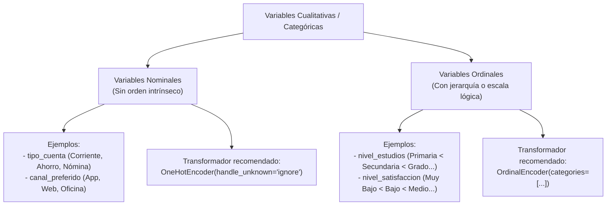
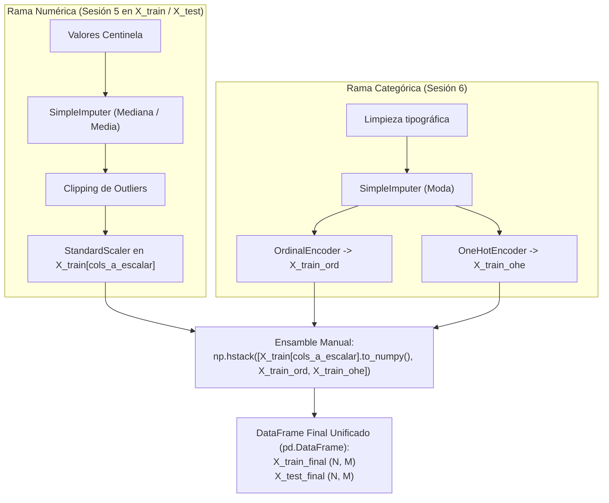

<div class="justify-text">

En la sesión anterior dominamos el tratamiento exhaustivo de las variables cuantitativas: sanitizamos valores centinela, imputamos nulos, acotamos los valores atípicos mediante *clipping* y estandarizamos las distribuciones con `StandardScaler`.

Sin embargo, las bases de datos del mundo real no están compuestas únicamente por números continuos. Columnas como el `tipo_cuenta`, el `canal_preferido`, el `nivel_estudios` o el `nivel_satisfaccion` contienen información cualitativa expresada mediante texto o categorías discretas. 

En esta sesión abordaremos la **rama categórica**: aprenderemos a imputar texto respetando la estanqueidad de datos, a distinguir cuándo codificar mediante jerarquías o mediante columnas binarias, a blindar nuestros modelos ante valores nunca vistos en producción y a experimentar en primera persona la complejidad y fragilidad de **ensamblar manualmente** todas las matrices resultantes mediante `np.hstack`.

---

## La necesidad de codificar variables cualitativas

Los algoritmos de Machine Learning y Deep Learning no comprenden el lenguaje natural de forma innata. En su núcleo matemático, los modelos son motores de **álgebra lineal**: realizan multiplicaciones de matrices, cálculos de distancias euclídeas y productos escalares entre vectores de pesos ($\mathbf{w}$) y vectores de características ($\mathbf{x}$):

$$\hat{y} = w_1 x_1 + w_2 x_2 + \dots + w_n x_n + b$$

Si una celda contiene la cadena `"Corriente"` o `"App Movil"`, el procesador no puede ejecutar ninguna operación aritmética sobre ella. Es estrictamente obligatorio traducir cada categoría cualitativa a un formato numérico algebraicamente coherente.

### La distinción esencial: nominales vs. ordinales

El diagnóstico realizado durante la fase de Análisis Exploratorio de Datos (EDA) nos permite clasificar las variables cualitativas en dos grandes familias:



1. **Variables nominales:**  
   No existe ninguna relación de orden, rango o jerarquía matemática entre sus valores. ¿Es una cuenta `"Nómina"` mayor, menor o superior a una cuenta `"Ahorro"`? ¿Es la `"App Movil"` matemáticamente superior a la `"Oficina"`? La respuesta es no; son simplemente etiquetas cualitativas disjuntas.

2. **Variables ordinales:**  
   Sus categorías poseen un orden natural y una escala lógica de progresión claramente demostrable. Sabemos con certeza que tener estudios de `"Doctorado"` implica un nivel formativo superior a `"Grado"`, y este a su vez superior a `"Primaria"`. De igual modo, una satisfacción `"Muy Alta"` se sitúa jerárquicamente por encima de `"Media"` y `"Muy Baja"`.

Elegir el método de codificación erróneo alterará por completo las relaciones de distancia del espacio geométrico de entrada, confundiendo al modelo predictivo.

---

## Limpieza textual previa

Antes de aplicar cualquier transformador o imputador de Scikit-learn, es fundamental corregir todos los **errores tipográficos, inconsistencias de formato y caracteres accidentales** detectados previamente durante la fase de EDA.

Si una misma categoría aparece registrada con distintas grafías —por ejemplo, `"Ahorro"` y `"ahorro"`, o con espacios sobrantes como `" Ahorro "`—, los algoritmos y codificadores las interpretarán como si fueran categorías completamente diferentes, fragmentando la señal de los datos y multiplicando innecesariamente las columnas *dummy*.

A continuación se muestra un ejemplo concreto para unificar las inconsistencias de mayúsculas y espacios en la columna `tipo_cuenta`:

```python
# Ejemplo concreto: eliminar espacios en blanco y unificar mayúsculas/minúsculas
# para que 'ahorro' y 'Ahorro' pasen a ser la misma categoría ('Ahorro')
X_train['tipo_cuenta'] = X_train['tipo_cuenta'].str.strip().str.capitalize()
X_test['tipo_cuenta'] = X_test['tipo_cuenta'].str.strip().str.capitalize()
```

:::info Adaptación a las necesidades específicas del proyecto
Ten en cuenta que este es solo un ejemplo ilustrativo para una columna determinada. En cada proyecto deberás adaptar el código de limpieza a las anomalías concretas descubiertas durante tu análisis exploratorio (por ejemplo, corregir erratas específicas mediante un diccionario de equivalencias con `.replace()`, eliminar caracteres extraños o unificar abreviaturas).
:::

---

## Imputación de variables categóricas con `SimpleImputer`

Al igual que ocurría en la rama numérica, las variables cualitativas pueden presentar valores ausentes (`np.nan`). Antes de poder codificar una columna en números, debemos resolver la presencia de nulos.

A diferencia de los datos cuantitativos, en las variables de texto o categorías no es posible calcular una media ni una mediana aritmética. Por ello, la estrategia estándar de referencia es **la moda (`strategy='most_frequent'`)**: Scikit-learn identifica el valor que más se repite en `X_train` y lo utiliza para rellenar las ausencias tanto en el conjunto de entrenamiento como en el de test.

### Implementación en código

Agrupamos todas las características cualitativas en una lista y aplicamos un único imputador por moda:

```python
from sklearn.impute import SimpleImputer

# Columnas cualitativas a imputar
cols_categoricas = ['tipo_cuenta', 'canal_preferido', 'nivel_estudios', 'nivel_satisfaccion']

# 1. Instanciamos el imputador con la estrategia del valor más frecuente (moda)
imputer_cat = SimpleImputer(strategy='most_frequent')

# 2. FIT: Aprende la moda de cada columna ÚNICAMENTE de X_train
imputer_cat.fit(X_train[cols_categoricas])

print("Modas aprendidas en X_train:")
for col, moda in zip(cols_categoricas, imputer_cat.statistics_):
    print(f" - {col}: '{moda}'")

# 3. TRANSFORM: Imputamos tanto en Train como en Test
X_train[cols_categoricas] = imputer_cat.transform(X_train[cols_categoricas])
X_test[cols_categoricas] = imputer_cat.transform(X_test[cols_categoricas])
```

:::info ¿Existe la imputación por valor constante?
Sí. Scikit-learn también permite configurar `strategy='constant'` especificando un valor de relleno con el parámetro `fill_value` (por ejemplo, `fill_value='Desconocido'` o `'No Consta'`). 

Esta opción resulta útil en situaciones particulares donde la ausencia del dato tiene un significado de negocio específico y se desea crear deliberadamente una nueva categoría para aislar esa incertidumbre. No obstante, para la gran mayoría de problemas y casos prácticos en el aula, **la moda (`strategy='most_frequent'`) es la opción recomendada**, ya que evita crear categorías artificiales y no altera las jerarquías ordinales de los datos.
:::

---

## Codificación ordinal con `OrdinalEncoder`

Cuando una variable presenta una jerarquía lógica natural, el objetivo de la codificación es **preservar esa relación de orden en el eje numérico**, asignando números enteros crecientes ($0, 1, 2, 3, \dots$).

### El uso profesional de `OrdinalEncoder`

El transformador `OrdinalEncoder` de Scikit-learn permite definir explícitamente el orden de las categorías mediante el parámetro `categories`. Este parámetro recibe una **lista de listas**, donde cada sublista describe la jerarquía exacta que debe asignarse a cada columna:

```python
from sklearn.preprocessing import OrdinalEncoder

# 1. Definimos el orden explícito de menor a mayor
orden_estudios = ['Primaria', 'Secundaria', 'Grado', 'Master', 'Doctorado']
orden_satisfaccion = ['Muy Bajo', 'Bajo', 'Medio', 'Alto', 'Muy Alto']

# 2. Instanciamos el codificador ordinal indicando las jerarquías
encoder_ordinal = OrdinalEncoder(categories=[orden_estudios, orden_satisfaccion])

# 3. FIT: Aprende la correspondencia numérica exclusivamente de X_train
cols_ordinales = ['nivel_estudios', 'nivel_satisfaccion']
encoder_ordinal.fit(X_train[cols_ordinales])

# 4. TRANSFORM: Generamos las matrices numéricas correspondientes
X_train_ord = encoder_ordinal.transform(X_train[cols_ordinales])
X_test_ord = encoder_ordinal.transform(X_test[cols_ordinales])
```

:::warning Separación en variables independientes
Observa que, a diferencia de lo que hicimos en la rama numérica (donde sobreescribíamos directamente sobre el DataFrame con `X_train[...] = ...`), ahora el resultado de la transformación se almacena en variables independientes (`X_train_ord` y `X_test_ord`).

Esto implica que estas características han quedado temporalmente fuera del DataFrame principal y que posteriormente tendremos que ensamblarlas de nuevo manualmente junto a las numéricas y a las nominales para conformar la matriz final de `X_train` y `X_test`.
:::

Al inspeccionar los datos transformados, observamos que:
* `'Primaria'` $\to 1.0$
* `'Grado'` $\to 3.0$
* `'Doctorado'` $\to 5.0$

El modelo lineal o el árbol de decisión podrá interpretar de forma nativa que avanzar de `1.0` a `3.0` representa un incremento en la escala formativa.

### El error clásico a desterrar: codificar nominales con enteros arbitrarios

Un fallo muy habitual entre principiantes consiste en codificar variables nominales asignando números enteros correlativos, ya sea manualmente con diccionarios de Python o mediante `LabelEncoder`:

```python
# ❌ ERROR GRAVE DE ARQUITECTURA: Mapeo ordinal arbitrario sobre una variable nominal
mapeo_tramposo = {'Coche': 0, 'Moto': 1, 'Camion': 2}
```

:::danger ¿Por qué está prohibido hacer esto con variables nominales?
Al asignar `0`, `1` y `2` a las categorías `Coche`, `Moto` y `Camion`:
1. El modelo asume que un `Camion` vale el doble que una `Moto` ($2 = 2 \times 1$).
2. El algoritmo asume que un `Coche` y un `Camion` están el doble de distanciados ($|2 - 0| = 2$) que un `Coche` y una `Moto` ($|1 - 0| = 1$).
3. Si calculamos distancias euclídeas o ajustamos un hiperplano de regresión, el modelo encontrará correlaciones y pendientes espurias completamente inexistentes en el mundo real.

`LabelEncoder` está diseñado exclusivamente para transformar la variable objetivo unidimensional ($y$), **nunca** para la matriz de características explicativas ($X$).
:::

---

## Codificación nominal con `OneHotEncoder`

Para variables puramente cualitativas sin relación de orden (`tipo_cuenta`, `canal_preferido`, `pais`, etc.), el estándar indiscutible en la industria es la **codificación One-Hot** (*One-Hot Encoding* o variables *dummy*).

### Mecanismo de funcionamiento

El transformador crea **una nueva columna binaria por cada categoría única** detectada en la fase de entrenamiento. Para cada registro, la columna correspondiente a su categoría toma el valor `1` y el resto de columnas toman el valor `0`:

| Cliente | `canal_preferido` | $\to$ | `canal_App Movil` | `canal_Oficina` | `canal_Web` |
| :---: | :---: | :---: | :---: | :---: | :---: |
| **CLI-1001** | App Movil | $\to$ | **1** | 0 | 0 |
| **CLI-1002** | Oficina | $\to$ | 0 | **1** | 0 |
| **CLI-1003** | Web | $\to$ | 0 | 0 | **1** |

Geométricamente, las tres categorías quedan situadas a la **misma distancia euclídea** entre sí ($\sqrt{(1-0)^2 + (0-1)^2} = \sqrt{2} \approx 1.414$), garantizando la máxima equidad matemática y eliminando cualquier sesgo de jerarquía artificial.

### Parámetros clave para entornos de producción

`OneHotEncoder` incorpora argumentos fundamentales para garantizar la estabilidad del software en producción:

* **`sparse_output=False`:**  
  Por defecto, Scikit-learn devuelve matrices dispersas en formato CSR (`scipy.sparse.csr_matrix`) para optimizar el uso de memoria cuando existen miles de categorías. Al fijar `sparse_output=False`, devuelve arrays densos estándar de NumPy, lo que facilita enormemente la inspección visual, la depuración y la concatenación manual.
* **`handle_unknown='ignore'` (El salvavidas de producción):**  
  ¿Qué ocurre si durante el entrenamiento el modelo solo vio los canales `App Movil`, `Oficina` y `Web`, pero tres meses después un usuario accede a través de `Metaverso` o `Kiosco Digital`?  
  * Con la configuración por defecto (`handle_unknown='error'`), Scikit-learn lanzará una excepción fatal (`ValueError: Found unknown categories...`), **tumbando el servicio en producción**.  
  * Con `handle_unknown='ignore'`, el codificador procesará la nueva categoría sin fallos, asignando un `0` en todas las columnas dummies de esa variable. El sistema sigue funcionando con total resiliencia.

### Implementación en código

```python
from sklearn.preprocessing import OneHotEncoder

cols_nominales = ['tipo_cuenta', 'canal_preferido']

# 1. Instanciamos el codificador con blindaje de producción y salida densa
encoder_ohe = OneHotEncoder(
    handle_unknown='ignore',
    sparse_output=False
)

# 2. FIT: Descubre y memoriza las categorías únicas SOLO de X_train
encoder_ohe.fit(X_train[cols_nominales])

# 3. TRANSFORM: Genera la matriz de dummies
X_train_ohe = encoder_ohe.transform(X_train[cols_nominales])
X_test_ohe = encoder_ohe.transform(X_test[cols_nominales])

# Inspeccionamos los nombres generados para cada nueva columna
nombres_dummies = encoder_ohe.get_feature_names_out(cols_nominales)
print(f"Número de características dummy generadas: {len(nombres_dummies)}")
print("Nuevas columnas generadas:")
for nombre in nombres_dummies:
    print(f" - {nombre}")
```

### Prueba de estrés: categorías desconocidas en inferencia

Comprobemos en vivo la protección que nos otorga `handle_unknown='ignore'`. Simularemos un nuevo registro en inferencia con un canal exótico jamás observado durante el entrenamiento:

```python
import pandas as pd

# Simulamos un nuevo cliente que usa un canal nunca visto
cliente_nuevo = pd.DataFrame({
    'tipo_cuenta': ['Corriente'],
    'canal_preferido': ['Metaverso']  # ¡Categoría desconocida!
})

# Transformamos con el encoder ajustado en entrenamiento
cliente_nuevo_ohe = encoder_ohe.transform(cliente_nuevo)

# Mostramos el resultado como DataFrame para facilitar la inspección
df_prueba = pd.DataFrame(cliente_nuevo_ohe, columns=nombres_dummies)
print(df_prueba.to_string(index=False))
```

Al inspeccionar la salida, el codificador no lanza error y asigna `0.0` a todas las columnas de `canal_preferido`, garantizando la resiliencia del pipeline en producción.

---

## Codificación con `LabelEncoder`

Un transformador que suele generar dudas al iniciarse en Scikit-learn es `LabelEncoder`. Su propósito es muy concreto: está diseñado **única y exclusivamente para codificar la variable objetivo ($y$, el target)** cuando se trata de un problema de clasificación y sus valores vienen representados por etiquetas de texto.

A diferencia de `OrdinalEncoder` y `OneHotEncoder` (que esperan recibir la matriz bidimensional de características $X$), `LabelEncoder` espera recibir un **vector unidimensional** ($y$). **Nunca** debe utilizarse sobre las características explicativas de $X$.

### Implementación en código

Supongamos que nuestra variable objetivo `y` contiene texto (por ejemplo, `'Abandona'` y `'No Abandona'`):

```python
from sklearn.preprocessing import LabelEncoder

# 1. Instanciamos el codificador para la variable objetivo
label_encoder = LabelEncoder()

# 2. FIT: Aprende las clases y su orden alfabético exclusivamente de y_train
label_encoder.fit(y_train)

print(f"Clases aprendidas: {label_encoder.classes_}")

# 3. TRANSFORM: Codifica a enteros (0, 1...) en Train y Test
y_train_encoded = label_encoder.transform(y_train)
y_test_encoded = label_encoder.transform(y_test)

# Permite decodificar las predicciones del modelo a texto en el futuro:
# label_encoder.inverse_transform([0, 1])
```

### Alternativa habitual para variables objetivo binarias: el uso de `.map()`

Cuando la variable objetivo es estrictamente **binaria** (solo existen dos categorías posibles, como `'Sí'`/`'No'` o `'Abandona'`/`'No Abandona'`), en el flujo de trabajo con Pandas suele ser mucho más directo y transparente utilizar un mapeo explícito mediante `.map()`:

```python
# Mapeo manual explícito: aseguramos el control de cuál es la clase positiva (1)
mapeo_target = {'No Abandona': 0, 'Abandona': 1}

y_train = y_train.map(mapeo_target)
y_test = y_test.map(mapeo_target)
```

:::info ¿Por qué preferir `.map()` en clasificación binaria?
`LabelEncoder` asigna el valor `0` a la primera clase por orden alfabético y `1` a la segunda. Si tus clases son `'No Abandona'` y `'Abandona'`, `'Abandona'` pasará a ser `0` y `'No Abandona'` pasará a ser `1`. 

Con un diccionario y `.map()` defines de forma 100 % explícita y bajo tu control qué categoría representa el evento de interés o **clase positiva ($1$)**, evitando confusiones al interpretar métricas de evaluación posteriores.
:::

---

## Regla de oro: NUNCA se escalan las variables dummy

Existe una tentación recurrente tras aplicar `OneHotEncoder`: pasar toda la matriz combinada por un `StandardScaler`. **Esto es un grave error metodológico**.

Las columnas resultantes de un One-Hot Encoding ya se encuentran acotadas en un rango natural perfecto:

$$\{0, 1\}$$

Si aplicamos `StandardScaler` sobre una columna binaria:

1. **Destruye su significado booleano directo:** Una celda con `0` ya no representa *"ausencia del atributo"* ni `1` representa *"presencia del atributo"*.
2. **Introduce valores continuos artificiales:** Al restar la media ($\mu$) y dividir por la desviación ($\sigma$), los ceros se transforman en valores negativos (ej. $-0.26$) y los unos en valores positivos altos (ej. $+3.81$), dependiendo de cuán frecuente sea la categoría.
3. **Destruye la esparcidad de los datos:** En datasets de gran volumen, millones de ceros que no ocupaban espacio se convierten en números flotantes de 64 bits, disparando el consumo de memoria RAM.

:::warning Principio de separación arquitectónica
El escalado numérico (`StandardScaler`, `MinMaxScaler`) pertenece **única y exclusivamente a las características cuantitativas continuas** (importe, saldo, edad, tiempo). Las variables binarias y dummies procedentes de `OneHotEncoder` deben mantenerse exactamente como unos y ceros.
:::

---

## La fricción del ensamble manual de matrices

Llegados a este punto, hemos procesado las diferentes ramas de nuestro conjunto de datos:

1. **Rama numérica continua** (Sesión 5): Las columnas cuantitativas (`cols_a_escalar = ['edad', 'ingresos_anuales', 'antiguedad_meses', 'saldo_cuenta']`) ya quedaron limpias y estandarizadas directamente en los DataFrames `X_train` y `X_test`.
2. **Rama ordinal codificada** (Sesión 6): Los arrays de NumPy `X_train_ord` y `X_test_ord`.
3. **Rama nominal codificada** (Sesión 6): Los arrays de NumPy `X_train_ohe` y `X_test_ohe`.

Para poder alimentar un algoritmo de Machine Learning, necesitamos unificar todos estos bloques en una **única matriz bidimensional final** ($X_{\text{final}}$):



### Concatenación horizontal y creación del DataFrame final

Como las columnas numéricas ya escaladas residen en el DataFrame `X_train` y las transformaciones cualitativas se encuentran en arrays independientes de NumPy (`X_train_ord` y `X_train_ohe`), debemos unificar todos los bloques.

Para que el resultado final vuelva a ser un **DataFrame de Pandas** estructurado con sus nombres de columnas y sus índices originales (lo que nos permitirá inspeccionarlo cómodamente con `.head()`, filtrarlo o guardarlo en CSV):

1. **Reconstruimos la lista ordenada de nombres de columnas:** Combinamos los nombres de las numéricas, las ordinales y las columnas *dummy* generadas por el `OneHotEncoder`.
2. **Concatenamos con `np.hstack` y envolvemos en `pd.DataFrame`:** Unimos los bloques matriciales y asignamos tanto los nombres de columnas como los índices originales (`index=X_train.index`).

```python
import numpy as np
import pandas as pd

# 1. Definimos las columnas numéricas cuantitativas
# (OJO: incluye tanto las continuas escaladas como las discretas/binarias que no se escalaron)
cols_numericas = ['edad', 'ingresos_anuales', 'antiguedad_meses', 'saldo_cuenta', 'num_productos', 'tiene_tarjeta']

# 2. Reconstruimos la lista completa y ordenada de nombres de columnas
# (numéricas + ordinales + dummies generadas por OHE)
nombres_columnas_final = (
    cols_numericas + 
    cols_ordinales + 
    list(encoder_ohe.get_feature_names_out(cols_nominales))
)

# 3. Concatenamos con np.hstack y convertimos inmediatamente en pd.DataFrame
X_train_final = pd.DataFrame(
    np.hstack([
        X_train[cols_numericas].to_numpy(),  # Rama numérica (escaladas y binarias)
        X_train_ord,                         # Rama ordinal codificada
        X_train_ohe                          # Rama nominal codificada con One-Hot
    ]),
    columns=nombres_columnas_final,
    index=X_train.index
)

X_test_final = pd.DataFrame(
    np.hstack([
        X_test[cols_numericas].to_numpy(),
        X_test_ord,
        X_test_ohe
    ]),
    columns=nombres_columnas_final,
    index=X_test.index
)

print(f"Dimensiones de X_train_final: {X_train_final.shape}")
print(f"Dimensiones de X_test_final:  {X_test_final.shape}")

# Inspección visual de las primeras filas del DataFrame unificado
X_train_final.head()
```

### La fragilidad del enfoque artesanal: el «código espagueti»

Aunque este procedimiento funciona y nos devuelve un DataFrame limpio y listo con `.head()`, expone una **fricción técnica considerable** en el día a día de un equipo de ingeniería de datos. 

Analicemos los riesgos críticos de este enfoque manual:

1. **Reconstrucción artesanal de metadatos:**  
   Al unificar bloques con `np.hstack`, NumPy descarta por completo los nombres de las columnas y los índices. Nos vemos obligados a reconstruir manualmente listas de cadenas de texto (`nombres_columnas_final = cols_numericas + cols_ordinales + list(...)`), con el riesgo añadido de equivocarnos en el orden relativo de las columnas respecto a los arrays concatenados.
2. **Mezcla caótica de estructuras (DataFrames y Arrays):**  
   Tenemos partes del dataset modificadas dentro de `X_train` y otras partes dispersas en arrays flotantes (`X_train_ord`, `X_train_ohe`). Esto nos obliga a recordar exactamente qué lista de columnas numéricas extraer (`X_train[cols_numericas].to_numpy()`) y cuáles ignorar para no meter texto original en NumPy.
3. **Altísimo riesgo de desalineación de columnas:**  
   Si en `X_train_final` concatenaste `[numéricas, ordinales, nominales]`, pero en `X_test_final` o en la función de inferencia en producción concatenas por error `[numéricas, nominales, ordinales]`, las dimensiones coincidirán, pero el modelo estará multiplicando los pesos de la educación por las dummies del canal. El modelo predecirá basura sin emitir ningún mensaje de error.
4. **Infierno de serialización en producción:**  
   Para desplegar este modelo en una API REST, el ingeniero de software debe guardar mediante `joblib.dump` **cuatro o cinco archivos `.joblib` distintos** (`imputer_num.joblib`, `scaler.joblib`, `imputer_cat.joblib`, `encoder_ord.joblib`, `encoder_ohe.joblib`), cargarlos individualmente y ejecutar el preprocesamiento en el mismo orden exacto para cada predicción en tiempo real.

:::tip La semilla de la siguiente etapa
Esta fricción manual y evidente es precisamente el motivo por el cual la ingeniería de software moderna en Inteligencia Artificial inventó herramientas como **`ColumnTransformer`** y **`Pipeline`**. En las próximas sesiones aprenderemos a encapsular toda esta maquinaria dispersa en un único objeto unificado de Scikit-learn.
:::

---

## 💻 Ejercicio guiado: rama categórica y ensamble final

### Contexto de la práctica
Completaremos la transformación de [`clientes_banca_raw.csv`](./0-datasets/clientes_banca_raw.csv) abordando todas las características cualitativas y ensamblando la matriz final que alimentará el modelo predictivo.

:::info Continuidad del Notebook
Trabaja en el mismo Jupyter Notebook donde completaste la sesión anterior (donde ya dispones de las columnas numéricas escaladas directamente en `X_train` y `X_test`).
:::

### Tareas a realizar paso a paso

1. **Sanitización y normalización de cadenas:**
   * Convierte a formato estándar (eliminación de espacios en blanco en los extremos y unificación tipográfica) las columnas cualitativas que lo necesiten.
2. **Imputación cualitativa:**
   * Aplica `SimpleImputer` con `strategy='most_frequent'` sobre el conjunto de variables cualitativas que lo requieran.
   * Verifica que no quedan nulos en dichas columnas.
3. **Codificación ordinal:**
   * Define la jerarquía exacta para las variables que sean categóricas ordinales.
   * Realiza la transformación tanto en `X_train` como en `X_test`.
4. **Codificación nominal:**
   * Configura `OneHotEncoder` y ajusta el transformador sobre las columnas nominales de `X_train` y transforma Train y Test.
   * Extrae e imprime los nombres de las características generadas con `encoder.get_feature_names_out()`.
5. **Ensamble manual y auditoría dimensional:**
   * Utiliza `np.hstack` para unir las columnas numéricas ya preparadas de `X_train` y `X_test` con los bloques ordinal y nominal generados en esta sesión.
   * Imprime la forma (`.shape`) de `X_train_final` y `X_test_final` y comprueba que ambas matrices tienen exactamente el mismo número de columnas.
   * Muestra por pantalla los primeros 10 clientes de `X_train_final` y `X_test_final` para verificar que el ensamble se ha realizado correctamente.
   * Asegúrate de que no se te haya olvidado añadir ninguna columna importante.

</div>
