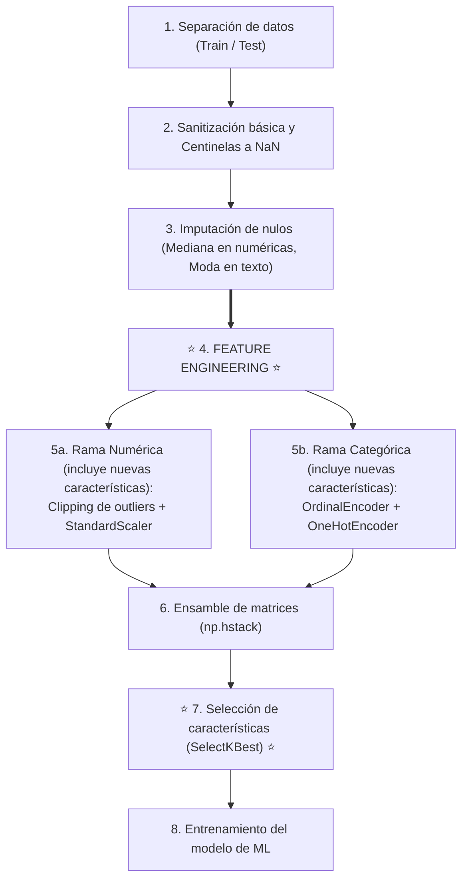
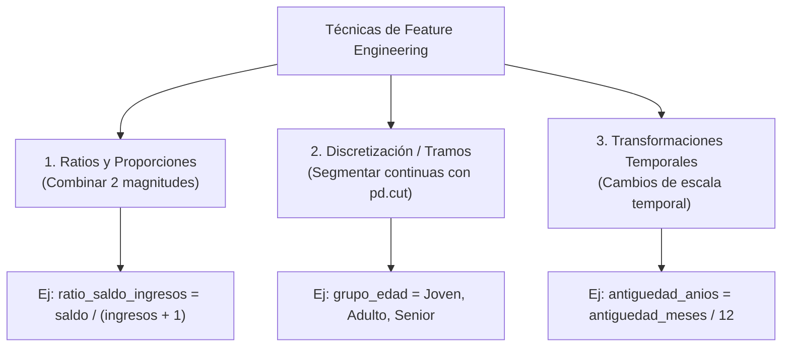
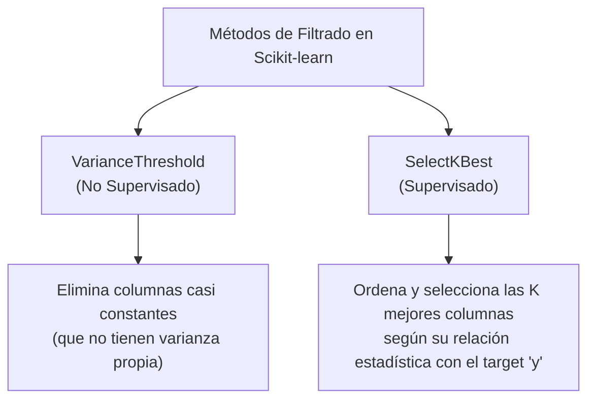

<div class="justify-text">

En las sesiones anteriores aprendimos a limpiar y formatear nuestros datos: sanitizamos centinelas, imputamos ausencias, recortamos valores atípicos, escalamos variables numéricas y codificamos el texto. El dataset ya es algebraicamente legible por cualquier algoritmo de Machine Learning.

Sin embargo, los modelos son esencialmente «miopes» frente al contexto real del problema: solo ven columnas aisladas de números y matrices. No saben qué es un banco, qué significa una nómina o por qué tener poco saldo habiendo ganado mucho dinero puede ser un síntoma claro de abandono inminente.

En esta sesión abordaremos dos disciplinas complementarias y fundamentales:
1. **Feature Engineering (Ingeniería de características):** El arte de combinar y transformar variables existentes para crear nuevas columnas que aporten información de negocio valiosa y directa al modelo.
2. **Selección de características:** El proceso de evaluar y cribar nuestras variables para eliminar el ruido, quedándonos únicamente con aquellas que poseen un poder predictivo real.

## El mapa global del pipeline

Para no perder la perspectiva del flujo de trabajo, es fundamental visualizar en qué momento exacto entra en juego la creación de variables dentro del ciclo completo de preparación de datos:



:::warning Cambio en el flujo de trabajo
Observa con atención este esquema: **la forma de trabajar cambia respecto a lo aprendido en las sesiones anteriores**.

Hasta ahora habíamos abordado el preprocesamiento tratando primero todas las variables numéricas de golpe (Sesión 5) y después todas las categóricas de golpe (Sesión 6). Al introducir *Feature Engineering*, ya no podemos trabajar en bloques aislados: es imprescindible seguir el orden secuencial del diagrama anterior. 

Primero se sanean e imputan los nulos de todo el dataset, después se crean las nuevas variables a partir de datos limpios en unidades de negocio reales, y finalmente se aplican el escalado y la codificación (incluyendo en esas etapas las nuevas características generadas).
:::

---

## Feature engineering

El profesor y pionero de la Inteligencia Artificial **Andrew Ng** suele resumirlo en una frase célebre:

> *«El Machine Learning aplicado es, en esencia, Feature Engineering»*.

Los algoritmos de aprendizaje automático son excelentes encontrando relaciones matemáticas entre las entradas ($X$) y la salida ($y$), pero su capacidad depende de cómo le presentemos la información. 

Si obligamos al modelo a deducir patrones complejos a partir de datos en bruto, necesitará modelos mucho más pesados, miles de datos adicionales y correrá el riesgo de sobreajustarse (*overfitting*). Por el contrario, si le entregamos variables **«masticadas»** que capturen directamente relaciones lógicas de negocio, el modelo aprenderá de forma más rápida, precisa y estable.

:::tip Principio de diseño
El *Feature Engineering* no consiste en inventar docenas de columnas al azar con operaciones matemáticas aleatorias. Cada nueva variable debe responder a una **hipótesis de negocio razonable** que hayamos detectado o sospechado durante el Análisis Exploratorio de Datos (EDA).
:::

---

### Técnicas de creación de características

No es necesario aplicar fórmulas matemáticas complejas para obtener mejoras sustanciales en un modelo predictivo. La mayoría de los avances provienen de tres técnicas muy intuitivas:



#### Ratios y proporciones relativas

Un número absoluto suele decir muy poco si no se compara con su contexto de referencia:
* Un cliente con un saldo de $5.000$ € en cuenta puede parecer solvente a primera vista.
* Pero si ese cliente ingresa $120.000$ € al año, tener solo $5.000$ € ahorrados indica que está utilizando otro banco para su ahorro principal.
* Por el contrario, para un cliente con ingresos de $14.000$ € al año, tener $5.000$ € en cuenta representa un colchón financiero excelente.

Al calcular el **ratio entre dos magnitudes**, le entregamos al algoritmo una métrica normalizada de comportamiento financiero relativo:

```python
# Creación de un ratio financiero relativo
# (Añadimos +1 al denominador para prevenir errores por división entre cero)
X_train['ratio_saldo_ingresos'] = X_train['saldo_cuenta'] / (X_train['ingresos_anuales'] + 1)
X_test['ratio_saldo_ingresos'] = X_test['saldo_cuenta'] / (X_test['ingresos_anuales'] + 1)
```

Otro ejemplo clásico en nuestro dataset bancario es calcular el **saldo medio por producto contratado**:

```python
X_train['saldo_por_producto'] = X_train['saldo_cuenta'] / X_train['num_productos']
X_test['saldo_por_producto'] = X_test['saldo_cuenta'] / X_test['num_productos']
```

:::info El truco del «+1» en el denominador
En cualquier operación de división entre columnas, si el denominador puede contener valores `0.0`, Python producirá valores infinitos (`inf` o divisiones por cero). Añadir un pequeño sesgo como `+ 1` evita que el pipeline colapse y no altera la interpretación de la variable.
:::

#### Discretización en tramos (*binning*)

A veces, la relación entre una variable numérica continua y el objetivo no es gradual ni lineal, sino que se produce por «saltos generacionales» o etapas vitales.

Con la función `pd.cut()` de Pandas podemos agrupar una columna continua (como la `edad`) en intervalos categóricos con significado intuitivo:

```python
import pandas as pd

# Definimos los límites de los tramos y sus etiquetas
limites_edad = [0, 30, 55, 120]
etiquetas_edad = ['Joven', 'Adulto', 'Senior']

# Creamos la nueva variable cualitativa por tramos
X_train['grupo_edad'] = pd.cut(X_train['edad'], bins=limites_edad, labels=etiquetas_edad)
X_test['grupo_edad'] = pd.cut(X_test['edad'], bins=limites_edad, labels=etiquetas_edad)
```

Posteriormente, esta nueva columna categórica puede transformarse mediante `OrdinalEncoder` o `OneHotEncoder` siguiendo el procedimiento habitual de la rama cualitativa.

#### Transformaciones temporales y de escala

Una columna que contenga fechas específicas en formato texto (por ejemplo, `'10-06-2026'` o `'2024-03-15'`) **aporta muy poco o nada de forma directa a un modelo de Machine Learning**: al tener prácticamente una fecha única por cada cliente o registro, el algoritmo no puede extraer patrones generales a partir de una cadena de texto.

Sin embargo, si convertimos esa columna a formato temporal con `pd.to_datetime()`, podemos derivar nuevas características con un alto poder predictivo:

* **Componentes estacionales:** Extraer el año (`.dt.year`), el mes (`.dt.month`) o el día de la semana (`.dt.dayofweek`) para capturar patrones periódicos (por ejemplo, descubrir si las cancelaciones se disparan a final de mes o en ciertos trimestres).
* **Indicadores booleanos (*flags*):** Crear variables binarias directas, como determinar si la operación ocurrió en fin de semana o en día laborable (`es_fin_de_semana`).
* **Cálculo de tiempos acumulados:** Medir la diferencia de días o meses transcurridos entre dos eventos (por ejemplo, el tiempo transcurrido desde la última compra).

```python
import pandas as pd

# Supongamos que disponemos de una columna con fechas en texto
# 1. Convertimos la columna a tipo datetime
X_train['fecha_alta'] = pd.to_datetime(X_train['fecha_alta'])
X_test['fecha_alta'] = pd.to_datetime(X_test['fecha_alta'])

# 2. Extraemos el mes de registro y si se produjo en fin de semana (sábado=5, domingo=6)
X_train['mes_alta'] = X_train['fecha_alta'].dt.month
X_train['es_fin_de_semana'] = (X_train['fecha_alta'].dt.dayofweek >= 5).astype(int)

X_test['mes_alta'] = X_test['fecha_alta'].dt.month
X_test['es_fin_de_semana'] = (X_test['fecha_alta'].dt.dayofweek >= 5).astype(int)
```

De igual modo, cuando ya disponemos de duraciones numéricas expresadas en unidades pequeñas (como meses o días), **cambiar la escala temporal** (por ejemplo, de meses a años) simplifica enormemente la interpretación de los coeficientes del modelo:

```python
# Convertimos meses a años de vinculación
X_train['antiguedad_anios'] = X_train['antiguedad_meses'] / 12.0
X_test['antiguedad_anios'] = X_test['antiguedad_meses'] / 12.0
```

---

### ¿En qué momento del pipeline se crean las características?

Como vimos en el diagrama global de la introducción, el *Feature Engineering* ocupa un lugar muy específico en el flujo (Paso 4):

1. **¿Por qué DESPUÉS de la imputación?**  
   Porque si intentas calcular un ratio (`saldo / ingresos`) y una fila tiene un valor nulo (`NaN`) en cualquiera de las dos columnas, la nueva columna resultante nacerá con un nulo. Al imputar primero, garantizas que cualquier variable derivada se calcule sobre datos limpios y completos.
2. **¿Por qué ANTES de escalar y codificar?**  
   * **Para las variables numéricas:** Porque los ratios necesitan operar con magnitudes reales del negocio (euros entre euros, meses entre productos). Si intentas calcular un ratio tras aplicar `StandardScaler`, las columnas tendrán media $0.0$, varianza $1.0$ y números negativos; dividir dos números que oscilan alrededor de cero provoca divisiones por valores casi nulos (asíntotas) y números carentes de significado físico. Una vez creado el nuevo ratio, **se incorpora a la lista de numéricas y se escala junto al resto**.
   * **Para las variables categóricas:** Si creas una variable por tramos con `pd.cut()` (como `grupo_edad`: `'Joven'`, `'Adulto'`, `'Senior'`), esa nueva columna cualitativa **debe pasar a continuación por el `OneHotEncoder`** para convertirse en columnas binarias $\{0, 1\}$.

:::tip Regla mnemotécnica
1. Primero limpias la casa (centinelas e imputación).  
2. Luego construyes los muebles nuevos (*Feature Engineering*).  
3. Al final empaquetas todo para la mudanza (escalado y codificación).
:::

---

## Selección de características: menos es más

Tras explorar ideas de negocio y aplicar *Feature Engineering*, es tentador crear 30 o 40 columnas nuevas combinando todo lo que se nos ocurra. Sin embargo, en Inteligencia Artificial más variables no significan necesariamente mejores predicciones.

### La maldición de la dimensionalidad

Añadir variables superfluas, repetitivas o con poco poder discriminatorio acarrea problemas muy serios:

1. **Inyección de ruido:** Si introducimos una columna que no tiene correlación real con el abandono, el algoritmo puede encontrar correlaciones casuales o espurias en los datos de entrenamiento, aumentando el sobreajuste (*overfitting*).
2. **Mayor coste computacional:** Modelos con cientos de columnas tardan mucho más en entrenarse y requieren más memoria en los servidores de producción.
3. **Pérdida de interpretabilidad:** Es mucho más difícil explicarle al negocio o a un regulador bancario por qué el modelo rechaza una operación si depende de 150 variables en vez de las 10 o 12 más determinantes.

La **selección de características (*Feature Selection*)** consiste precisamente en aplicar filtros estadísticos para **descartar el ruido y conservar únicamente las variables más informativas**.

:::info ¿Siempre es obligatorio aplicar selección de características?
**No, no siempre se hace.** La decisión de aplicar selección de variables depende fundamentalmente de la naturaleza del problema y del algoritmo que vayamos a utilizar:

* **Modelos con selección intrínseca:** Los algoritmos basados en árboles de decisión (como *Random Forest*, *XGBoost* o *LightGBM*) seleccionan automáticamente en cada partición qué variables aportan mayor ganancia de información e ignoran el ruido o las columnas redundantes. Del mismo modo, los modelos lineales con regularización $L_1$ (*Lasso*) penalizan las variables poco informativas llevando sus coeficientes exactamente a cero.
* **¿Cuándo sí resulta fundamental?**
  * En algoritmos sensibles a las distancias (como $k$-NN o SVM), donde variables ruidosas distorsionan la distancia geométrica entre puntos (la conocida *«maldición de la dimensionalidad»*).
  * En modelos lineales estándar sin regularización.
  * Cuando tras aplicar *One-Hot Encoding* sobre variables de alta cardinalidad o texto el número de columnas se dispara a cientos o miles, ralentizando el entrenamiento y disparando el consumo de memoria.
  * Cuando el negocio exige un modelo muy simple, rápido y fácil de auditar en producción.

**La buena práctica en Machine Learning:** Probar ambas opciones. En la fase de experimentación, se entrena y evalúa el modelo con todas las variables (`X_train_final`) y también con las características seleccionadas (`X_train_seleccionado`). Solo si la selección mantiene o mejora la métrica de evaluación (o reduce drásticamente la complejidad sin perder precisión) se adopta definitivamente para el modelo final.
:::

---

### Filtros estadísticos en Scikit-learn

Scikit-learn ofrece dos herramientas directas y muy accesibles para cribar características sin necesidad de entrenar modelos complejos:



#### ¿Sobre qué datos se aplica la selección?

Observa el flujo global del pipeline (Paso 7): **la selección de características se realiza sobre el DataFrame unificado (`X_train_final`, `X_test_final`)**, después de haber completado las transformaciones numéricas, la codificación categórica y el ensamble.

¿Por qué se hace en este punto y no antes?
1. **Compatibilidad técnica:** Los estimadores de Scikit-learn como `VarianceThreshold` y `SelectKBest` requieren matrices puramente numéricas. Si les pasáramos columnas de texto (como `'Corriente'`, `'Grado'`, etc.), arrojarían un error `ValueError`.
2. **Evaluación equitativa y global:** Al operar sobre el conjunto ensamblado tras el Paso 6, **todas las variables compiten en igualdad de condiciones**: las numéricas continuas escaladas, los nuevos ratios creados, las ordinales codificadas a enteros y las columnas *dummy* procedentes del *One-Hot Encoding*.

Como en la sesión anterior empaquetamos el ensamble directamente como un **`pd.DataFrame`** con sus nombres de columnas correspondientes (`nombres_columnas_final`), ahora podemos consultar sus nombres de forma directa mediante **`X_train_final.columns`**.

#### Filtro no supervisado: `VarianceThreshold`

¿Qué valor aporta una columna que contiene prácticamente el mismo número en todas las filas? Ninguno. Una variable sin variabilidad no tiene capacidad de distinguir a un cliente que abandona de uno que se queda.

La clase **`VarianceThreshold`** calcula la varianza de cada columna en `X_train_final` y elimina automáticamente aquellas cuya variabilidad no alcance un umbral mínimo fijado:

```python
from sklearn.feature_selection import VarianceThreshold

# 1. Instanciamos el filtro (por ejemplo, descartando varianzas inferiores a 0.01)
filtro_varianza = VarianceThreshold(threshold=0.01)

# 2. FIT: Aprende la varianza de cada columna exclusivamente de X_train_final
filtro_varianza.fit(X_train_final)

# 3. Comprobamos qué columnas superaron el filtro usando .columns directamente
columnas_conservadas = X_train_final.columns[filtro_varianza.get_support()]
columnas_descartadas = X_train_final.columns[~filtro_varianza.get_support()]

print(f"Columnas conservadas ({len(columnas_conservadas)}): {list(columnas_conservadas)}")
print(f"Columnas descartadas ({len(columnas_descartadas)}): {list(columnas_descartadas)}")
```

:::tip Varianza en variables dummy
Para una variable binaria (0 o 1) con probabilidad de éxito $p$, la varianza es $p(1 - p)$. Fijar un umbral de `threshold=0.01` permite detectar y eliminar de forma natural categorías residuales o erróneas que aparecen en menos del 1 % de los registros (por ejemplo, errores tipográficos residuales o categorías marginales).
:::

#### Filtro supervisado: `SelectKBest`

Mientras que `VarianceThreshold` solo mira a las características de forma aislada, **`SelectKBest`** es un método **supervisado**: evalúa mediante una prueba estadística qué relación tiene cada columna de $X_{\text{final}}$ con la variable objetivo $y$ y se queda con las **$k$ características con mayor puntuación**.

La función de evaluación estadística (`score_func`) debe elegirse en función del tipo de problema a resolver:

| Tipo de problema ($y$) | Función recomendada (`score_func`) | ¿Qué mide internamente? |
| :--- | :--- | :--- |
| **Clasificación** (target discreto: binario o multiclase) | **`f_classif`** | ANOVA F-test: evalúa si la media de la variable varía significativamente entre las diferentes clases del target. |
| **Regresión** (target cuantitativo continuo: importe, precio) | **`f_regression`** | Correlación lineal de Pearson y test F de regresión. |

*(Nota: Scikit-learn también ofrece `mutual_info_classif` y `mutual_info_regression` basadas en información mutua, útiles cuando sospechamos relaciones no lineales complejas).*

En nuestro caso, como queremos predecir el `abandono` (clasificación binaria: 0 o 1), utilizaremos **`f_classif`** sobre el DataFrame ensamblado:

```python
import pandas as pd
from sklearn.feature_selection import SelectKBest, f_classif

# X_train_final es el DataFrame unificado (numéricas, ordinales y dummies)
# y_train es el target binario (0 o 1)

# 1. Instanciamos el selector para quedarnos con las 5 mejores características
selector = SelectKBest(score_func=f_classif, k=5)

# 2. FIT: Calcula la relación estadística de cada columna de X_train_final con y_train
selector.fit(X_train_final, y_train)

# 3. Construimos una tabla resumen con X_train_final.columns para ordenar y visualizar el ranking
ranking = pd.DataFrame({
    'Variable': X_train_final.columns,
    'Puntuacion_F': selector.scores_
}).sort_values(by='Puntuacion_F', ascending=False)

print("Ranking de relevancia de las variables:")
print(ranking.to_string(index=False))
```

**Salida en consola:**
```text
Ranking de relevancia de las variables:
                      Variable  Puntuacion_F
            nivel_satisfaccion    228.671637
                 num_productos     14.429925
                  saldo_cuenta     13.826957
            saldo_por_producto      6.080619
            tipo_cuenta_Ahorro      4.526877
              antiguedad_meses      3.921600
         tipo_cuenta_Corriente      1.420018
canal_preferido_Cajero Antiguo      1.221242
            tipo_cuenta_Nomina      0.839971
                nivel_estudios      0.746992
      canal_preferido_Telefono      0.725813
              ingresos_anuales      0.475857
       canal_preferido_Oficina      0.363578
                 tiene_tarjeta      0.264235
     canal_preferido_App Movil      0.187862
           canal_preferido_Web      0.150727
                          edad      0.072807
          ratio_saldo_ingresos      0.000616
         tipo_cuenta_Inversion      0.000137
```

##### ¿Cómo aplicamos el filtro a los datos?

Una vez ajustado el selector, el método `.transform()` nos devuelve una matriz con únicamente las $k$ columnas ganadoras. Si deseamos mantener la comodidad de Pandas, podemos reconstruir el DataFrame con las columnas seleccionadas mediante `selector.get_support()`:

```python
# TRANSFORM: Conserva solo las 5 columnas ganadoras tanto en Train como en Test
X_train_sel_array = selector.transform(X_train_final)
X_test_sel_array = selector.transform(X_test_final)

# Columnas ganadoras seleccionadas
cols_seleccionadas = X_train_final.columns[selector.get_support()]

# Conversión a DataFrame para poder seguir usando .head()
X_train_seleccionado = pd.DataFrame(X_train_sel_array, columns=cols_seleccionadas, index=X_train_final.index)
X_test_seleccionado = pd.DataFrame(X_test_sel_array, columns=cols_seleccionadas, index=X_test_final.index)

print(f"Dimensiones originales (X_train_final):        {X_train_final.shape}")
print(f"Dimensiones tras filtro (X_train_seleccionado): {X_train_seleccionado.shape}")
X_train_seleccionado.head()
```

:::tip ¿Entraron nuestras nuevas variables en el ranking?
La gran prueba de fuego del *Feature Engineering* consiste en revisar la tabla del ranking: fíjate cómo la nueva columna que creamos (`saldo_por_producto`) ha alcanzado la 4.ª posición con un F-Score de $6.08$, superando a variables tradicionales como la antigüedad o los ingresos. Habrás demostrado empíricamente que tu hipótesis de negocio aporta un valor predictivo directo al modelo.
:::

##### ¿Cómo elegir el valor adecuado de $k$?

Una duda muy habitual es: *¿con cuántas columnas solemos quedarnos al filtrar?*

No existe un número mágico fijo universal (depende de cada problema y volumen de datos), pero en la práctica profesional se siguen tres pautas esenciales:

1. **La regla visual del «codo» (buscar la caída en el ranking):**  
   Observa la tabla de puntuaciones obtenida sobre `X_train_final`:
   * La primera variable (`nivel_satisfaccion`) domina con rotundidad con una puntuación de **$228.67$**.
   * El siguiente bloque (`num_productos`, `saldo_cuenta`, `saldo_por_producto`, `tipo_cuenta_Ahorro` y `antiguedad_meses`) presenta puntuaciones sólidas y significativas: entre **$3.9$ y $14.4$**.
   * A partir de ahí, la puntuación se desploma por debajo de **$1.4$**, indicando una relación estadística prácticamente residual.  
   Mirar dónde se produce la «caída» en el ranking nos indica de forma natural que un valor de **$k = 5$ o $k = 6$** es un punto de corte excelente.

2. **Proporción del dataset (Criterio del 50 % - 70 %):**  
   En problemas tabulares estándar con entre 10 y 30 características, una regla orientativa muy extendida es conservar entre el 50 % y el 70 % de las mejores variables (o un subconjunto de entre 5 y 10 columnas clave) para mantener modelos interpretables, rápidos y protegidos del sobreajuste.

3. **Optimización con validación cruzada:**  
   En fases avanzadas de modelado, $k$ se puede tratar como un hiperparámetro más y evaluar mediante búsqueda en cuadrícula (*GridSearchCV*) qué valor concreto ($k=4, 5, 6...$) maximiza la métrica final del modelo (como el F1-Score o el AUC-ROC).

---

## 💻 Ejercicio guiado: diseño de características y selección estadística

### Contexto de la práctica
Continuando con el dataset de clientes bancarios [`clientes_banca_raw.csv`](./0-datasets/clientes_banca_raw.csv), utilizaremos nuestra intuición de negocio para crear nuevas características, completaremos el pipeline ensamblando la matriz final y comprobaremos estadísticamente la relevancia de todas las variables mediante Scikit-learn.

:::info Continuidad del Notebook
Trabajaremos sobre el mismo Jupyter Notebook en el que realizaste la limpieza, codificación y ensamble de matrices. Reorganiza el proceso para poder hacer Feature Engineering y Selection en los momentos adecuados del Pipeline.
:::

### Tareas a realizar paso a paso

1. **Diseño de un ratio financiero:**
   * Crea en `X_train` y `X_test` la variable `ratio_saldo_ingresos` dividiendo el saldo entre los ingresos anuales más uno (`saldo_cuenta / (ingresos_anuales + 1)`).
   * Muestra las estadísticas básicas (`describe()`) de esta nueva columna en `X_train`.
2. **Diseño de una variable agrupada por tramos:**
   * Utiliza `pd.cut()` para crear la columna `grupo_edad` en `X_train` y `X_test` clasificando la edad en tres categorías: `'Joven'` ($\le 30$), `'Adulto'` ($31$ a $55$) y `'Senior'` ($> 55$).
   * Muestra la distribución de clientes en cada grupo mediante `.value_counts()`.
3. **Criba por baja varianza sobre la matriz ensamblada:**
   * Aplica `VarianceThreshold(threshold=0.01)` sobre la matriz ensamblada `X_train_final` para identificar si alguna variable o dummy generada presenta varianza residual o casi nula.
4. **Ranking de relevancia con `SelectKBest`:**
   * Aplica `SelectKBest(score_func=f_classif, k=5)` sobre el DataFrame unificado `X_train_final` frente al target `abandono`.
   * Genera e imprime un DataFrame ordenado de mayor a menor con el nombre de cada variable (`X_train_final.columns`) y su puntuación estadística (`selector.scores_`).
5. **Conclusión analítica:**
   * Responde en una celda Markdown: ¿En qué posición del ranking se han situado las nuevas variables creadas frente a las originales? ¿Valió la pena el proceso de selección o mantendrías todas las variables para un modelo de árbol de decisión?

</div>
