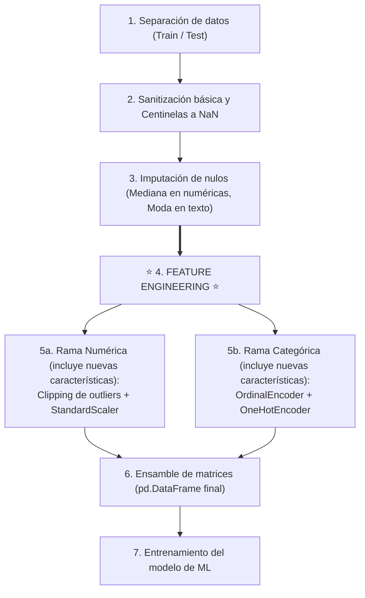
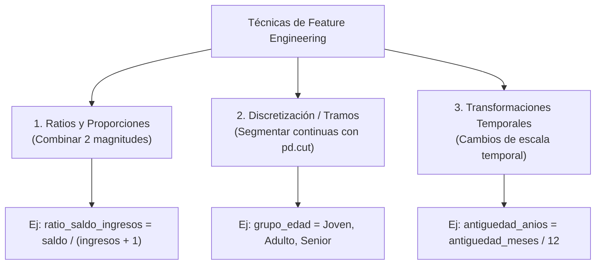

<div class="justify-text">

En las sesiones anteriores aprendimos a limpiar y formatear nuestros datos: sanitizamos centinelas, imputamos ausencias, recortamos valores atípicos, escalamos variables numéricas y codificamos el texto. El dataset ya es algebraicamente legible por cualquier algoritmo de Machine Learning.

Sin embargo, los modelos son esencialmente «miopes» frente al contexto real del problema: solo ven columnas aisladas de números y matrices. No saben qué es un banco, qué significa una nómina o por qué tener poco saldo habiendo ganado mucho dinero puede ser un síntoma claro de abandono inminente.

En esta sesión abordaremos una disciplina fundamental:
* **Feature Engineering (Ingeniería de características):** El arte de combinar y transformar variables existentes para crear nuevas columnas que aporten información de negocio valiosa y directa al modelo antes de alimentar los algoritmos predictivos.

## El mapa global del pipeline

Para no perder la perspectiva del flujo de trabajo, es fundamental visualizar en qué momento exacto entra en juego la creación de variables dentro del ciclo completo de preparación de datos:



:::warning Cambio en el flujo de trabajo
Observa con atención este esquema: **la forma de trabajar cambia respecto a lo aprendido en las sesiones anteriores**.

Hasta ahora habíamos abordado el preprocesamiento tratando primero todas las variables numéricas de golpe (Sesión 5) y después todas las categóricas de golpe (Sesión 6). Al introducir *Feature Engineering*, ya no podemos trabajar en bloques aislados: es imprescindible seguir el orden secuencial del diagrama anterior. 

Primero se sanean e imputan los nulos de todo el dataset, después se crean las nuevas variables a partir de datos limpios en unidades de negocio reales, y finalmente se aplican el escalado y la codificación (incluyendo en esas etapas las nuevas características generadas).
:::

---

## Feature engineering

El profesor y pionero de la Inteligencia Artificial **Andrew Ng** suele resumirlo en una frase célebre:

> *«El Machine Learning aplicado es, en esencia, Feature Engineering»*.

Los algoritmos de aprendizaje automático son excelentes encontrando relaciones matemáticas entre las entradas ($X$) y la salida ($y$), pero su capacidad depende de cómo le presentemos la información. 

Si obligamos al modelo a deducir patrones complejos a partir de datos en bruto, necesitará modelos mucho más pesados, miles de datos adicionales y correrá el riesgo de sobreajustarse (*overfitting*). Por el contrario, si le entregamos variables **«masticadas»** que capturen directamente relaciones lógicas de negocio, el modelo aprenderá de forma más rápida, precisa y estable.

:::tip Principio de diseño
El *Feature Engineering* no consiste en inventar docenas de columnas al azar con operaciones matemáticas aleatorias. Cada nueva variable debe responder a una **hipótesis de negocio razonable** que hayamos detectado o sospechado durante el Análisis Exploratorio de Datos (EDA).
:::

---

### Técnicas de creación de características

No es necesario aplicar fórmulas matemáticas complejas para obtener mejoras sustanciales en un modelo predictivo. La mayoría de los avances provienen de tres técnicas muy intuitivas:



#### Ratios y proporciones relativas

Un número absoluto suele decir muy poco si no se compara con su contexto de referencia:
* Un cliente con un saldo de $5.000$ € en cuenta puede parecer solvente a primera vista.
* Pero si ese cliente ingresa $120.000$ € al año, tener solo $5.000$ € ahorrados indica que está utilizando otro banco para su ahorro principal.
* Por el contrario, para un cliente con ingresos de $14.000$ € al año, tener $5.000$ € en cuenta representa un colchón financiero excelente.

Al calcular el **ratio entre dos magnitudes**, le entregamos al algoritmo una métrica normalizada de comportamiento financiero relativo:

```python
# Creación de un ratio financiero relativo
# (Añadimos +1 al denominador para prevenir errores por división entre cero)
X_train['ratio_saldo_ingresos'] = X_train['saldo_cuenta'] / (X_train['ingresos_anuales'] + 1)
X_test['ratio_saldo_ingresos'] = X_test['saldo_cuenta'] / (X_test['ingresos_anuales'] + 1)
```

Otro ejemplo clásico en nuestro dataset bancario es calcular el **saldo medio por producto contratado**:

```python
X_train['saldo_por_producto'] = X_train['saldo_cuenta'] / X_train['num_productos']
X_test['saldo_por_producto'] = X_test['saldo_cuenta'] / X_test['num_productos']
```

:::info El truco del «+1» en el denominador
En cualquier operación de división entre columnas, si el denominador puede contener valores `0.0`, Python producirá valores infinitos (`inf` o divisiones por cero). Añadir un pequeño sesgo como `+ 1` evita que el pipeline colapse y no altera la interpretación de la variable.
:::

#### Discretización en tramos (*binning*)

A veces, la relación entre una variable numérica continua y el objetivo no es gradual ni lineal, sino que se produce por «saltos generacionales» o etapas vitales.

Con la función `pd.cut()` de Pandas podemos agrupar una columna continua (como la `edad`) en intervalos categóricos con significado intuitivo:

```python
import pandas as pd

# Definimos los límites de los tramos y sus etiquetas
limites_edad = [0, 30, 55, 120]
etiquetas_edad = ['Joven', 'Adulto', 'Senior']

# Creamos la nueva variable cualitativa por tramos
X_train['grupo_edad'] = pd.cut(X_train['edad'], bins=limites_edad, labels=etiquetas_edad)
X_test['grupo_edad'] = pd.cut(X_test['edad'], bins=limites_edad, labels=etiquetas_edad)
```

Posteriormente, esta nueva columna categórica puede transformarse mediante `OrdinalEncoder` o `OneHotEncoder` siguiendo el procedimiento habitual de la rama cualitativa.

#### Transformaciones temporales y de escala

Una columna que contenga fechas específicas en formato texto (por ejemplo, `'10-06-2026'` o `'2024-03-15'`) **aporta muy poco o nada de forma directa a un modelo de Machine Learning**: al tener prácticamente una fecha única por cada cliente o registro, el algoritmo no puede extraer patrones generales a partir de una cadena de texto.

Sin embargo, si convertimos esa columna a formato temporal con `pd.to_datetime()`, podemos derivar nuevas características con un alto poder predictivo:

* **Componentes estacionales:** Extraer el año (`.dt.year`), el mes (`.dt.month`) o el día de la semana (`.dt.dayofweek`) para capturar patrones periódicos (por ejemplo, descubrir si las cancelaciones se disparan a final de mes o en ciertos trimestres).
* **Indicadores booleanos (*flags*):** Crear variables binarias directas, como determinar si la operación ocurrió en fin de semana o en día laborable (`es_fin_de_semana`).
* **Cálculo de tiempos acumulados:** Medir la diferencia de días o meses transcurridos entre dos eventos (por ejemplo, el tiempo transcurrido desde la última compra).

```python
import pandas as pd

# Supongamos que disponemos de una columna con fechas en texto
# 1. Convertimos la columna a tipo datetime
X_train['fecha_alta'] = pd.to_datetime(X_train['fecha_alta'])
X_test['fecha_alta'] = pd.to_datetime(X_test['fecha_alta'])

# 2. Extraemos el mes de registro y si se produjo en fin de semana (sábado=5, domingo=6)
X_train['mes_alta'] = X_train['fecha_alta'].dt.month
X_train['es_fin_de_semana'] = (X_train['fecha_alta'].dt.dayofweek >= 5).astype(int)

X_test['mes_alta'] = X_test['fecha_alta'].dt.month
X_test['es_fin_de_semana'] = (X_test['fecha_alta'].dt.dayofweek >= 5).astype(int)
```

De igual modo, cuando ya disponemos de duraciones numéricas expresadas en unidades pequeñas (como meses o días), **cambiar la escala temporal** (por ejemplo, de meses a años) simplifica enormemente la interpretación de los coeficientes del modelo:

```python
# Convertimos meses a años de vinculación
X_train['antiguedad_anios'] = X_train['antiguedad_meses'] / 12.0
X_test['antiguedad_anios'] = X_test['antiguedad_meses'] / 12.0
```

---

### ¿En qué momento del pipeline se crean las características?

Como vimos en el diagrama global de la introducción, el *Feature Engineering* ocupa un lugar muy específico en el flujo (Paso 4):

1. **¿Por qué DESPUÉS de la imputación?**  
   Porque si intentas calcular un ratio (`saldo / ingresos`) y una fila tiene un valor nulo (`NaN`) en cualquiera de las dos columnas, la nueva columna resultante nacerá con un nulo. Al imputar primero, garantizas que cualquier variable derivada se calcule sobre datos limpios y completos.
2. **¿Por qué ANTES de escalar y codificar?**  
   * **Para las variables numéricas:** Porque los ratios necesitan operar con magnitudes reales del negocio (euros entre euros, meses entre productos). Si intentas calcular un ratio tras aplicar `StandardScaler`, las columnas tendrán media $0.0$, varianza $1.0$ y números negativos; dividir dos números que oscilan alrededor de cero provoca divisiones por valores casi nulos (asíntotas) y números carentes de significado físico. Una vez creado el nuevo ratio, **se incorpora a la lista de numéricas y se escala junto al resto**.
   * **Para las variables categóricas:** Si creas una variable por tramos con `pd.cut()` (como `grupo_edad`: `'Joven'`, `'Adulto'`, `'Senior'`), esa nueva columna cualitativa **debe pasar a continuación por el `OneHotEncoder`** para convertirse en columnas binarias $\{0, 1\}$.

:::tip Regla mnemotécnica
1. Primero limpias la casa (centinelas e imputación).  
2. Luego construyes los muebles nuevos (*Feature Engineering*).  
3. Al final empaquetas todo para la mudanza (escalado y codificación).
:::

---

### ¿Qué hacemos con las variables originales? ¿Debemos conservarlas o eliminarlas?

Una duda inmediata que surge al crear nuevas características es: *«Si ya he creado `ratio_saldo_ingresos`, `grupo_edad` o `antiguedad_anios`, ¿debo mantener las columnas originales (`saldo_cuenta`, `ingresos_anuales`, `edad`, `antiguedad_meses`) en el dataset, o ahora son redundantes?»*.

La respuesta no es única: **depende de la naturaleza matemática de cada transformación**:

#### 1. Ratios y operaciones combinadas 

**SÍ se mantienen las originales ✅:**

* En un ratio como `saldo_cuenta / (ingresos_anuales + 1)`, la nueva variable mide una **relación o proporción relativa**.
* Sin embargo, el ratio pierde por completo la **magnitud o escala absoluta**:
  * Un cliente con $1.000$ € de saldo y $20.000$ € de ingresos tiene un ratio de $0.05$.
  * Otro cliente con $50.000$ € de saldo y $1.000.000$ € de ingresos tiene exactamente el mismo ratio ($0.05$).
* Para el modelo predictivo, ambos clientes tienen el mismo ratio relativo, pero su capacidad patrimonial y el impacto de su abandono para el banco son radicalmente distintos.
* **Conclusión:** Las variables originales (`saldo_cuenta`, `ingresos_anuales`) y el ratio derivado **no son redundantes, sino complementarias**. Se deben mantener ambas en el dataset.

#### 2. Cambios de escala estrictamente lineales 

**NO se mantienen ambas, se elige una ❌**

* Si calculas `antiguedad_anios = antiguedad_meses / 12.0`, estás aplicando una transformación lineal simple ($y = x / 12$).
* La correlación estadística entre `antiguedad_meses` y `antiguedad_anios` es **exactamente $1.0$ (correlación lineal perfecta)**.
* Mantener ambas no aporta ninguna información adicional al modelo e introduce **multicolinealidad perfecta**, lo que puede desestabilizar modelos lineales y regresiones.
* **Conclusión:** Son redundantes. **Se elige una de las dos** para el ensamble final (aquella cuya unidad resulte más intuitiva y cómoda de interpretar para el negocio o el equipo técnico).

#### 3. Discretización en tramos 

**Depende del caso y del modelo ⚠️**

* La variable continua original (`edad`) tiene **máxima granularidad** (sabe distinguir entre 29 y 31 años).
* La variable discretizada (`grupo_edad`: `'Joven'`, `'Adulto'`, `'Senior'`) agrupa en cajones y **pierde información de detalle**, pero ayuda a modelos lineales sencillos a capturar comportamientos no lineales por etapas vitales.
* En modelos modernos basados en árboles (Random Forest, XGBoost), el algoritmo ya es capaz de encontrar por sí mismo los puntos de corte óptimos sobre la variable continua, por lo que la continua suele ser más potente.
* **Conclusión:** Introducir ambas a la vez suele generar redundancia innecesaria. Es habitual evaluar cuál de las dos aporta mayor claridad o quedarse con la continua.

| Tipo de Feature | Ejemplo | ¿Se conservan las originales? | Motivo |
| :--- | :--- | :---: | :--- |
| **Ratios / Relaciones combinadas** | $\frac{\text{saldo}}{\text{ingresos}}$ | **SÍ ✅** | El ratio mide proporción relativa; las originales aportan la magnitud o escala absoluta. |
| **Escala lineal simple** | $\frac{\text{meses}}{12}$ | **NO (Elegir una) ❌** | Redundancia matemática del 100 % (correlación $r = 1.0$). |
| **Discretización (Tramos)** | `pd.cut(edad)` | **DECIDIR UNA ⚠️** | Agrupar destruye granularidad continua. Solemos priorizar la continua en modelos complejos. |

---

## 💻 Ejercicio guiado: diseño de características

### Contexto de la práctica
Continuando con el dataset de clientes bancarios [`clientes_banca_raw.csv`](./0-datasets/clientes_banca_raw.csv), utilizaremos nuestra intuición de negocio para diseñar nuevas características, reorganizaremos el flujo de trabajo en el Notebook y completaremos el pipeline ensamblando el DataFrame final que alimentará los modelos predictivos.

:::info Continuidad del Notebook
Trabajaremos sobre **UNA COPIA** del Jupyter Notebook en el que realizaste la limpieza, codificación y ensamble de matrices. Reorganiza las celdas para ubicar la creación de variables en el **Paso 4 del Pipeline** (después de la imputación de nulos y antes del escalado y codificación).

Por tanto, a partir de ahora tienes que tener dos Pipelines:
- 1_pipeline_sin_feature_engineering.ipynb
- 2_pipeline_con_feature_engineering.ipynb
:::

### Tareas a realizar paso a paso

1. **Diseño de un ratio financiero:**
   * Crea en `X_train` y `X_test` la variable `ratio_saldo_ingresos` dividiendo el saldo entre los ingresos anuales más uno (`saldo_cuenta / (ingresos_anuales + 1)`).
   * Muestra las estadísticas básicas descriptivas (`describe()`) de esta nueva columna en `X_train`.
2. **Diseño de un ratio por producto:**
   * Crea en `X_train` y `X_test` la variable `saldo_por_producto` dividiendo el saldo en cuenta entre el número de productos contratados (`saldo_cuenta / num_productos`).
   * Muestra sus estadísticas descriptivas (`describe()`) en `X_train`.
3. **Diseño de una variable agrupada por tramos:**
   * Utiliza `pd.cut()` para crear la columna `grupo_edad` en `X_train` y `X_test` clasificando la edad en tres categorías: `'Joven'` ($\le 30$), `'Adulto'` ($31$ a $55$) y `'Senior'` ($> 55$).
   * Muestra la distribución de clientes en cada grupo mediante `.value_counts()`.
4. **Transformación temporal de escala:**
   * Crea en `X_train` y `X_test` la columna `antiguedad_anios` dividiendo la antigüedad en meses entre 12 (`antiguedad_meses / 12.0`).
5. **Decisión sobre redundancias e integración en el Pipeline (modificación del código original):**
   * **Toma de decisiones según la teoría estudiada:** A la luz de los principios anteriores, reflexiona y decide qué variables deben formar parte del dataset final:
     * ¿Mantienes `saldo_cuenta` e `ingresos_anuales` junto al nuevo `ratio_saldo_ingresos`?
     * Entre `antiguedad_meses` y `antiguedad_anios`, ¿cuál de las dos conservas y cuál descartas para evitar redundancia lineal?
     * Entre la `edad` continua y los tramos `grupo_edad`, ¿cuál decides incluir en el ensamble?
   * Añade las variables numéricas que hayas decidido conservar a la lista de columnas numéricas a escalar con `StandardScaler`.
   * Incluye las variables categóricas correspondientes en la codificación (`OneHotEncoder` o `OrdinalEncoder`).
   * Vuelve a ejecutar el ensamble manual para obtener `X_train_final` y `X_test_final` como DataFrames de Pandas con todas sus columnas nombradas.
   * Muestra las primeras 5 filas con `X_train_final.head()` y redacta una breve justificación en una celda Markdown explicando las decisiones tomadas respecto a qué columnas originales conservaste y cuáles descartaste.

</div>
