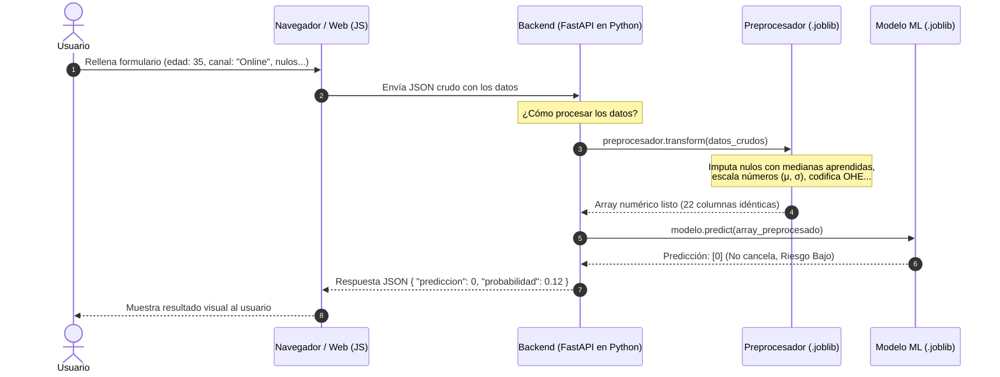
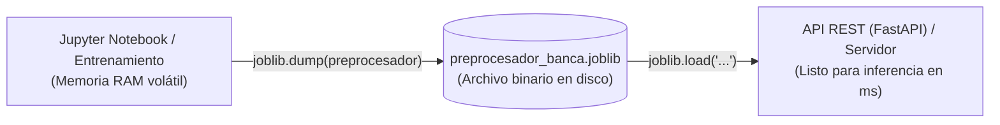
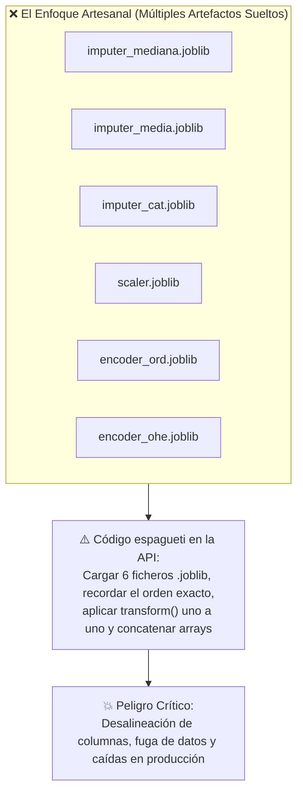
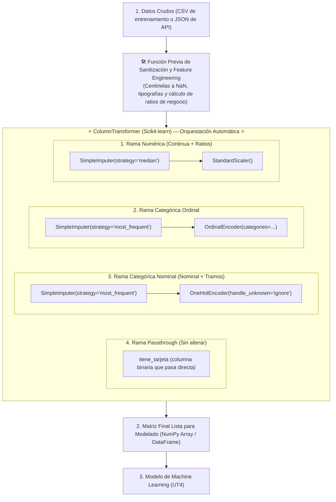

<div class="justify-text">

A lo largo de las sesiones 5, 6 y 7 aprendimos a preparar nuestros datos paso a paso: imputamos nulos, diseñamos nuevas variables de negocio, recortamos valores atípicos, escalamos variables cuantitativas y codificamos las categorías cualitativas. Finalmente, unimos todas las matrices con `np.hstack` para construir nuestro DataFrame final.

Aunque este método manual es ideal para comprender qué ocurre matemáticamente en cada etapa, en el mundo profesional presenta un grave problema: **es un proceso artesanal, frágil e inviable para entornos de producción**.

En esta sesión aprenderemos a sustituir todo ese código disperso por una solución arquitectónica estándar en la industria: **los `Pipelines` y el `ColumnTransformer` de Scikit-learn**, empaquetaremos todo el sistema mediante la librería **`joblib`** y construiremos de forma guiada en un **Jupyter Notebook (`3_pipeline_columntransformer.ipynb`)** un conjunto de funciones modulares listas para alimentar modelos predictivos en producción.

---

## ¿Por qué necesitamos el preprocesamiento en producción?

Imaginemos un caso de uso real: hemos entrenado un modelo predictivo para conceder préstamos bancarios o evaluar el riesgo de cancelación de clientes. Ahora queremos que este modelo dé servicio en una **aplicación web interactiva**.

Un usuario entra en la página web, rellena un formulario y pulsa el botón *"Calcular probabilidad"*:



### ¿Por qué los datos nuevos no pueden entrar directos al modelo?

Un modelo de Machine Learning es estrictamente una ecuación matemática: solo sabe multiplicar matrices de números. Cuando el usuario introduce datos en la web:
1. **Los valores cualitativos son texto:** La web envía `"Online"` o `"Máster"`. El modelo no sabe qué significa esa cadena de texto; necesita que se haya transformado en columnas binarias (One-Hot Encoding) o valores jerárquicos (Ordinal Encoding).
2. **Pueden faltar campos (valores nulos):** Si el usuario no rellena un campo opcional (como su nivel de satisfacción), la API recibe un `None` o `NaN`. Si alimentamos una ecuación matricial con `NaN`, el resultado es un error fatal (`ValueError: Input contains NaN`).
3. **Las escalas son dispares:** Si introducimos una edad de `35` y un saldo de cuenta de `45.000 €` sin escalar, los pesos del modelo interpretarán erróneamente que el saldo es miles de veces más importante que la edad.

Por lo tanto, **el nuevo dato introducido en la web debe pasar por EXACTAMENTE el mismo preprocesamiento que los datos de entrenamiento**.

### ¿Dónde y cómo se realiza este preprocesamiento? (Errores comunes vs Solución profesional)

Muchos desarrolladores noveles se preguntan: *¿dónde debemos escribir el código que hace esta transformación?*

* ❌ **¿Lo hacemos en JavaScript en el navegador del usuario?**
  **Rotundamente NO.** El navegador (JavaScript) no conoce las medianas históricas del banco, ni las medias ($\mu$), ni las desviaciones estándar ($\sigma$) de los datos de entrenamiento. Replicar la matemática en el frontend rompería la seguridad, expondría la lógica interna del negocio y sobrecargaría el cliente web.
* ❌ **¿Lo programamos a mano en los endpoints de la API (backend)?**
  **Tampoco.** Intentar recrear a mano en Python o Java las transformaciones dentro de la función de la API (por ejemplo, calculando `(x - 52345.12) / 18432.55` o escribiendo decenas de `if canal == 'Online': ...`) es una práctica pésima: genera código espagueti inmantendible, provoca errores humanos al teclear números y causa desalineación en el orden de las columnas. Además, si reentrenamos el modelo con nuevos datos el mes que viene, tendríamos que reescribir manualmente todo el código de la API.
* ✅ **La solución profesional estándar: artefactos `.joblib`**
  El preprocesamiento **no se reprograma en JS ni a mano en la API**. Lo que hacemos es:
  1. Durante la fase de ciencia de datos, ajustamos nuestro pipeline de preprocesamiento (`fit`) con los datos de entrenamiento.
  2. **Exportamos ese preprocesador ajustado a un archivo binario `.joblib`**.
  3. En la API (por ejemplo, con FastAPI), cargamos ese fichero `.joblib` en memoria al arrancar el servidor.
  4. Cuando llega la petición web con los datos crudos en formato JSON, la API ejecuta una sola instrucción: `preprocesador.transform(datos)`.

El archivo `.joblib` aplica automáticamente y de forma instantánea las mismas imputaciones, los mismos escalados y las mismas codificaciones categóricas, garantizando que el modelo reciba exactamente las columnas esperadas.

---

## ¿Qué es Joblib y para qué se utiliza?

Para entender cómo viaja el trabajo de un científico de datos desde un Jupyter Notebook hasta un servidor en producción, necesitamos comprender qué significa **serializar un objeto**:



### ¿Qué es Joblib?
**`joblib`** es una librería estándar del ecosistema científico de Python diseñada para **guardar en disco y recuperar en memoria objetos de Scikit-learn y arrays de NumPy de forma ultraeficiente**.

Si un objeto de Python (como nuestro preprocesador ajustado) reside temporalmente en la memoria RAM volátil mientras ejecutamos el código, `joblib` actúa como una «cámara fotográfica de alta resolución»: congela el objeto tal y como está y lo guarda en un archivo binario permanente (habitualmente con extensión `.joblib`).

### ¿Por qué Joblib y no el `pickle` nativo de Python?
Python incluye de fábrica el módulo `pickle` para serializar objetos. Sin embargo, `pickle` es ineficiente cuando los objetos contienen grandes estructuras matriciales de NumPy. `joblib` está optimizado internamente para gestionar matrices numéricas y transformadores de Machine Learning con máxima velocidad y compresión de memoria, convirtiéndose en el estándar indiscutible de la industria.

### ¿Para qué se usa?
* **Evitar recalcular estadísticas desde cero:** Ajustar transformadores (`fit`) sobre millones de registros puede tardar minutos u horas. Gracias a `joblib`, ajustamos el preprocesador una sola vez, lo guardamos en un archivo y lo reutilizamos al instante.
* **Despliegue en producción:** En una API web (como los microservicios con FastAPI que vimos en la UT2), el servidor carga el archivo `.joblib` en el arranque y procesa cada nueva petición de un cliente en apenas unos pocos milisegundos (`.transform()`).

### ¿Qué encapsula exactamente en su interior?
Cuando guardamos un objeto como un `ColumnTransformer` o un `Pipeline`, el archivo `.joblib` encapsula **todo el «cerebro» estadístico aprendido durante el entrenamiento**:
1. **Los parámetros numéricos aprendidos:** Las medianas y medias de imputación (`imputer.statistics_`), y las medias ($\mu$) y desviaciones típicas ($\sigma$) del escalador (`scaler.mean_`, `scaler.scale_`).
2. **Los mapeos de categorías:** El orden jerárquico asignado a las variables ordinales y el listado exacto de columnas binarias que descubrió el `OneHotEncoder` (`encoder.categories_`).
3. **El orden y alineación de columnas:** La ruta exacta por la que debe pasar cada característica y su concatenación final.

---

## El problema del enfoque manual en producción

Pensemos ahora por un instante en qué ocurriría si intentamos poner en producción el código artesanal de las sesiones anteriores:



Los riesgos críticos de este enfoque son evidentes:

1. **Infierno de serialización:** Para poner en marcha una API predictiva, tendríamos que guardar y cargar media docena de archivos `.joblib` sueltos en el servidor.
2. **Altísimo riesgo de desalineación:** Si en entrenamiento unimos las columnas en el orden `[numéricas, ordinales, nominales]`, pero en la función de la API concatenamos por descuido `[numéricas, nominales, ordinales]`, el modelo recibirá datos incoherentes y predecirá basura sin emitir ningún mensaje de error.
3. **Peligro de Data Leakage:** Cualquier despiste al calcular una media o un percentil fuera del flujo de entrenamiento puede contaminar el test o los datos futuros.

---

## La arquitectura estándar: ¿Qué se hace dentro y qué fuera del Pipeline?

Antes de escribir una sola línea de código, es fundamental comprender la frontera entre la **lógica de negocio previa** y la **transformación estadística automatizada**:



### 1. Fuera del Pipeline (Función de preparación previa con Pandas)
Los transformadores de Scikit-learn (`SimpleImputer`, `StandardScaler`) están diseñados para operar sobre valores `np.nan` y tipos de datos limpios. No saben que en nuestro banco un valor `-999` representa una ausencia, ni cómo calcular un ratio entre saldo e ingresos.

Por tanto, estas operaciones deterministas se agrupan en una **función de limpieza previa**:
* **Descarte de identificadores y fuga:** Eliminar `id_cliente` y columnas contaminadas como `motivo_cancelacion`.
* **Sustitución de centinelas por `np.nan`:** Edades imposibles ($\le 0$ o $> 120$), saldo `-999` o códigos de texto como `"?"` o `"???"`.
* **Homogeneización tipográfica:** Eliminar espacios (`strip()`) y unificar mayúsculas (`capitalize()`).
* **Feature Engineering:** Crear las nuevas variables de negocio (`ratio_saldo_ingresos`, `saldo_por_producto`, `grupo_edad`, `antiguedad_anios`).

:::tip Regla de oro
Esta función previa no aprende estadísticas (no hace `fit`). Aplica una serie de reglas de negocio fijas y se ejecutará exactamente igual sobre el dataset completo, sobre el test o sobre un cliente individual que llegue a nuestra aplicación web.
:::

### 2. Dentro del Pipeline (Automatizado al 100 % por Scikit-learn)
Todo aquello que **aprende parámetros estadísticos de los datos (`fit`)**:
* **Imputación estadística:** Aprende medianas y modas **exclusivamente de `X_train`** y las aplica automáticamente en `X_test` o en nuevos clientes.
* **Escalado numérico:** Aprende la media $\mu$ y la desviación $\sigma$ de entrenamiento y transforma las columnas.
* **Codificación categórica:** Memoriza las categorías vistas en entrenamiento y gestiona nuevas categorías imprevistas en producción mediante `handle_unknown='ignore'`.
* **Paso directo sin transformar (`passthrough`):** Permite conservar variables binarias como `tiene_tarjeta` sin alterarlas ni escalarlas.
* **Ensamble automático en paralelo:** El `ColumnTransformer` concatena automáticamente todas las columnas procesadas en el orden correcto, **eliminando para siempre la necesidad de usar `np.hstack` a mano**.

---

## Las dos piezas fundamentales de Scikit-learn

Para orquestar este flujo, Scikit-learn nos proporciona dos clases complementarias:

### 1. `Pipeline`: Transformaciones en serie (secuenciales)
Un **`Pipeline`** encadena varios transformadores uno detrás de otro de forma secuencial: la salida del primer paso es la entrada del segundo.

Se define pasando una lista de tuplas con el formato `('nombre_del_paso', Transformador)`:

```python
from sklearn.pipeline import Pipeline
from sklearn.impute import SimpleImputer
from sklearn.preprocessing import StandardScaler

# Pipeline secuencial para variables numéricas: primero imputa la mediana, luego escala
pipeline_numerico = Pipeline([
    ('imputador', SimpleImputer(strategy='median')),
    ('escalador', StandardScaler())
])
```

### 2. `ColumnTransformer`: Rutas paralelas por tipo de columna
El **`ColumnTransformer`** permite aplicar transformadores o pipelines distintos a diferentes conjuntos de columnas y concatenar automáticamente los resultados en paralelo.

Se define indicando una lista de tuplas con el formato `('nombre', Transformador_o_Pipeline, lista_columnas)`:

```python
from sklearn.compose import ColumnTransformer
from sklearn.preprocessing import OneHotEncoder

preprocesador = ColumnTransformer(
    transformers=[
        ('num', pipeline_numerico, ['edad', 'saldo_cuenta', 'ingresos_anuales']),
        ('nom', OneHotEncoder(handle_unknown='ignore'), ['tipo_cuenta', 'canal_preferido']),
        ('bool', 'passthrough', ['tiene_tarjeta'])  # 'passthrough' deja la columna tal cual
    ],
    remainder='drop'  # Descarta cualquier columna que no esté en las listas anteriores
)
```

:::info ¿Qué hace `preprocesador.fit_transform(X_train)`?
En una única llamada:
1. Envía las columnas numéricas a su pipeline (imputa y escala).
2. Envía las categóricas a su codificador (genera las dummies).
3. Deja pasar la columna binaria intacta.
4. Concatena horizontalmente todos los bloques en una única matriz limpia.

Y para evaluar en test, basta con ejecutar:
```python
X_test_procesado = preprocesador.transform(X_test)
```
Scikit-learn aplicará los parámetros aprendidos en train sin riesgo de Data Leakage y garantizando que el orden y número de columnas sea idéntico.
:::

---

## Serialización con `joblib`: El puente hacia producción

Una vez ajustado nuestro `ColumnTransformer`, no queremos repetir el entrenamiento cada vez que un usuario haga una petición a nuestro sistema. 

Mediante la librería **`joblib`**, guardamos el objeto preprocesador ajustado en un único archivo binario:

```python
import joblib

# Guardamos todo el preprocesador ajustado en un único archivo
joblib.dump(preprocesador, 'preprocesador_banca.joblib')
```

Este archivo contiene **todos los parámetros aprendidos**:
* Las medianas de las numéricas.
* Las modas de las categóricas.
* Las medias ($\mu$) y desviaciones típicas ($\sigma$) del escalador.
* El mapeo de categorías del `OrdinalEncoder` y las columnas del `OneHotEncoder`.

En cualquier momento y en cualquier servidor (por ejemplo, en un microservicio con FastAPI), podemos cargar el artefacto y procesar nuevos datos en milisegundos:

```python
# En el servidor de producción:
preprocesador_cargado = joblib.load('preprocesador_banca.joblib')

# Transforma un nuevo cliente directamente a la matriz que espera el modelo
datos_listos = preprocesador_cargado.transform(nuevo_cliente_df)
```

---

## 💻 Ejercicio guiado: Construcción del Pipeline en Jupyter Notebook

Para consolidar todos estos conceptos, desarrollaremos un notebook completo llamado **`3_pipeline_columntransformer.ipynb`** (en la misma carpeta donde realizamos los dos ejercicios anteriores).

A diferencia de los notebooks anteriores donde el código estaba disperso en celdas sueltas, aquí estructuraremos el trabajo mediante **funciones modulares**. Cada función tendrá un único propósito bien delimitado, lo que nos permitirá entender qué hace, qué recibe por parámetro, qué devuelve e inspeccionar sus resultados celda a celda.

---

### Paso 1: Configuración del entorno y división estratificada

Antes de transformar cualquier columna, preparamos las importaciones necesarias, cargamos el dataset y separamos los datos para blindarnos contra el *Data Leakage*.

```python
import os
import joblib
import numpy as np
import pandas as pd
from sklearn.model_selection import train_test_split
from sklearn.compose import ColumnTransformer
from sklearn.pipeline import Pipeline
from sklearn.impute import SimpleImputer
from sklearn.preprocessing import StandardScaler, OrdinalEncoder, OneHotEncoder

# 1. Carga del dataset crudo
ruta_csv = '0-datasets/clientes_banca_raw.csv' if os.path.exists('0-datasets/clientes_banca_raw.csv') else 'clientes_banca_raw.csv'
df_raw = pd.read_csv(ruta_csv)

# 2. Separación de características predictoras (X) y variable objetivo (y)
X = df_raw.drop(columns=['abandono'])
y = df_raw['abandono']

# 3. Partición Train / Test estratificada (80% train, 20% test)
X_train, X_test, y_train, y_test = train_test_split(
    X, y, test_size=0.20, random_state=42, stratify=y
)

print(f"Dimensiones de X_train inicial: {X_train.shape}")
print(f"Dimensiones de X_test inicial:  {X_test.shape}")
```

:::note 📝 Pregunta de comprensión 1 (Copia y responde en una celda de Markdown)
**¿Por qué es imprescindible separar la variable objetivo `y` y realizar la división `train_test_split` ANTES de realizar cualquier imputación o escalado estadístico? ¿Qué pasaría si calculamos la media o la mediana sobre todo el dataset `df_raw` antes de dividir?**
:::

---

### Paso 2: Función determinista previa (`preparar_datos_crudos`)

#### ¿Qué hace esta función?
Aplica las reglas de negocio fijas que no aprenden estadísticas:
1. **Descarte de identificadores y fuga:** Elimina columnas no predictivas (`id_cliente`) o con fuga de datos / nulos masivos (`motivo_cancelacion`, `salario_mensual_aprox`, `comentarios_cliente`).
2. **Centinelas a `np.nan`:** Sustituye códigos de ausencia por `np.nan` para que Scikit-learn pueda imputarlos posteriormente (edad $\le 0$ o $> 120$, saldo `-999`, signos `"?"` o `"???"`).
3. **Limpieza tipográfica:** Elimina espacios accidentales (`.strip()`) y unifica mayúsculas (`.capitalize()`).
4. **Feature Engineering:** Genera las nuevas características acordadas: `ratio_saldo_ingresos`, `saldo_por_producto`, `grupo_edad` y `antiguedad_anios` (descartando `antiguedad_meses`).

#### Parámetros que recibe:
* **`df_entrada` (`pd.DataFrame`):** DataFrame con las columnas en bruto (puede ser `X_train`, `X_test` o el diccionario convertido a DataFrame de un único cliente en una API).

#### Qué devuelve:
* **`pd.DataFrame`:** Un nuevo DataFrame saneado, con valores `np.nan` reconocibles y las nuevas columnas de negocio calculadas.

```python
def preparar_datos_crudos(df_entrada: pd.DataFrame) -> pd.DataFrame:
    """
    Aplica reglas de negocio deterministas sobre datos crudos:
    - Descarta columnas de identificador o data leakage.
    - Convierte valores centinelas en np.nan.
    - Limpia tipografía y espacios.
    - Genera las características de negocio (Feature Engineering).
    """
    df = df_entrada.copy()

    # A. Descarte de columnas no utilizables en inferencia (si existen en el DataFrame)
    columnas_descarte = ['id_cliente', 'salario_mensual_aprox', 'comentarios_cliente', 'motivo_cancelacion']
    df = df.drop(columns=[col for col in columnas_descarte if col in df.columns], errors='ignore')

    # B. Sanitización de centinelas numéricos a NaN
    if 'edad' in df.columns:
        df.loc[(df['edad'] <= 0) | (df['edad'] > 120), 'edad'] = np.nan
    if 'ingresos_anuales' in df.columns:
        df.loc[df['ingresos_anuales'] <= 0, 'ingresos_anuales'] = np.nan
    if 'saldo_cuenta' in df.columns:
        df['saldo_cuenta'] = df['saldo_cuenta'].replace(-999, np.nan)

    # C. Limpieza tipográfica y centinelas categóricos a NaN
    if 'tipo_cuenta' in df.columns:
        df['tipo_cuenta'] = df['tipo_cuenta'].astype(str).str.strip().str.capitalize()
        df['tipo_cuenta'] = df['tipo_cuenta'].replace({'Desconocido': np.nan, '?': np.nan, 'Nan': np.nan})

    if 'canal_preferido' in df.columns:
        df['canal_preferido'] = df['canal_preferido'].astype(str).str.strip()
        df['canal_preferido'] = df['canal_preferido'].replace({'???': np.nan, 'Nan': np.nan})

    if 'nivel_estudios' in df.columns:
        df['nivel_estudios'] = df['nivel_estudios'].astype(str).str.strip().replace({'Nan': np.nan, 'nan': np.nan})

    # D. Feature Engineering (Variables de negocio)
    if 'saldo_cuenta' in df.columns and 'ingresos_anuales' in df.columns:
        df['ratio_saldo_ingresos'] = df['saldo_cuenta'] / (df['ingresos_anuales'] + 1)

    if 'saldo_cuenta' in df.columns and 'num_productos' in df.columns:
        df['saldo_por_producto'] = df['saldo_cuenta'] / df['num_productos']

    if 'edad' in df.columns:
        limites_edad = [0, 30, 55, 120]
        etiquetas_edad = ['Joven', 'Adulto', 'Senior']
        df['grupo_edad'] = pd.cut(df['edad'], bins=limites_edad, labels=etiquetas_edad).astype(str)

    if 'antiguedad_meses' in df.columns:
        df['antiguedad_anios'] = df['antiguedad_meses'] / 12.0
        df = df.drop(columns=['antiguedad_meses'])

    return df
```

En la siguiente celda del notebook, aplicamos la función sobre `X_train` y `X_test` para verificar que las columnas resultantes son exactamente las esperadas:

```python
X_train_prep = preparar_datos_crudos(X_train)
X_test_prep = preparar_datos_crudos(X_test)

print(f"Columnas resultantes tras la preparación ({len(X_train_prep.columns)}):")
print(list(X_train_prep.columns))
X_train_prep.head(3)
```

:::note 📝 Pregunta de comprensión 2 (Copia y responde en una celda de Markdown)
**¿Por qué esta función `preparar_datos_crudos` NO realiza ningún cálculo estadístico con `.fit()`? Si dentro de un año llega un cliente nuevo a nuestra aplicación web, ¿por qué podemos pasarle directamente su información por esta misma función sin modificar nada?**
:::

---

### Paso 3: Función de construcción del `ColumnTransformer` (`construir_pipeline_preprocesamiento`)

#### ¿Qué hace esta función?
Configura y ensambla la arquitectura de Scikit-learn dividiendo las columnas por naturaleza:
1. **Rama Numérica:** Encadena `SimpleImputer(strategy='median')` con `StandardScaler()`.
2. **Rama Categórica Ordinal:** Encadena `SimpleImputer(strategy='most_frequent')` con `OrdinalEncoder(categories=...)` respetando la jerarquía explícita.
3. **Rama Categórica Nominal:** Encadena `SimpleImputer(strategy='most_frequent')` con `OneHotEncoder(sparse_output=False, handle_unknown='ignore')`.
4. **Rama Passthrough:** Deja pasar la variable binaria `'tiene_tarjeta'` sin modificar.
5. Ensambla todas las ramas en un único objeto `ColumnTransformer`.

#### Parámetros que recibe:
* No recibe parámetros obligatorios. Contiene la especificación de diseño arquitectónico de nuestras variables.

#### Qué devuelve:
* **`ColumnTransformer`:** El objeto transformador compuesto, con su topología definida pero **aún sin ajustar (sin entrenar)**.

```python
def construir_pipeline_preprocesamiento() -> ColumnTransformer:
    """
    Construye y ensambla el ColumnTransformer con todos los sub-pipelines estadísticos.
    """
    cols_numericas = [
        'edad', 
        'ingresos_anuales', 
        'saldo_cuenta', 
        'num_productos', 
        'antiguedad_anios', 
        'ratio_saldo_ingresos', 
        'saldo_por_producto'
    ]

    cols_ordinales = ['nivel_estudios', 'nivel_satisfaccion']
    cols_nominales = ['tipo_cuenta', 'canal_preferido', 'grupo_edad']
    cols_passthrough = ['tiene_tarjeta']

    # 1. Rama Numérica: Imputación por mediana + Escalado estándar
    pipeline_num = Pipeline([
        ('imputador', SimpleImputer(strategy='median')),
        ('escalador', StandardScaler())
    ])

    # 2. Rama Ordinal: Imputación por moda + Codificación jerárquica
    orden_estudios = ['Primaria', 'Secundaria', 'Grado', 'Master', 'Doctorado']
    orden_satisfaccion = ['Muy Bajo', 'Bajo', 'Medio', 'Alto', 'Muy Alto']
    
    pipeline_ord = Pipeline([
        ('imputador', SimpleImputer(strategy='most_frequent')),
        ('codificador', OrdinalEncoder(categories=[orden_estudios, orden_satisfaccion]))
    ])

    # 3. Rama Nominal: Imputación por moda + OneHot con protección para producción
    pipeline_nom = Pipeline([
        ('imputador', SimpleImputer(strategy='most_frequent')),
        ('codificador', OneHotEncoder(sparse_output=False, handle_unknown='ignore'))
    ])

    # 4. Ensamble de ramas en ColumnTransformer
    preprocesador = ColumnTransformer(
        transformers=[
            ('num', pipeline_num, cols_numericas),
            ('ord', pipeline_ord, cols_ordinales),
            ('nom', pipeline_nom, cols_nominales),
            ('bool', 'passthrough', cols_passthrough)
        ],
        remainder='drop'
    )

    return preprocesador
```

Para inspeccionar la arquitectura en Jupyter Notebook, instanciamos la función y escribimos la variable en la celda:

```python
preprocesador = construir_pipeline_preprocesamiento()
# Al ejecutar esta celda en Jupyter, Scikit-learn renderiza un diagrama HTML interactivo:
preprocesador
```

:::note 📝 Pregunta de comprensión 3 (Copia y responde en una celda de Markdown)
**¿Qué papel fundamental cumple el parámetro `handle_unknown='ignore'` dentro del `OneHotEncoder`? Si en el futuro un usuario introduce en el formulario web una categoría imprevista (por ejemplo, `tipo_cuenta = "Inversion"`), ¿qué ocurriría si no hubiéramos incluido ese parámetro?**
:::

---

### Paso 4: Función de ajuste y serialización (`ajustar_y_guardar_preprocesador`)

#### ¿Qué hace esta función?
1. Ejecuta `.fit_transform()` sobre los datos de entrenamiento (`X_train_prep`), calculando y memorizando las medianas, medias ($\mu$), desviaciones ($\sigma$) y categorías de las columnas.
2. Ejecuta **únicamente `.transform()`** sobre los datos de prueba (`X_test_prep`), aplicando los parámetros aprendidos en train.
3. Imprime por pantalla las dimensiones de las matrices resultantes para verificar que coinciden con las 22 columnas esperadas.
4. Serializa el objeto `ColumnTransformer` ya entrenado en un archivo permanente mediante `joblib.dump()`.

#### Parámetros que recibe:
* **`preprocesador` (`ColumnTransformer`):** El transformador sin ajustar retornado por `construir_pipeline_preprocesamiento()`.
* **`X_train_prep` (`pd.DataFrame`):** Datos de entrenamiento limpios.
* **`X_test_prep` (`pd.DataFrame`):** Datos de test limpios.
* **`ruta_guardado` (`str`, por defecto `'preprocesador_banca.joblib'`):** Ruta y nombre del archivo binario de salida.

#### Qué devuelve:
* **`tuple (np.ndarray, np.ndarray)`:** La tupla `(X_train_final, X_test_final)` con las matrices numéricas limpias y listas para modelar.

```python
def ajustar_y_guardar_preprocesador(
    preprocesador: ColumnTransformer, 
    X_train_prep: pd.DataFrame, 
    X_test_prep: pd.DataFrame, 
    ruta_guardado: str = 'preprocesador_banca.joblib'
):
    """
    Ajusta el ColumnTransformer sobre train, transforma test y serializa el objeto en disco.
    """
    print("--> Ajustando preprocesador sobre X_train (fit_transform)...")
    X_train_final = preprocesador.fit_transform(X_train_prep)

    print("--> Aplicando preprocesador sobre X_test (transform)...")
    X_test_final = preprocesador.transform(X_test_prep)

    print(f"Dimensiones de X_train_final: {X_train_final.shape}")
    print(f"Dimensiones de X_test_final:  {X_test_final.shape}")

    # Guardamos el artefacto entrenado
    joblib.dump(preprocesador, ruta_guardado)
    print(f"✅ Preprocesador exportado con éxito en: {ruta_guardado}")

    return X_train_final, X_test_final
```

Lo ejecutamos en la siguiente celda del notebook:

```python
X_train_final, X_test_final = ajustar_y_guardar_preprocesador(
    preprocesador, X_train_prep, X_test_prep
)
```

:::note 📝 Pregunta de comprensión 4 (Copia y responde en una celda de Markdown)
**¿Cuál es la diferencia matemática conceptual entre llamar a `.fit_transform()` y llamar a `.transform()`? ¿Por qué bajo ningún concepto debemos hacer `.fit_transform()` sobre `X_test_prep`?**
:::

---

### Paso 5: Función de inferencia para producción (`transformar_cliente_nuevo`)

#### ¿Qué hace esta función?
Simula cómo trabajaría nuestra API REST o aplicación web cuando un usuario real rellena el formulario:
1. Carga desde el disco el archivo binario `.joblib` previamente entrenado.
2. Convierte el diccionario con los datos del usuario en un DataFrame de 1 fila.
3. Pasa los datos por la función previa `preparar_datos_crudos(df_nuevo)`.
4. Aplica `preprocesador.transform()` y devuelve el vector numérico listo para pasárselo a `modelo.predict()`.

#### Parámetros que recibe:
* **`datos_cliente` (`dict`):** Diccionario con las claves y valores introducidos por el usuario en la web.
* **`ruta_artefacto` (`str`, por defecto `'preprocesador_banca.joblib'`):** Ruta del archivo binario guardado.

#### Qué devuelve:
* **`np.ndarray`:** Matriz de una sola fila con forma `(1, 22)` con todas las variables numéricas escaladas y las categóricas codificadas.

```python
def transformar_cliente_nuevo(
    datos_cliente: dict, 
    ruta_artefacto: str = 'preprocesador_banca.joblib'
) -> np.ndarray:
    """
    Recibe los datos crudos de un cliente (JSON / dict) y devuelve el array listo para predecir.
    """
    # 1. Cargamos el artefacto preprocesador entrenado
    preprocesador_cargado = joblib.load(ruta_artefacto)

    # 2. Convertimos a DataFrame de 1 fila
    df_nuevo = pd.DataFrame([datos_cliente])

    # 3. Aplicamos la misma limpieza previa determinista
    df_nuevo_prep = preparar_datos_crudos(df_nuevo)

    # 4. Transformamos con el pipeline (sin fit)
    vector_salida = preprocesador_cargado.transform(df_nuevo_prep)

    return vector_salida
```

¡Llega la prueba de fuego en el notebook! Creamos un cliente simulado con espacios tipográficos, columnas que deben descartarse y valores reales para comprobar la inferencia:

```python
cliente_simulado = {
    'id_cliente': 'CLI-9999',         # Columna que la función debe descartar
    'edad': 42.0,
    'ingresos_anuales': 48000.0,
    'saldo_cuenta': 14200.0,
    'num_productos': 2,
    'tiene_tarjeta': 1,
    'antiguedad_meses': 60,
    'tipo_cuenta': '  ahorro  ',      # Con espacios y minúsculas (se corregirá)
    'canal_preferido': 'App Movil',
    'nivel_estudios': 'Grado',
    'nivel_satisfaccion': 'Alto'
}

vector_cliente = transformar_cliente_nuevo(cliente_simulado)

print(f"Forma del vector resultante: {vector_cliente.shape}")
print(f"Vector numérico procesado:\n{vector_cliente}")
```

:::note 📝 Pregunta de comprensión 5 (Copia y responde en una celda de Markdown)
**¿Por qué en esta función de inferencia cargamos el archivo `.joblib` en lugar de volver a llamar a `construir_pipeline_preprocesamiento()` y hacer `.fit()` con los datos del nuevo cliente? ¿Qué ocurriría si intentamos hacer `.fit()` sobre un solo cliente nuevo de 1 fila?**
:::

---

## 🔍 Criterios docentes y enlace directo con la UT4

:::tip Conexión con la siguiente unidad (UT4: Modelos de Machine Learning)
¡Enhorabuena! **Has completado la fase más crítica y laboriosa de toda la ciencia de datos**.

A partir de la próxima unidad (UT4: Algoritmos Supervisados), conectar todo este trabajo con un modelo requerirá únicamente añadir una línea al final del pipeline:

```python
from sklearn.ensemble import RandomForestClassifier

# Pipeline integral de producción (Preprocesamiento + Algoritmo)
pipeline_completo = Pipeline([
    ('preprocesador', preprocesador),
    ('modelo', RandomForestClassifier(random_state=42))
])

# Entrenamiento conjunto con un solo comando:
pipeline_completo.fit(X_train_prep, y_train)

# Predicción directa en producción:
prediccion = pipeline_completo.predict(nuevo_cliente_df)
```

Tus datos están limpios, estandarizados, enriquecidos mediante *Feature Engineering*, blindados contra el *Data Leakage* y listos para competir en producción.
:::

</div>
