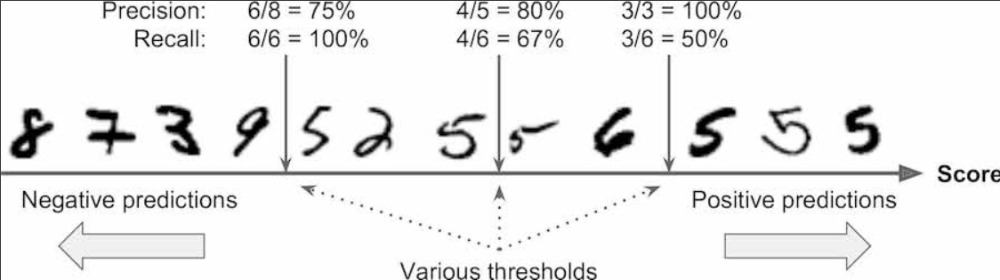
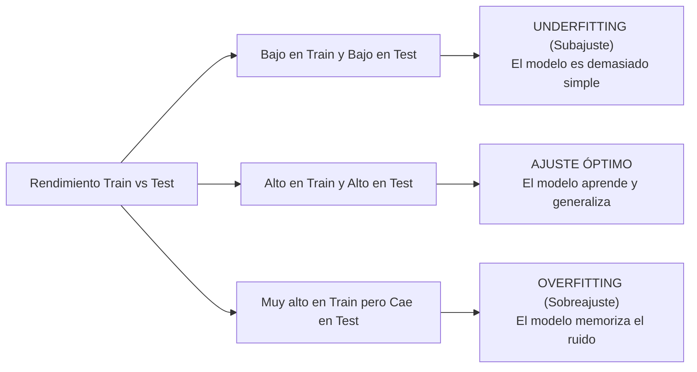

<div class="justify-text">

:::info Enfoque de la sesión
Entrenar un modelo de Machine Learning en Python requiere apenas tres líneas de código. Lo difícil —y lo que te convierte en un buen programador de IA— es **saber diagnosticar si tu modelo realmente funciona** o si te está engañando. En este tema aprenderás a evaluar clasificadores con criterio profesional.
:::

## ¿Qué es la Clasificación Supervisada?

En los problemas de clasificación, tu objetivo es predecir una **etiqueta categórica o cualitativa** a partir de un conjunto de características de entrada ($X$):

* **Clasificación Binaria:** Solo existen dos respuestas posibles ($0$ o $1$, Sí o No). Ejemplos: *¿Es spam o correo legítimo?*, *¿El cliente cancelará su suscripción o se queda?*, *¿El tumor es benigno o maligno?*.
* **Clasificación Multiclase:** Existen 3 o más categorías excluyentes entre sí. Ejemplos: *Clasificar flores (Setosa, Versicolor, Virginica)*, *Reconocer dígitos escritos a mano (0 al 9)*.

---

## La Trampa del Accuracy (Exactitud)

El **Accuracy** es la métrica más intuitiva: mide el porcentaje total de aciertos sobre el total de predicciones:

$$\text{Accuracy} = \frac{\text{Aciertos Totales}}{\text{Muestras Totales}}$$

Parece la métrica perfecta, pero esconde una trampa letal cuando los datos están **desbalanceados**.

Imagina un sistema médico para detectar una enfermedad grave muy poco frecuente:
* En tu dataset de prueba tienes **1000 pacientes**: 990 están sanos y 10 están enfermos.
* Creas un "modelo perezoso" que devuelve siempre **"Sano"** para cualquier persona, sin mirar ninguna prueba médica.

¿Qué Accuracy consigue este modelo inútil? **Un 99% de acierto**.

```text
Aciertos: 990 / 1000 = 99% de Accuracy
Vidas salvadas: 0 (los 10 enfermos se van a su casa sin tratamiento)
```

:::warning Regla de oro
Nunca confíes en el **Accuracy** cuando la distribución entre tus clases sea desigual. Si el 95% de tus datos pertenecen a una clase, cualquier modelo mediocre alcanzará el 95% de accuracy simplemente diciendo siempre lo mismo.
:::

---

## La Matriz de Confusión: Radiografía del Modelo

Para ver la verdad completa necesitas una **Matriz de Confusión**. Es una tabla de doble entrada que compara lo que **realmente ocurrió** frente a lo que tu modelo **predijo**:

| | **Predicho Negativo (0)** | **Predicho Positivo (1)** |
| :--- | :---: | :---: |
| **Real Negativo (0)** | **VN** (Verdadero Negativo) | **FP** (Falso Positivo) |
| **Real Positivo (1)** | **FN** (Falso Negativo) | **VP** (Verdadero Positivo) |

Los cuatro resultados posibles tienen un significado crítico en el mundo real:

* **Verdadero Positivo (VP):** El paciente estaba enfermo y el modelo dijo que estaba enfermo. *(Acierto)*.
* **Verdadero Negativo (VN):** El paciente estaba sano y el modelo dijo que estaba sano. *(Acierto)*.
* **Falso Positivo (FP) — «Falsa alarma»:** El paciente estaba sano, pero el modelo dijo que estaba enfermo. Genera un susto innecesario o pruebas médicas adicionales.
* **Falso Negativo (FN) — «Peligro silencioso»:** El paciente estaba enfermo, pero el modelo dijo que estaba sano. El paciente se va a casa sin diagnóstico.

---

## Precision, Recall y F1-Score: Diagnóstico Fino

Para medir el rendimiento real en la clase que nos importa (la clase positiva), separamos el análisis en dos preguntas complementarias:

### 1. Precision (Precisión)
> *"De todo lo que el modelo marcó como positivo, ¿cuánto acertó realmente?"*

$$\text{Precision} = \frac{\text{VP}}{\text{VP} + \text{FP}}$$

* **Cuándo priorizar Precision:** Cuando un **Falso Positivo es muy destructivo o costoso**.
* *Ejemplo:* El filtro anti-spam de tu correo corporativo. Si un correo legítimo y urgente de tu jefe (negativo) acaba en la bandeja de spam (FP), puedes tener problemas serios. Prefieres que se cuele algún spam antes de enviar un correo vital a la papelera.

### 2. Recall (Sensibilidad o Exhaustividad)
> *"De todos los casos positivos reales que existían, ¿cuántos fue capaz de cazar?"*

$$\text{Recall} = \frac{\text{VP}}{\text{VP} + \text{FN}}$$

* **Cuándo priorizar Recall:** Cuando un **Falso Negativo es inaceptable o mortal**.
* *Ejemplo:* Detección de cáncer o detección de fraude bancario millonario. Prefieres equivocarte y pedir una segunda biopsia a un paciente sano (FP), antes de que un paciente enfermo se marche sin tratamiento (FN).

### 3. F1-Score (El Equilibrio)
Es la media armónica entre Precision y Recall. A diferencia de una media aritmética normal, si cualquiera de las dos métricas se hunde hacia cero, el F1-Score se desploma:

$$\text{F1-Score} = 2 \times \frac{\text{Precision} \times \text{Recall}}{\text{Precision} + \text{Recall}}$$

Utiliza el F1-Score como tu métrica de referencia cuando quieras comparar modelos y busques un equilibrio sólido entre no generar falsas alarmas y no dejar escapar positivos reales.

---

## El Umbral de Decisión (Threshold)

Casi todos los clasificadores de Machine Learning no deciden directamente *"Sí"* o *"No"*. En su interior, calculan una **probabilidad continua entre 0 y 1** a través de su método `.predict_proba()`:

* Si la probabilidad es $\ge 0.50$, el modelo predice la clase positiva ($1$).
* Si la probabilidad es $< 0.50$, el modelo predice la clase negativa ($0$).

Ese valor $0.50$ es el **Umbral de Decisión (*Threshold*)**, y como ingeniero de IA **puedes moverlo a conveniencia**.



Al mover el umbral alteras directamente el equilibrio entre Precision y Recall:

* **Si SUBES el umbral (hacia la derecha, ej. 0.80):**
  * El modelo se vuelve muy "exigente". Solo dispara cuando está prácticamente seguro.
  * **Efecto:** Disminuyen los falsos positivos $\rightarrow$ **Aumenta la Precision**, pero aumentan los falsos negativos $\rightarrow$ **Cae el Recall**.
* **Si BAJAS el umbral (hacia la izquierda, ej. 0.20):**
  * El modelo se vuelve muy "sensible" o alarmista. Ante la menor sospecha, marca positivo.
  * **Efecto:** Cazas casi todos los positivos reales $\rightarrow$ **Aumenta el Recall**, pero tendrás muchas falsas alarmas $\rightarrow$ **Cae la Precision**.

:::tip Criterio de negocio
El umbral no es una decisión matemática; es una **decisión de negocio o impacto operativo**:
* ¿El coste de dejar escapar un positivo es catastrófico? $\rightarrow$ **Baja el umbral**.
* ¿El coste de una falsa alarma es inasumible? $\rightarrow$ **Sube el umbral**.
:::

---

## Detección de Sobreajuste (Overfitting) y Subajuste (Underfitting)

Un modelo de clasificación debe ser capaz de **generalizar**: aprender los patrones de fondo para acertar con datos nuevos que nunca vio durante el entrenamiento.

Comparamos siempre el rendimiento en el conjunto de entrenamiento (**Train**) frente al conjunto de prueba (**Test**):



* **Subajuste (*Underfitting*):** El modelo es tan simple (o le faltan variables) que ni siquiera es capaz de aprender los datos de entrenamiento. *Solución:* usar un modelo más potente o suministrar mejores características.
* **Sobreajuste (*Overfitting*):** El modelo tiene tanta capacidad o se ha entrenado tanto tiempo que se ha aprendido de memoria las peculiaridades y el ruido del dataset de entrenamiento. En train saca un 99%, pero al enfrentarse a test cae en picado al 65%. *Solución:* regularizar el modelo, reducir su complejidad o conseguir más datos.

---

## Implementación Práctica con Scikit-Learn

En Scikit-Learn, obtener todas estas métricas requiere únicamente unas pocas líneas estructuradas:

```python
from sklearn.model_selection import train_test_split
from sklearn.neighbors import KNeighborsClassifier
from sklearn.metrics import (
    confusion_matrix,
    ConfusionMatrixDisplay,
    precision_score,
    recall_score,
    f1_score,
    classification_report
)
import matplotlib.pyplot as plt

# 1. Separamos en entrenamiento (80%) y prueba (20%)
X_train, X_test, y_train, y_test = train_test_split(
    X, y, test_size=0.2, random_state=42, stratify=y
)

# 2. Instanciamos y entrenamos el clasificador
modelo = KNeighborsClassifier(n_neighbors=5)
modelo.fit(X_train, y_train)

# 3. Obtenemos las predicciones sobre el conjunto de test
y_pred = modelo.predict(X_test)

# 4. Diagnóstico con Matriz de Confusión
cm = confusion_matrix(y_test, y_pred)
disp = ConfusionMatrixDisplay(confusion_matrix=cm)
disp.plot(cmap="Blues")
plt.title("Matriz de Confusión")
plt.show()

# 5. Cálculo individual de métricas clave
print(f"Precision: {precision_score(y_test, y_pred):.3f}")
print(f"Recall:    {recall_score(y_test, y_pred):.3f}")
print(f"F1-Score:  {f1_score(y_test, y_pred):.3f}")

# 6. Informe consolidado con un solo comando
print("\n--- Informe Completo ---")
print(classification_report(y_test, y_pred))
```

---

## Práctica Asociada

Abre el cuaderno de trabajo [Practica_1_Introduccion.ipynb](file:///Users/aliciacamara/Desktop/DevTacora/docs/02_pia_2627/ut4_machine_learning/Practica_1_Introduccion.ipynb) y sigue las instrucciones para:
1. Cargar el dataset y visualizar la distribución inicial.
2. Entrenar tu primer clasificador KNN.
3. Generar la matriz de confusión y extraer las métricas de evaluación.
4. Experimentar cómo varía el rendimiento cambiando el hiperparámetro `n_neighbors` para identificar zonas de sobreajuste y subajuste.

</div>
