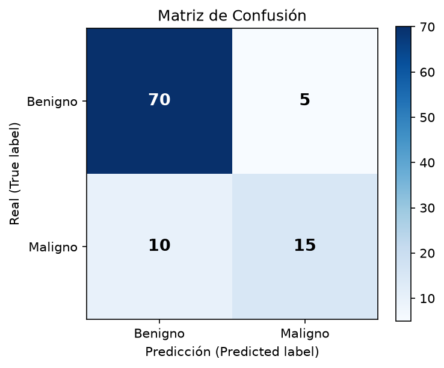
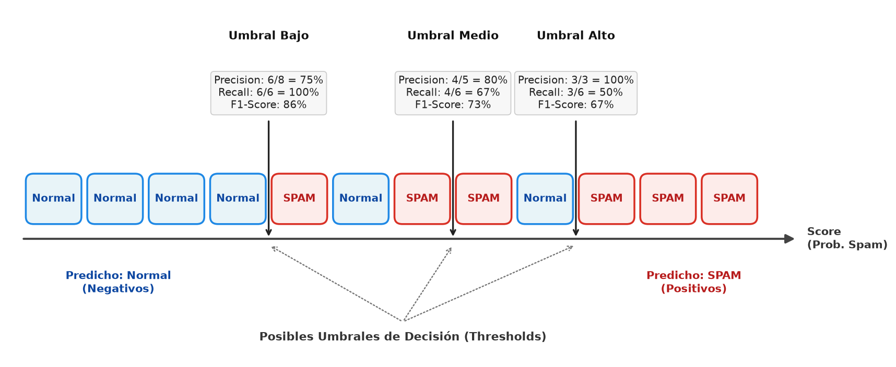
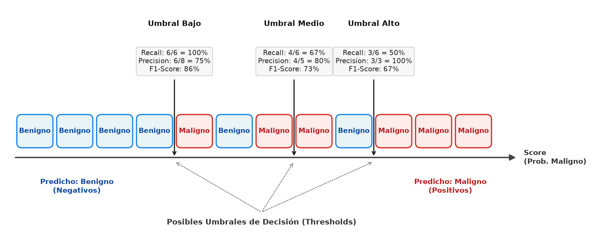
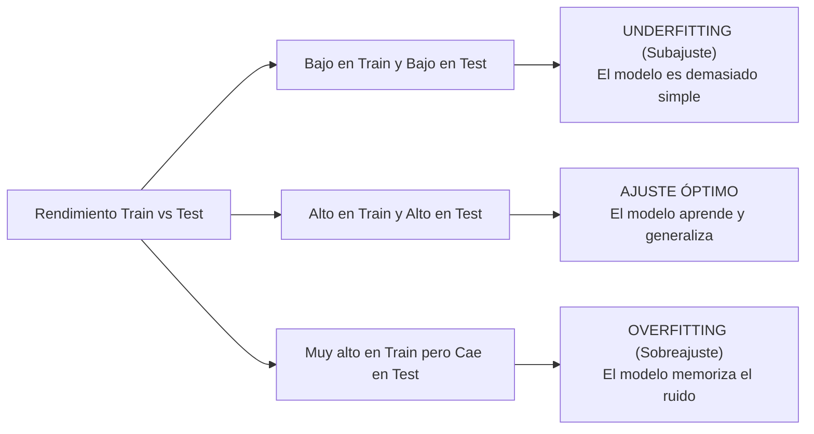

<div class="justify-text">

Entrenar un modelo de Machine Learning en Python requiere apenas tres líneas de código. Lo difícil es saber diagnosticar si el modelo realmente funciona o si está dando resultados engañosos. En este tema aprenderemos el sistema para evaluar los clasificadores.

## ¿Qué es la clasificación supervisada?

En los problemas de clasificación, el objetivo es predecir una **etiqueta categórica o discreta** a partir de un conjunto de variables de entrada ($X$):

* **Clasificación binaria:** Solo existen dos clases posibles ($0$ o $1$, Sí o No). Por ejemplo: determinar si un correo es spam o no, si un cliente cancelará su suscripción o si un tumor es benigno o maligno.
* **Clasificación multiclase:** Existen tres o más categorías excluyentes entre sí. Por ejemplo: clasificar especies de flores (*Setosa*, *Versicolor*, *Virginica*) o reconocer dígitos escritos a mano (del 0 al 9).

---

## Pipeline de Machine Learning

Como ya vimos en temas anteriores, en cualquier proyecto de Machine Learning se sigue una secuencia estructurada de pasos desde que se plantea el problema hasta que el modelo llega a producción:


Las fases de análisis exploratorio (EDA) y preprocesamiento ya forman parte de la preparación previa. En este tema nos centraremos concretamente en las fases de **entrenamiento** y **evaluación** del modelo.

---

## Entrenamiento de modelos

Antes de evaluar un clasificador, conviene tener clara la diferencia entre dos conceptos que suelen usarse indistintamente:

* **Algoritmo:** Es el método o conjunto de reglas matemáticas que define cómo aprender a partir de los datos (por ejemplo, *K-Nearest Neighbors* o un *Árbol de Decisión*). Por sí solo no sabe predecir nada.
* **Modelo:** Es el resultado de entrenar un algoritmo con un conjunto de datos concreto. Tras el entrenamiento, el modelo ya ha aprendido los patrones de esos datos y está listo para hacer predicciones.

En Scikit-Learn todos los clasificadores comparten una misma interfaz sencilla basada en dos métodos principales:

* **`.fit(X_train, y_train)`:** Entrena el algoritmo proporcionándole los datos de entrada (`X_train`) y sus respuestas correctas (`y_train`).
* **`.predict(X_test)`:** Utiliza el modelo ya entrenado para predecir las etiquetas de nuevos ejemplos (`X_test`). Muchos clasificadores también disponen de **`.predict_proba(X_test)`**, que devuelve la probabilidad estimada para cada clase en lugar de la etiqueta final.

```python
from sklearn.model_selection import train_test_split
from sklearn.neighbors import KNeighborsClassifier

# 1. Separamos en entrenamiento (80%) y prueba (20%)
X_train, X_test, y_train, y_test = train_test_split(
    X, y, test_size=0.2, random_state=42, stratify=y
)

# 2. Instanciamos el algoritmo
modelo = KNeighborsClassifier(n_neighbors=5)

# 3. Entrenamos el modelo con los datos de entrenamiento
modelo.fit(X_train, y_train)

# 4. Generamos las predicciones sobre el conjunto de prueba
y_pred = modelo.predict(X_test)
```

---

## Métricas de evaluación

Una vez entrenado un modelo de clasificación, necesitamos medir qué tan bien predice sobre datos nuevos. Para ello existen diferentes métricas de evaluación, y no hay una única que sirva para todos los casos. Cada métrica aporta información distinta sobre el comportamiento del modelo, por lo que todas resultan útiles y se complementan entre sí.

Dependiendo del problema, de si las clases están equilibradas o de qué tipo de error sea más grave cometer, nos fijaremos más en unas métricas o en otras. A continuación veremos las principales métricas de clasificación y qué aporta cada una.

### Accuracy (Exactitud)

El **Accuracy** es la métrica más intuitiva: mide el porcentaje total de aciertos sobre el total de predicciones:

$$\text{Accuracy} = \frac{\text{Aciertos Totales}}{\text{Muestras Totales}}$$

En Python, se calcula comparando las etiquetas reales (`y_test`) con las predicciones (`y_pred`) del ejemplo anterior:

```python
from sklearn.metrics import accuracy_score

acc = accuracy_score(y_test, y_pred)
print(f"Accuracy: {acc:.3f}")
```

#### Problema del desbalanceo

Aunque resulta útil en conjuntos equilibrados, el accuracy puede ofrecer una imagen falsa cuando las clases están **desbalanceadas**.

Supongamos un sistema médico para detectar una enfermedad poco frecuente en un conjunto de **1000 pacientes**, donde 990 están sanos y 10 están enfermos. Si construimos un modelo trivial que predice siempre «Sano» sin analizar ninguna prueba:

```text
Aciertos: 990 / 1000 = 99% de Accuracy
Enfermos detectados: 0
```

El modelo alcanza un 99% de accuracy siendo completamente inútil para resolver el problema.

:::warning
Cuando una clase es muy mayoritaria frente a la otra (por ejemplo, 95% frente a 5%), el accuracy deja de ser un indicador fiable del rendimiento del modelo y obligatoriamente debemos revisar otras métricas.
:::

### La Matriz de Confusión

Para analizar en detalle qué aciertos y qué errores comete el clasificador se utiliza la **Matriz de Confusión**. Es una tabla de doble entrada que cruza la realidad con las predicciones del modelo:

| | **Predicho Negativo (0)** | **Predicho Positivo (1)** |
| :--- | :---: | :---: |
| **Real Negativo (0)** | **VN** (Verdadero Negativo) | **FP** (Falso Positivo) |
| **Real Positivo (1)** | **FN** (Falso Negativo) | **VP** (Verdadero Positivo) |

Los cuatro cuadrantes representan lo siguiente:

* **Verdadero Positivo (VP):** El caso real es positivo y el modelo lo predice como positivo.
* **Verdadero Negativo (VN):** El caso real es negativo y el modelo lo predice como negativo.
* **Falso Positivo (FP):** El caso real es negativo, pero el modelo lo predice como positivo (falsa alarma).
* **Falso Negativo (FN):** El caso real es positivo, pero el modelo lo predice como negativo (caso no detectado).

#### Ejemplo de matriz de confusión

Supongamos un modelo médico evaluado sobre **100 muestras** (75 tumores benignos y 25 malignos) que obtiene la siguiente matriz al representarla en Python:



* De los 75 casos **benignos** reales, acierta **70** (VN) y se equivoca en **5** (FP), generando 5 falsas alarmas.
* De los 25 casos **malignos** reales, detecta **15** (VP) y deja escapar **10** (FN).
* El **Accuracy** global es del **85%** (85 aciertos de 100), pero la matriz deja ver claramente que el modelo falla bastante al detectar los casos malignos.

En Scikit-Learn se calcula y representa gráficamente de la siguiente forma:

```python
from sklearn.metrics import confusion_matrix, ConfusionMatrixDisplay
import matplotlib.pyplot as plt

cm = confusion_matrix(y_test, y_pred)
disp = ConfusionMatrixDisplay(confusion_matrix=cm)
disp.plot(cmap="Blues")
plt.title("Matriz de Confusión")
plt.show()
```

A partir de los valores de la matriz de confusión se calculan tres métricas centradas en la clase positiva:

### Precision (Precisión)

Mide qué proporción de las predicciones positivas realizadas por el modelo son realmente correctas:

$$\text{Precision} = \frac{\text{VP}}{\text{VP} + \text{FP}}$$

* **Cuándo priorizarla:** Cuando el coste de un **Falso Positivo** es alto. Por ejemplo, en un filtro anti-spam: marcar un correo importante de trabajo como spam (FP) es más grave que dejar pasar algún correo publicitario. En este ejemplo:
  * **VP:** correos que realmente son spam y se marcan como spam.
  * **FP:** correos normales que se marcan erróneamente como spam.



```python
from sklearn.metrics import precision_score

precision = precision_score(y_test, y_pred)
print(f"Precision: {precision:.3f}")
```

### Recall (Sensibilidad)

Mide qué proporción de los positivos reales ha sido capaz de detectar el modelo:

$$\text{Recall} = \frac{\text{VP}}{\text{VP} + \text{FN}}$$

* **Cuándo priorizarla:** Cuando el coste de un **Falso Negativo** es muy elevado. Por ejemplo, en la detección de cáncer o de fraude bancario: es preferible realizar una prueba adicional a un paciente sano (FP) antes que dejar sin diagnosticar a un paciente enfermo (FN). En el ejemplo de diagnóstico de cáncer:
  * **VP:** tumores que realmente son malignos y se detectan como malignos.
  * **FN:** tumores que realmente son malignos pero el modelo clasifica erróneamente como benignos.



```python
from sklearn.metrics import recall_score

recall = recall_score(y_test, y_pred)
print(f"Recall: {recall:.3f}")
```

### F1-Score

Es la media armónica entre Precision y Recall:

$$\text{F1-Score} = 2 \times \frac{\text{Precision} \times \text{Recall}}{\text{Precision} + \text{Recall}}$$

A diferencia de una media aritmética normal, el F1-Score penaliza fuertemente que una de las dos métricas sea muy baja. Resulta útil cuando se busca un equilibrio entre Precision y Recall en un único valor.

```python
from sklearn.metrics import f1_score

f1 = f1_score(y_test, y_pred)
print(f"F1-Score: {f1:.3f}")
```

---

## El Umbral de Decisión (Threshold) y compromiso Precision/Recall

La mayoría de los clasificadores no deciden directamente «Sí» o «No», sino que calculan una **probabilidad entre 0 y 1** (accesible mediante el método `.predict_proba()`). Por defecto, Scikit-learn utiliza un corte en **0.50**: si la probabilidad es $\ge 0.50$ asigna la clase positiva ($1$), y si es menor asigna la negativa ($0$).

Este valor de corte se denomina **umbral de decisión (*threshold*)** y se puede ajustar según las necesidades del problema.


Entre **Precision** y **Recall** existe una relación inversa conocida como **compromiso (*trade-off*) entre Precision y Recall**: por lo general, cuando se intenta mejorar una de las dos métricas moviendo el umbral, la otra tiende a empeorar:

* **Si se sube el umbral (hacia la derecha, ej. 0.80):** El modelo exige mayor seguridad para predecir positivo. Disminuyen los falsos positivos (**sube la Precision**), pero se escapan más positivos reales (**baja el Recall**).
* **Si se baja el umbral (hacia la izquierda, ej. 0.20):** El modelo etiqueta como positivo ante indicios más débiles. Se detectan más positivos reales (**sube el Recall**), pero aumentan las falsas alarmas (**baja la Precision**).

En la práctica, casi nunca es posible maximizar ambas métricas al 100% de forma simultánea. El punto de equilibrio adecuado **depende del objetivo del problema** y del coste de cada error:

* **Priorizar Precision (subir el umbral):** cuando el coste de un falso positivo es alto (por ejemplo, bloquear cuentas bancarias legítimas o enviar correos importantes a spam).
* **Priorizar Recall (bajar el umbral):** cuando el coste de un falso negativo es inasumible (por ejemplo, no detectar un tumor maligno o un fallo crítico en una máquina).
* **Equilibrio (F1-Score):** cuando ambos tipos de error tienen un impacto similar y se busca un rendimiento compensado.

---

## Overfitting y Underfitting

Un modelo debe ser capaz de **generalizar**, es decir, mantener un buen rendimiento con datos nuevos que no ha visto durante el entrenamiento. Para comprobarlo se compara su puntuación en entrenamiento (**Train**) frente a su puntuación en prueba (**Test**):



* **Underfitting (Subajuste):** El modelo es demasiado simple para capturar la estructura de los datos. Obtiene resultados bajos tanto en entrenamiento como en test.
* **Overfitting (Sobreajuste):** El modelo se ajusta en exceso a los datos de entrenamiento, memorizando incluso el ruido. Obtiene un rendimiento muy alto en entrenamiento, pero cae notablemente en test.

---

## Práctica

Realiza la Actividad de Seguimiento 6, disponible en Evex, en la que se ponen en práctica estos conceptos entrenando un clasificador KNN, generando su matriz de confusión, evaluando sus métricas y analizando cómo afecta el número de vecinos al sobreajuste y subajuste.

</div>
