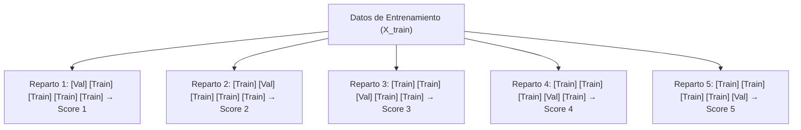

<div class="justify-text">

Hasta ahora hemos evaluado nuestros modelos haciendo una única división entre entrenamiento y prueba (`train_test_split`). Aunque es un buen punto de partida, depende en parte del azar: si por casualidad caen en `test` los ejemplos más fáciles, el modelo parecerá mejor de lo que es; si caen los más difíciles, parecerá peor.

En este tema veremos cómo obtener una evaluación más fiable mediante **Validación Cruzada (*Cross-Validation*)** y cómo automatizar el ajuste de hiperparámetros con **`GridSearchCV`**.

---

## Validación Cruzada (Cross-Validation)

El **objetivo de la validación cruzada** es medir de forma fiable cómo rinde un modelo (con unos hiperparámetros concretos) **sin tocar el conjunto de prueba (`X_test`)** y evitando que el resultado dependa de la suerte de un único reparto.

Si solo evaluamos el modelo una vez con un corte fijo, no sabemos si esa puntuación se debe a que el modelo es bueno o a que le tocaron ejemplos fáciles. Además, si probamos muchos hiperparámetros mirando siempre el mismo conjunto de prueba, acabaríamos ajustando el modelo a esos datos concretos.

### ¿Cómo funciona K-Fold?

La técnica más habitual es **K-Fold Cross-Validation**, que se ejecuta **antes** de elegir el modelo definitivo utilizando únicamente los datos de entrenamiento (`X_train`, `y_train`). Consiste en dividir `X_train` en $K$ bloques iguales (por ejemplo, $K = 5$) y realizar $K$ entrenamientos independientes:

1. **Reparto 1:** Se deja aparte el **bloque 1** como conjunto de validación. Se entrena un modelo **desde cero** con los bloques 2, 3, 4 y 5, y se calcula su métrica (*Score 1*).
2. **Reparto 2:** Se descarta el modelo anterior. Ahora se deja aparte el **bloque 2** para validar, se entrena otro modelo **desde cero** con los bloques 1, 3, 4 y 5, y se anota su métrica (*Score 2*).
3. Se repite el proceso hasta que los 5 bloques han actuado una vez como validación.



Al finalizar los 5 entrenamientos, no nos quedamos con ninguno de esos 5 modelos temporales; lo que nos interesa son sus **5 puntuaciones**:

* La **media** de los 5 *scores* nos da una estimación mucho más realista de cómo funciona esa configuración.
* La **desviación estándar** nos indica si el modelo es estable (si saca notas parecidas en todos los bloques) o si varía mucho según los datos que le toquen.

En problemas de clasificación, Scikit-Learn utiliza por defecto **Stratified K-Fold**, una variante que asegura que cada uno de los $K$ bloques mantenga la misma proporción de clases que el conjunto original.

Es importante tener en cuenta que **un modelo por sí solo no hace validación cruzada**: si ejecutas `modelo.fit(X_train, y_train)`, el algoritmo simplemente entrena una única vez con todo `X_train`. 

Donde sí ocurre todo este proceso es **en el funcionamiento interno de `GridSearchCV` al llamar a `grid.fit(X_train, y_train)`**: antes de quedarse con una configuración definitiva, `GridSearchCV` prueba cada combinación de hiperparámetros sobre esos 5 subconjuntos sacados de `X_train`, calcula cuál obtiene mejor nota media y, finalmente, entrena un **modelo final único** con esos hiperparámetros ganadores utilizando el 100% de `X_train`.

:::info
El conjunto de prueba (`X_test`, `y_test`) **no se utiliza** durante la validación cruzada. Permanece guardado hasta el final del proyecto para hacer una evaluación final completamente imparcial.
:::

---

## Búsqueda de Hiperparámetros con `GridSearchCV`

Al trabajar con un algoritmo conviene distinguir dos tipos de valores:

* **Parámetros:** se aprenden automáticamente durante `.fit()` (por ejemplo, los pesos de una Regresión Logística).
* **Hiperparámetros:** se configuran manualmente antes de entrenar (por ejemplo, `n_neighbors` en KNN o `max_depth` en un Árbol de Decisión).

Probar combinaciones de hiperparámetros a mano en un bucle funciona cuando hay uno o dos valores, pero se vuelve lento y propenso a errores cuando combinamos varios. **`GridSearchCV`** automatiza este proceso:

1. Define una rejilla (`param_grid`) con los valores que quieres probar.
2. Prueba **todas las combinaciones posibles** evaluando cada una mediante Validación Cruzada.
3. Selecciona automáticamente la mejor combinación y reentrena el modelo ganador con todo el conjunto de entrenamiento.

```python
from sklearn.model_selection import GridSearchCV
from sklearn.ensemble import RandomForestClassifier

# 1. Definimos el diccionario con los hiperparámetros a probar
param_grid = {
    "n_estimators": [50, 100, 200],
    "max_depth": [3, 5, 10, None],
    "min_samples_split": [2, 5]
}

# 2. Configuramos GridSearchCV (3 x 4 x 2 = 24 combinaciones x 5 pliegues = 120 entrenamientos)
grid = GridSearchCV(
    estimator=RandomForestClassifier(random_state=42),
    param_grid=param_grid,
    cv=5,
    scoring="f1",
    n_jobs=-1  # Usa todos los núcleos disponibles del procesador
)

# 3. Ejecutamos la búsqueda sobre los datos de entrenamiento
grid.fit(X_train, y_train)

# 4. Consultamos los resultados
print("Mejores hiperparámetros:", grid.best_params_)
print(f"Mejor F1 en validación cruzada: {grid.best_score_:.3f}")
```

Una vez terminado `.fit()`, los tres atributos más útiles de `grid` son:

* `grid.best_params_`: diccionario con la combinación ganadora.
* `grid.best_score_`: mejor puntuación media obtenida en validación cruzada.
* `grid.best_estimator_`: el modelo ya entrenado con esa mejor configuración, listo para predecir.

---

## Evaluación final en Test

Cuando `GridSearchCV` ha encontrado la mejor combinación y ha reentrenado el modelo ganador con todo `X_train`, realizamos la **evaluación definitiva** sobre el conjunto `X_test` que reservamos al principio:

```python
# Extraemos el mejor modelo ya entrenado
mejor_modelo = grid.best_estimator_

# Predecimos sobre datos que el modelo nunca ha visto
y_pred = mejor_modelo.predict(X_test)

# Ya podemos calcular las métricas
```

Si la puntuación en `X_test` es similar a la obtenida en validación cruzada (`grid.best_score_`), tenemos la garantía de que el modelo generaliza bien y no sufre sobreajuste.

---

## Ejemplo de entrenamiento con GridSearch

En el siguiente cuaderno se puede consultar un ejemplo completo del flujo de trabajo: carga y preprocesamiento de datos con `ColumnTransformer` (mismo código que en la unidad anterior), búsqueda de hiperparámetros con `GridSearchCV`, cálculo de métricas, análisis de *overfitting*/*underfitting* y exportación del modelo final.

* 📥 **<a href="/DevTacora/recursos/pia_ut4/entrenamiento_grid_search.ipynb" download="entrenamiento_grid_search.ipynb">Descargar entrenamiento_grid_search.ipynb</a>**

</div>
